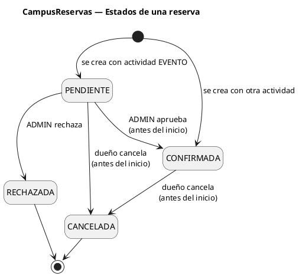
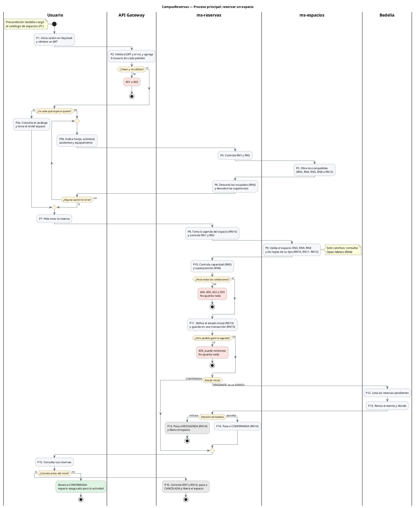
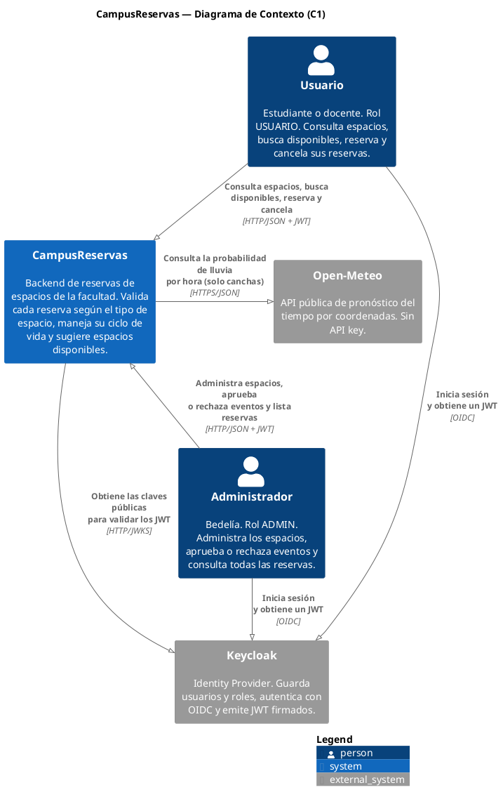
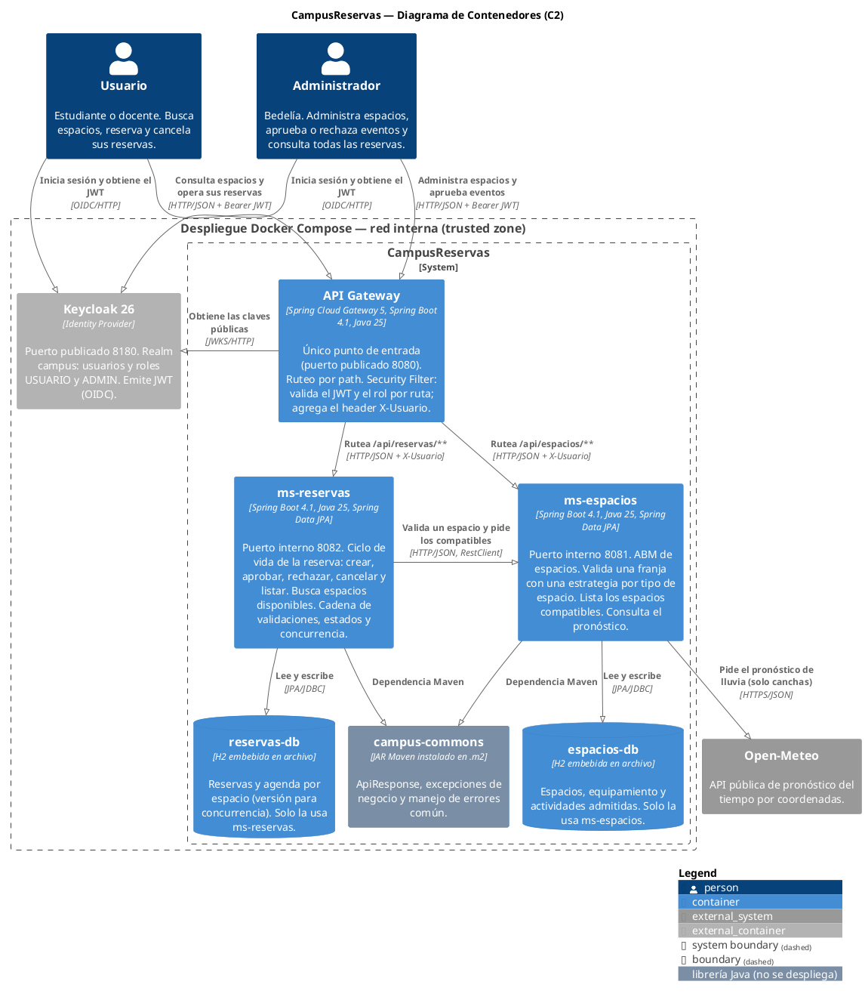
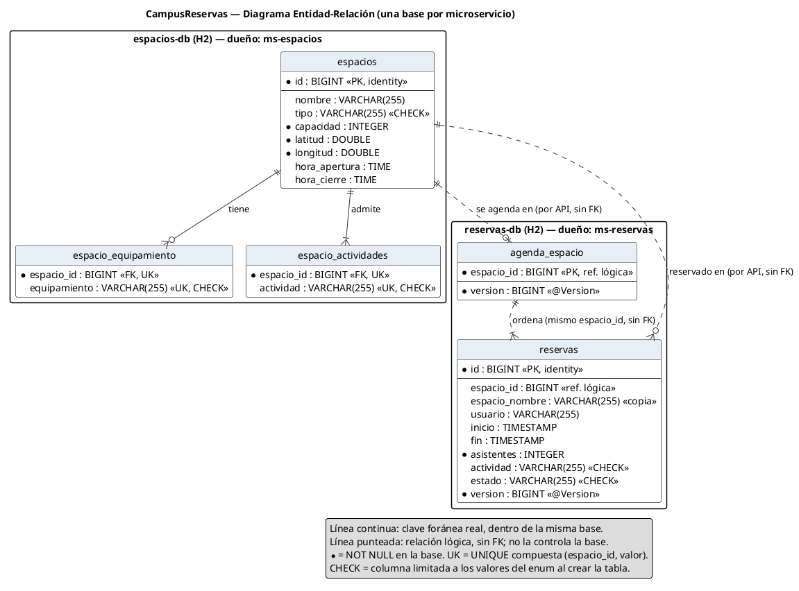

# CampusReservas: resúmenes para la defensa

Respuestas cortas para explicar cada parte del TP con nuestras palabras. Se va completando a medida que avanzamos, paso por paso.

Al final está la sección **Decisiones que tomamos**: cada elección que hicimos al programar, con por qué y qué descartamos. Las decisiones de arquitectura del plan (D1 a D25) están en el plan de desarrollo, sección 10. Las nuestras se numeran T1, T2… para no confundirlas.

---

## Estructura del repositorio

**Por qué todos los paquetes empiezan con `ar.edu.utn.frc.bda.campus`**

> "Es la convención de Java de usar el dominio invertido (`utn.edu.ar` → `ar.edu.utn`) para que los nombres de paquete sean únicos y no choquen con los de otras librerías. Además, cada parte del paquete es una carpeta dentro de `src/main/java`, que es donde Maven busca el código por convención. Los tres proyectos comparten el prefijo `ar.edu.utn.frc.bda.campus`, y por eso los microservicios usan `@SpringBootApplication(scanBasePackages = "ar.edu.utn.frc.bda.campus")`: así Spring encuentra también el `GlobalExceptionHandler`, que está en otro paquete (`...campus.commons`) dentro del JAR común."

**Qué no subimos al repo (`.gitignore`)**

> "No subimos `target/`, porque lo genera Maven y se puede regenerar; tampoco la configuración del IDE (`.idea/`, `.vscode/`), que es personal de cada uno; ni las bases H2 (`data/`), que son datos locales que cada servicio crea al arrancar."

---

## Fase 0: JAR común `campus-commons`

**Qué es y por qué es el componente común reutilizable**

> "campus-commons es un JAR Maven, una librería, no una aplicación: no tiene `main` y no se ejecuta solo. Lo instalamos con `mvn install` en el repositorio local `.m2`, y los dos microservicios lo declaran como dependencia en su `pom.xml`. Contiene solo lo transversal: el formato de respuesta `ApiResponse`, las excepciones de negocio y el manejador global que las traduce a códigos HTTP. Así las dos APIs responden y fallan igual sin duplicar código. No ponemos entidades ni reglas de negocio, para que los servicios sigan siendo independientes."

Ideas clave por si repreguntan:

- **JAR librería vs. JAR ejecutable:** campus-commons es una librería, sin `main`, que usan otros proyectos. `ms-espacios.jar` es ejecutable: levanta el servidor con `java -jar`.
- **`.m2`:** es el repositorio local de Maven. Primero busca ahí y, si no encuentra la dependencia, la baja de Maven Central. Como campus-commons no está en internet, hay que instalarlo con `mvn install`.
- **Coordenadas Maven:** `groupId` + `artifactId` + `version` (`ar.edu.utn.frc.bda:campus-commons:1.0.0`) identifican el JAR de forma única.
- **Si cambia el JAR:** hay que volver a correr `mvn install` antes de compilar los servicios. Por eso `build.sh` lo compila primero.
- **D13: qué NO va en el JAR.** Entidades, DTOs de dominio y reglas de negocio. Ponerlos ahí acoplaría los servicios: un cambio en el modelo de uno obligaría a recompilar y desplegar el otro. Por eso `TipoActividad` está declarado en los dos servicios, una duplicación chica a propósito para no acoplarlos.

**El `pom.xml` de campus-commons**

> "Es un proyecto Maven simple, no una aplicación Spring Boot: no tiene `spring-boot-starter-parent`, ni `@SpringBootApplication`, ni el `spring-boot-maven-plugin`, porque es una librería y no tiene que generar un JAR ejecutable. Para usar las mismas versiones de Spring que los microservicios, importa la BOM `spring-boot-dependencies` en `dependencyManagement`; así declaramos `spring-web` sin versión y queda alineada. `spring-web` va con `scope provided`: la necesitamos para compilar (`ResponseEntity`, `@RestControllerAdvice`), pero no la metemos dentro del JAR, porque la aporta el microservicio que lo use. Así no hay dos copias de Spring ni choques de versiones."

Ideas clave por si repreguntan:

- **`packaging jar`:** le dice a Maven que el resultado es un `.jar`. Es el valor por defecto, pero lo dejamos explícito.
- **Parent vs. BOM:** heredar de `spring-boot-starter-parent` trae versiones *y* configuración de plugins pensada para apps Boot. Importar la BOM trae **solo las versiones**, que es lo único que necesita una librería.
- **`scope import` + `type pom`:** es la forma de "traer" la tabla de versiones de otro `pom` sin heredarlo.
- **`dependencyManagement` no agrega dependencias:** solo fija versiones. Las dependencias reales son las de `<dependencies>`.
- **Tres dependencias `provided`:** `spring-web` (`ResponseEntity`, `@RestControllerAdvice`), `spring-context` (`BindingResult`, que usa el handler de `@Valid`) y `jakarta.servlet-api` (`ServletException`, de la que hereda la excepción de parámetro faltante; ver T37).
- **`provided` vs. `compile`:** `compile` (el default) viaja con el JAR y se pasa a quien lo use. `provided` se usa para compilar, pero se asume que el entorno la tiene.
- **`maven.compiler.release 25`:** compila para Java 25 y verifica que no se use API de otra versión. Tiene que coincidir con el Java de los microservicios.
- **`project.build.sourceEncoding UTF-8`:** para que los acentos de los mensajes de error compilen igual en todas las máquinas del grupo.
- **Versión del compilador fijada:** para que todos compilen igual aunque tengan distinta versión de Maven.

**`ApiResponse<T>`**

> "Es el formato único de respuesta de todas nuestras APIs, el mismo del ejemplo de la cátedra: `success` dice si salió bien, `responseValue` trae el dato, `message` explica qué pasó y `executedOn` dice cuándo. Es un `record` porque es un dato inmutable que solo transporta información: Java genera solo el constructor, los getters, `equals`, `hashCode` y `toString`. Es genérico (`<T>`) para que sirva para cualquier dato: `ApiResponse<EspacioDto>`, `ApiResponse<List<ReservaDto>>` o `ApiResponse<Void>` en los errores. El método estático `create` completa la fecha solo, así nadie se olvida de ponerla."

Ideas clave por si repreguntan:

- **Por qué un formato único:** el cliente siempre lee la misma estructura, sea éxito o error, y sea de `ms-espacios` o de `ms-reservas`. Además, `ms-reservas` puede leer las respuestas de `ms-espacios` con el mismo record (`ApiResponse<ValidacionEspacio>`).
- **`record`:** clase inmutable (campos `final`) para datos. Los "getters" se llaman como el campo (`success()`, no `getSuccess()`). Jackson, la librería de Spring que convierte objetos a JSON, los serializa con esos nombres.
- **Genéricos:** `T` es un "tipo a completar". Una sola clase sirve para cualquier contenido, con chequeo de tipos al compilar.
- **`ApiResponse<Void>`:** en los errores no hay dato; `Void` deja claro que `responseValue` siempre es `null`.
- **Método de fábrica (`create`):** un constructor con nombre que además pone `LocalDateTime.now()`. El código que lo usa queda más corto: `ApiResponse.create(true, dto, "Reserva creada")`.
- **El código HTTP no va adentro:** viaja en la respuesta HTTP misma (200, 404, 409…). `success` es un atajo para el cliente.

**¿Por qué el código HTTP no está dentro de `ApiResponse`?**

> "Porque una respuesta HTTP ya tiene un lugar para el código: la línea de estado, antes de los headers y del body. Nosotros lo ponemos ahí con `ResponseEntity.status(...)`. Repetirlo en el JSON sería tener dos fuentes de verdad que podrían contradecirse. Además, todo el que está en el medio decide por la línea de estado y no lee nuestro body: `RestClient` lanza `HttpClientErrorException.NotFound` cuando ve un 404, el gateway devuelve 401 y 403 sin pasar por nuestro código, y Postman y Swagger muestran el código de la línea de estado. Así respetamos la semántica de REST: el código dice qué pasó, y el body da el detalle."

- **Anatomía de una respuesta HTTP:** línea de estado (`HTTP/1.1 404 Not Found`), headers (`Content-Type: application/json`) y body (nuestro `ApiResponse`).
- **Dónde se pone en el código:** `ResponseEntity.status(HttpStatus.NOT_FOUND).body(ApiResponse.create(false, null, "..."))`. El `status` va a la línea de estado, y el `body`, al JSON.
- **Hay respuestas sin nuestro body:** el 401 y el 403 del gateway, o un 503 de Docker si un servicio no levanta. Si el cliente dependiera de un `status` dentro del JSON, en esos casos no lo tendría.
- **No es una regla absoluta:** algunos formatos (por ejemplo Problem Details, RFC 9457) repiten el código en el body como información extra. Nosotros seguimos el `ApiResponse` de la cátedra, que no lo incluye.

**Las cinco excepciones de negocio**

> "Tenemos una excepción por cada situación de error del negocio, y cada una corresponde a un código HTTP: `RecursoNoEncontradoException` → 404, `AccesoDenegadoException` → 403, `ConflictoException` → 409, `ReglaNegocioException` → 422 y `ServicioNoDisponibleException` → 503. Los servicios solo hacen `throw new ...("mensaje")` y el `GlobalExceptionHandler` las traduce al código y al `ApiResponse` de error. Extienden `RuntimeException` porque son *unchecked*: no obligan a poner `throws` ni `try/catch` en cada capa, y además Spring deshace la transacción (`@Transactional`) automáticamente cuando sale una `RuntimeException`."

Ideas clave por si repreguntan:

| Excepción | Código | Cuándo, en el TP |
|---|---|---|
| `RecursoNoEncontradoException` | 404 | Espacio o reserva que no existe (espacio 999) |
| `AccesoDenegadoException` | 403 | `usuario2` cancela la reserva de `usuario1` (RN7) |
| `ConflictoException` | 409 | Superposición (RN6), transición de estado inválida (RN14) |
| `ReglaNegocioException` | 422 | RN1, RN2, RN5, espacio no disponible (RN3, RN4, RN8 a RN12), reserva ya empezada |
| `ServicioNoDisponibleException` | 503 | `ms-espacios` caído u Open-Meteo sin responder |

- **Checked vs. unchecked:** las *checked* (`Exception`) obligan a declararlas con `throws` o capturarlas. Las *unchecked* (`RuntimeException`) no. Con checked, cada método entre el service y el controller tendría que declarar todas las excepciones.
- **Rollback:** por defecto, `@Transactional` hace rollback solo con `RuntimeException`. Si fueran checked, una reserva inválida podría quedar guardada.
- **Por qué una clase por situación y no una sola con el código:** el handler elige el código por el **tipo** de la excepción, y el service expresa *qué pasó* (un conflicto, una regla) sin saber nada de HTTP.
- **422 vs. 400:** 400 es "el pedido está mal formado" (falta un campo, una fecha que no es fecha). 422 es "está bien formado, pero una regla de negocio no lo permite".
- **409 vs. 422:** 409 es un choque con el **estado actual** del recurso (otra reserva ya ocupa la franja, la reserva ya está cancelada). Con otro estado, el mismo pedido podría pasar. 422 es que el pedido en sí viola una regla, sin importar el estado (50 personas en un aula para 40).
- **500 vs. 503:** los dos son errores del servidor, pero dicen cosas distintas. 500 es "algo se rompió adentro": un bug nuestro (un `NullPointerException`, un caso no previsto), reintentar no sirve y el log lo marca con ERROR y el stack trace (T10). 503 es "ahora no puedo atenderte": no hay ningún bug, falla algo de lo que dependemos (ms-espacios, Open-Meteo), es temporal y reintentar más tarde sí sirve. Por eso nunca respondemos 500 por una dependencia caída: el código HTTP ya le dice al cliente si el problema es nuestro o externo, y si tiene sentido reintentar.
- **403 acá vs. 403 del gateway:** el gateway da 403 cuando el **rol** no alcanza. Esta excepción es para cuando el rol está bien, pero el recurso no es tuyo (RN7). Eso solo lo sabe `ms-reservas`.
- **`super(mensaje)`:** guarda el mensaje en la excepción; el handler lo recupera con `getMessage()` y lo pone en el `message` del `ApiResponse`.

**`GlobalExceptionHandler`**

> "Es la clase que traduce excepciones a respuestas HTTP, en un solo lugar para toda la aplicación. Está anotada con `@RestControllerAdvice`, así que Spring la aplica a todos los controllers: cuando un controller o un service lanza una excepción que nadie atrapó, Spring busca el método `@ExceptionHandler` de ese tipo y devuelve lo que ese método arme. Cada uno elige el código HTTP (404, 403, 409, 422, 503) y arma un `ApiResponse` con `success: false` y el mensaje de la excepción. También maneja `MethodArgumentNotValidException`, que es lo que lanza `@Valid` cuando un DTO viene mal formado, y responde 400 con el detalle de cada campo. Gracias a esto, los controllers no tienen ningún `try/catch`."

Ideas clave por si repreguntan:

- **Cómo lo encuentra Spring si está en otro JAR:** por `@SpringBootApplication(scanBasePackages = "ar.edu.utn.frc.bda.campus")` en cada microservicio. Por defecto, Spring escanea solo el paquete de la clase principal (`...campus.espacios`), y el handler está en `...campus.commons`.
- **`@RestControllerAdvice`** = `@ControllerAdvice` + `@ResponseBody`: lo que devuelven los métodos se escribe como JSON en el body.
- **`ResponseEntity`:** permite elegir el código HTTP además del body. Sin él, todo saldría 200.
- **Por qué los métodos reciben `RuntimeException` y no la excepción concreta:** solo usan `getMessage()`, que tienen todas. El tipo concreto lo decide la anotación `@ExceptionHandler(...)`.
- **El método privado `error(...)`:** evita repetir la misma línea en cinco métodos (DRY).
- **400 de `@Valid`:** recorre los `FieldError` y arma un mensaje del tipo `"capacidad: debe ser mayor que 0; nombre: no debe estar vacío"`.
- **Los otros cuatro 400:** parámetro obligatorio que falta, parámetro que no se puede convertir (`actividad=NADAR`), JSON ilegible o con un enum inválido, y header obligatorio que falta (`X-Usuario`). Sin estos handlers, Spring responde 400 con su propio formato y sin explicar qué está mal (T37 y T57).
- **`UNPROCESSABLE_CONTENT` y no `UNPROCESSABLE_ENTITY`:** es el mismo 422. Spring 7 renombró la constante siguiendo la especificación HTTP actual (RFC 9110) y marcó la vieja como *deprecated*. El plan usa el nombre viejo.
- **Por qué el `pom.xml` también tiene `spring-context`:** `MethodArgumentNotValidException` está en `spring-web`, pero hereda de `BindException` y devuelve un `BindingResult`, que están en `spring-context` (paquete `org.springframework.validation`). `spring-web` no trae `spring-context`, así que sin esa dependencia no compila ("cannot access org.springframework.validation.BindException"). Va `provided` por el mismo motivo que `spring-web`: los microservicios ya lo tienen.
- **Excepciones no previstas (500):** el método `inesperado`, con `@ExceptionHandler(Exception.class)`, atrapa todo lo que no tiene un handler propio. Si es una excepción de Spring que ya sabe su código (una ruta que no existe → 404, un método no permitido → 405), lo conserva. Si es un error nuestro (por ejemplo, un `NullPointerException`), responde **500** "Error interno del servidor", con nuestro `ApiResponse`, y escribe el stack trace completo en el log con nivel ERROR. Sigue siendo un 500 a propósito: indica un bug que hay que corregir, no un error de negocio (T10).
- **`ErrorResponse`:** es la interfaz que implementan las excepciones de Spring MVC que saben su propio código HTTP (`NoResourceFoundException`, `HttpRequestMethodNotSupportedException`…). Con `ex instanceof ErrorResponse er` se pregunta eso y, en el mismo paso, se la usa para leer el código y el detalle.
- **Por qué el 500 no muestra el mensaje real:** el detalle de un error interno (un `NullPointerException`, un nombre de tabla) no le sirve al cliente y puede mostrar cómo está hecho el sistema por dentro. Por eso el mensaje es genérico, y el detalle queda en el log para nosotros.
- **El handler también loguea:** ver la sección "Logs".

**Sección 09 de la entrega: librería común**

> "Sí, tenemos una librería común: `campus-commons`. Su propósito es que todas las APIs respondan y fallen igual, sin repetir ese código en cada servicio. Solo compartimos lo transversal, lo que no depende del negocio: el formato de respuesta y el manejo de errores. El dominio queda dentro de cada microservicio, para que un cambio en uno no obligue a recompilar y desplegar el otro (D13)."

- **Nombre y coordenadas:** `campus-commons`, `ar.edu.utn.frc.bda:campus-commons:1.0.0`. Es un JAR librería: sin `main`, no se ejecuta solo.
- **Servicios que la usan:** `ms-espacios` y `ms-reservas`. El gateway no: es reactivo, y el `GlobalExceptionHandler` es de Spring MVC (T63).
- **Distribución:** `mvn install` la deja en el repositorio local `.m2`, y cada servicio la declara en su `pom.xml`. Queda empaquetada dentro del JAR ejecutable de cada uno: se comparte al compilar, no al desplegar. `build.sh` la compila primero (previsto para la Fase 4).
- **Cómo la encuentra Spring:** `scanBasePackages = "ar.edu.utn.frc.bda.campus"` en cada servicio, porque el handler está en otro paquete.

| Componente | Para qué | Por qué es reutilizable |
|---|---|---|
| `ApiResponse<T>` | Formato único de respuesta | Es genérico: no conoce ningún dato del negocio. `ms-reservas` lo usa además para leer las respuestas de `ms-espacios` |
| `RecursoNoEncontradoException` (404), `AccesoDenegadoException` (403), `ConflictoException` (409), `ReglaNegocioException` (422), `ServicioNoDisponibleException` (503) | Las situaciones de error | Nombran categorías de error, no reglas: el mensaje concreto lo pone cada servicio |
| `GlobalExceptionHandler` | Traduce excepciones a código HTTP y `ApiResponse`, incluidos los 400 de formato | La traducción es la misma en todos los servicios |

| Queda en cada microservicio | Por qué no va en la librería |
|---|---|
| Entidades y repositorios | Cada servicio es dueño de sus datos (D9) |
| DTOs (`EspacioDto`, `ReservaDto`…) | Son el contrato de cada API. `ms-reservas` define sus propios records, `ValidacionEspacio` y `EspacioDisponible`, para leer las respuestas de `ms-espacios`: ningún servicio importa clases del otro |
| `TipoActividad` | Es dominio. Se repite a propósito: viaja como texto, y alcanza con que los valores coincidan (D13) |
| Reglas de negocio, Strategy, Template Method y la cadena de validaciones | Son el motivo de ser de cada servicio |
| `ConcurrenciaExceptionHandler` | Solo `ms-reservas` usa bloqueo optimista (`@Version`, RN15): `ms-espacios` no tiene esa situación. Además, su mensaje habla de espacios y reservas, y en el JAR obligaría a sumar `spring-tx` como dependencia |
| `RestClientConfig` | Casi igual en los dos, pero cada uno apunta a otra dependencia y sus timeouts deben poder ser distintos (ver T62). Son pocas líneas: una abstracción costaría más que la repetición |
| `application.yaml` y `DatosIniciales` | Son la configuración y los datos de cada servicio |

- **Si preguntan por las excepciones que un servicio no usa:** hoy `AccesoDenegadoException` y `ConflictoException` solo las lanza `ms-reservas`. Igual van en el JAR, porque el `GlobalExceptionHandler` tiene que conocerlas para traducirlas, y así la tabla completa de excepción a código HTTP queda en un solo lugar.
- **El criterio:** va al JAR lo que es igual en todos los servicios **y** cambia sin importar el negocio. Si dos clases se parecen pero pueden cambiar por motivos distintos, se duplican: es preferible un poco de duplicación a acoplar los servicios.
- **El costo que aceptamos:** la librería usa las mismas versiones de Spring que los servicios (T2), y si cambia hay que reinstalarla y recompilar los dos. Por eso la mantenemos chica: siete clases y sin dependencias que viajen con el JAR (todas `provided`).

---

## Fase 0: Keycloak

**Qué es Keycloak y qué hace en el TP**

> "Keycloak es nuestro Identity Provider: el sistema que se encarga de la identidad. Guarda los usuarios, sus contraseñas y sus roles (USUARIO y ADMIN), hace el login con el protocolo OIDC y entrega un JWT firmado. Nosotros no programamos el login ni guardamos contraseñas: el usuario se autentica en Keycloak y después manda el JWT en cada pedido (`Authorization: Bearer <jwt>`). El gateway verifica la firma del token con la clave pública de Keycloak y lee los roles para decidir si deja pasar el pedido."

**Por qué el realm se importa desde un JSON**

> "En vez de configurar Keycloak a mano desde la consola, definimos el realm `campus` en `realm-campus.json` (roles, el cliente `campus-api` y los usuarios de prueba) y Keycloak lo importa al arrancar con `--import-realm`. Así cualquiera del grupo levanta exactamente la misma configuración con `docker compose up`, y la configuración queda versionada en Git."

Ideas clave por si repreguntan:

- **Realm:** un espacio aislado dentro de Keycloak, con sus propios usuarios, roles y clientes. El nuestro es `campus`.
- **Rol de realm:** un rol válido en todo el realm. Viaja en el token en `realm_access.roles`.
- **Cliente (`campus-api`):** la aplicación que pide tokens. Es **público** (sin *client secret*), porque quien lo usa (Postman, un futuro frontend) no puede guardar un secreto.
- **`directAccessGrantsEnabled`:** habilita el flujo *password* (usuario y contraseña directo al endpoint de token). Lo usamos **solo para probar con Postman**, porque no hay frontend. En producción se usaría *Authorization Code* con redirección al login de Keycloak (D7).
- **OIDC vs. OAuth 2:** OAuth 2 es para *autorizar* (dar acceso). OIDC (OpenID Connect) es una capa encima que agrega la *identidad*: quién es el usuario.
- **JWT:** un token con tres partes separadas por puntos: header, payload (los *claims*) y firma. No está cifrado, se puede leer; pero está **firmado** por Keycloak, así que si alguien lo modifica la firma deja de coincidir y el gateway lo rechaza (401).
- **Claims que usamos:** `iss` (quién lo emitió; el gateway exige `http://localhost:8180/realms/campus`), `exp` (vencimiento), `preferred_username` (va al header `X-Usuario`) y `realm_access.roles` (USUARIO o ADMIN).
- **Nombre, apellido y email en los usuarios:** Keycloak 26 los exige por su *user profile*. Sin ellos, el login falla con "Account is not fully set up".
- **`start-dev`:** modo desarrollo, con HTTP sin certificado y base embebida. No es para producción.
- **`8180:8080`:** Keycloak escucha en el 8080 *dentro* del contenedor, y lo publicamos en el 8180 de la máquina porque el 8080 lo va a usar el gateway.
- **Volumen `./keycloak:/opt/keycloak/data/import`:** monta nuestra carpeta dentro del contenedor, en la carpeta donde Keycloak busca realms para importar.

---

## Fase 1: ms-espacios

**Cómo se creó el proyecto y qué tiene el `pom.xml`**

> "Lo generamos con Spring Initializr: Maven, Java 25, Spring Boot 4.1.2 y las dependencias Spring Web, Spring Data JPA, H2, Validation y Lombok. A diferencia de campus-commons, es una aplicación, así que hereda de `spring-boot-starter-parent` (versiones y configuración de plugins) y tiene el `spring-boot-maven-plugin`, que arma el JAR ejecutable. A mano agregamos dos dependencias: `campus-commons` (nuestro JAR del `.m2`) y `springdoc-openapi`, que genera el Swagger leyendo los controllers."

Ideas clave por si repreguntan:

- **Starters:** dependencias "paquete" de Spring Boot que traen todo lo necesario para algo. `spring-boot-starter-webmvc` trae Spring MVC, Jackson y un Tomcat embebido; `spring-boot-starter-data-jpa` trae Hibernate y Spring Data. En Boot 4, el viejo `starter-web` se llama `starter-webmvc`.
- **Tomcat embebido:** el servidor web viene dentro del JAR. No hay que instalar un servidor: `java -jar ms-espacios.jar` levanta la API.
- **H2 con `scope runtime`:** el código nunca usa clases de H2 directamente (habla con JPA), solo hace falta al ejecutar.
- **Lombok `optional` + `annotationProcessorPaths`:** Lombok genera código (getters, constructores) durante la compilación, así que solo hace falta al compilar.
- **`mvnw` (Maven Wrapper):** un script que baja la versión exacta de Maven del proyecto. Sirve para compilar en una máquina sin Maven instalado.

**La clase principal y `scanBasePackages`**

> "`@SpringBootApplication` hace tres cosas: marca la clase como configuración, activa la autoconfiguración de Spring Boot y escanea componentes (`@Component`, `@Service`, `@RestController`…). Por defecto escanea solo el paquete de la clase principal, `ar.edu.utn.frc.bda.campus.espacios`. Con `scanBasePackages = "ar.edu.utn.frc.bda.campus"` ampliamos el escaneo un nivel más arriba, y así Spring también encuentra el `GlobalExceptionHandler`, que está en `...campus.commons` dentro del JAR común. Sin eso, los errores saldrían como 500 en vez de 404, 409 o 422."

**`application.yaml`**

> "Es la configuración del servicio: puerto 8081, la base H2 en archivo (`jdbc:h2:file:./data/espacios`), `ddl-auto: update` para que Hibernate cree las tablas a partir de las entidades, la ruta del Swagger y nuestras propiedades propias (`campus.clima.url` y `campus.clima.umbral-lluvia`). Los valores con `${VARIABLE:defecto}` se pueden pisar con variables de entorno: así el mismo JAR corre desde el IDE y en Docker sin cambiar código."

Ideas clave por si repreguntan:

- **`jdbc:h2:file:` vs. `jdbc:h2:mem:`:** en archivo, los datos sobreviven a un reinicio. En memoria se pierden al apagar (D10).
- **`ddl-auto: update`:** Hibernate compara las entidades con las tablas y crea o agrega lo que falte, sin borrar datos. Es cómodo para desarrollo; en producción se usan migraciones (Flyway o Liquibase).
- **`open-in-view: false`:** por defecto, Spring deja abierta la sesión de JPA hasta que termina de escribirse la respuesta HTTP, y eso puede disparar consultas fuera del service. Lo apagamos para que todo el acceso a datos pase por el service, dentro de su transacción. Además, saca un warning al arrancar.
- **`${OPEN_METEO_URL:https://api.open-meteo.com}`:** si existe la variable de entorno `OPEN_METEO_URL`, usa esa; si no, usa el valor después de los dos puntos. Sirve para probar la falla de Open-Meteo (`OPEN_METEO_URL=http://localhost:9`) y para forzar lluvia (`CLIMA_UMBRAL=0`).
- **Puerto 8081:** cada servicio tiene el suyo en la máquina (8080 gateway, 8081 espacios, 8082 reservas). En Docker, solo el gateway lo publica.

**Los enums `TipoEspacio`, `Equipamiento` y `TipoActividad`**

> "Son listas cortas y estables de valores, así que las modelamos como enums de Java (D12). Un enum valida solo: si llega un valor que no existe, como `"PILETA"`, Spring responde 400 sin que escribamos código. `TipoEspacio` además decide qué estrategia de validación se usa (Strategy). La contra es que agregar un valor requiere recompilar, y `TipoActividad` se declara también en `ms-reservas` con los mismos valores, para no compartir clases de dominio entre servicios."

**La entidad `Espacio`**

> "Es la clase que JPA mapea a la tabla `espacios`. `@Entity` la marca como persistente, `@Id` con `GenerationType.IDENTITY` hace que la base genere el id autoincremental, y los enums se guardan como texto (`EnumType.STRING`) para que la base sea legible y no dependa del orden de los valores. El equipamiento y las actividades son conjuntos de enums, así que usamos `@ElementCollection`, que los guarda en tablas aparte (`espacio_equipamiento` y `espacio_actividades`) con el id del espacio, sin necesidad de crear una entidad para cada uno. Lombok genera los getters, setters, constructores y el builder."

Ideas clave por si repreguntan:

- **Anotaciones de JPA (`jakarta.persistence`):** son el estándar. Hibernate es la implementación que las lee y genera el SQL.
- **`IDENTITY`:** la columna `id` es autoincremental en la base; el id se conoce recién al insertar.
- **`EnumType.STRING` vs. `ORDINAL`:** con `ORDINAL` se guarda la posición (0, 1, 2…). Si alguien reordena o inserta un valor en el medio del enum, todos los datos viejos pasan a significar otra cosa. Con `STRING` se guarda `"AULA"`.
- **`@JdbcTypeCode(SqlTypes.VARCHAR)`:** con H2, Hibernate 7 crea las columnas de enums como tipo `ENUM('AULA', ...)` de la base, con la lista fija. Con `ddl-auto: update` esa lista no se actualiza, así que agregar un tipo nuevo (un auditorio) fallaría al insertar. Forzamos `VARCHAR` para que la columna sea texto común. Ojo: Hibernate igual agrega un `CHECK` con los valores del enum, así que en una base existente también hay que tratar esa restricción (T68).
- **`@ElementCollection`:** para colecciones de valores simples (enums, strings) que no tienen identidad propia. Alternativa descartada: una entidad `Equipamiento` con `@ManyToMany`, que sería más tablas y un ABM sin valor para el TP.
- **`FetchType.EAGER`:** trae los conjuntos junto con el espacio. Con `open-in-view: false` y sin transacción en el controller, una colección `LAZY` daría `LazyInitializationException` al convertirla a DTO. Son conjuntos chicos, así que el costo es mínimo.
- **`Set` y no `List`:** un espacio no puede tener dos veces el mismo equipamiento.
- **`latitud` y `longitud` como `double`:** se mandan a Open-Meteo. Solo importan en las canchas, pero todos los espacios las tienen; así no hace falta herencia de entidades (D16).
- **`LocalTime` para el horario:** solo la hora del día (08:00), sin fecha. RN3 compara la hora de la franja contra estas dos.
- **Lombok:** `@Data` (getters, setters, `equals`, `hashCode`, `toString`), `@Builder` (`Espacio.builder().nombre(...).build()`), `@NoArgsConstructor` (lo exige JPA para crear objetos al leer de la base) y `@AllArgsConstructor` (lo necesita `@Builder`).
- **`@Builder.Default`:** sin esto, el builder ignora el `= new HashSet<>()` y deja el campo en `null`.
- **La entidad nunca sale del servicio:** los controllers devuelven DTOs (records), no entidades. Así la API no depende de cómo está guardado el dato.
- **`@Data` en una entidad:** genera `equals` y `hashCode` con todos los campos, incluido el `id`, que cambia de `null` a un número al guardar. Si una entidad se mete en un `Set` antes de guardarla, se "pierde" adentro. No nos pasa, porque nunca ponemos `Espacio` en un `Set`, y es lo que usa el plan y la cátedra. Si preguntan, la alternativa es `@Getter` + `@Setter` y un `equals` solo por `id`.

**`EspacioRepository`**

> "Es una interfaz que extiende `JpaRepository<Espacio, Long>`: con eso, Spring Data genera en tiempo de ejecución una implementación con `findAll`, `findById`, `save`, `deleteById`, `count` y más, sin que escribamos SQL ni una clase. Además, declaramos `findByCapacidadGreaterThanEqual(int capacidad)`, una consulta derivada: Spring Data lee el nombre del método y arma solo `SELECT ... WHERE capacidad >= ?`. La usa la búsqueda de compatibles para filtrar por capacidad en la base, antes de aplicar las estrategias."

Ideas clave por si repreguntan:

- **Patrón Repository:** separa el acceso a datos del resto. El service pide "los espacios con capacidad ≥ 30" sin saber de SQL ni de H2.
- **`<Espacio, Long>`:** la entidad que maneja y el tipo de su `@Id`.
- **Consulta derivada del nombre:** `findBy` + campo (`Capacidad`) + operador (`GreaterThanEqual`). Si el nombre no coincide con un campo de la entidad, la app **no arranca**: el error aparece temprano.
- **Interfaz sin implementación:** Spring crea un *proxy* al arrancar. Por eso se puede inyectar aunque no exista ninguna clase que la implemente.
- **Filtrar en la base y no en Java:** traer solo los espacios con capacidad suficiente es más eficiente que traer todos y descartar en memoria.

**Los DTOs: `EspacioRequest`, `EspacioDto` y `ValidacionDto`**

> "Los DTOs son los objetos que entran y salen por la API; la entidad nunca se expone. `EspacioRequest` es lo que manda el ADMIN para crear o modificar un espacio, y tiene las validaciones de formato (`@NotBlank`, `@Positive`, `@NotNull`…), que con `@Valid` dan 400 si algo viene mal. `EspacioDto` es lo que devolvemos al consultar espacios. `ValidacionDto` es la respuesta a ms-reservas cuando pregunta si un espacio sirve para una franja: nombre, capacidad, `disponible` y, si no está disponible, el `motivo`. Son `record` porque solo transportan datos."

Ideas clave por si repreguntan:

- **Por qué no exponer la entidad:** la API queda desacoplada de la base (si cambia una tabla, el JSON sigue igual), el cliente no puede mandar campos que no debe (como el `id` al crear) y elegimos exactamente qué se muestra.
- **Request vs. DTO de respuesta:** el request no tiene `id` (lo genera la base); la respuesta sí.
- **Validación de formato (400) vs. regla de negocio (422):** las anotaciones validan cada campo por separado. Que la hora de apertura sea anterior a la de cierre compara dos campos, y lo controla el service.
- **`ValidacionDto` no es un error:** que un espacio no sirva para una franja es una respuesta normal (200 con `disponible: false` y el `motivo`). Quien decide qué hacer es ms-reservas.
- **`ValidacionDto` trae nombre y capacidad:** ms-reservas guarda el nombre en la reserva (D11) y controla RN5 con la capacidad, sin otra llamada.
- **Paquete `entities.models`:** la convención del ejemplo de la cátedra para los DTOs.

**El cliente de Open-Meteo (`RestClientConfig`, `OpenMeteoResponse` y `OpenMeteoClient`)**

> "Open-Meteo es la API pública que nos da la probabilidad de lluvia por hora; es gratuita y no pide API key. La consultamos con `RestClient`, el cliente HTTP de Spring. En `RestClientConfig` creamos un `RestClient` como bean, con la URL base de la configuración y dos timeouts: 2 segundos para conectar y 3 para leer. `OpenMeteoResponse` es un record con solo los campos que usamos de la respuesta. `OpenMeteoClient` arma el pedido con la latitud, la longitud y la fecha, y recorre las horas de la franja para quedarse con la probabilidad máxima. Si Open-Meteo no responde, tarda demasiado, devuelve un error o un JSON incompleto, lanzamos `ServicioNoDisponibleException`, que el JAR común convierte en 503. Nunca sale un 500 por culpa de la API externa."

Ideas clave por si repreguntan:

- **Por qué se consulta afuera:** el pronóstico cambia hora a hora; no se puede guardar como configuración (5.3 de la Entrega 1).
- **Pedido real:** `GET /v1/forecast?latitude=-31.44&longitude=-64.19&hourly=precipitation_probability&timezone=America/Argentina/Cordoba&start_date=...&end_date=...`.
- **Respuesta:** dos listas paralelas, `hourly.time` (`"2026-10-24T10:00"`) y `hourly.precipitation_probability` (`73`). La posición `i` de una corresponde a la posición `i` de la otra.
- **Timeouts:** sin ellos, si Open-Meteo se cuelga, el pedido del usuario queda esperando indefinidamente y ocupa un hilo del servidor. Con 2 + 3 segundos, el peor caso es un 503 rápido.
- **Bean con nombre:** el método `openMeteoRestClient` crea un bean con ese nombre. El campo `private final RestClient openMeteoRestClient` se inyecta por constructor (`@RequiredArgsConstructor`).
- **`@JsonProperty("precipitation_probability")`:** el JSON usa *snake_case*; en Java el campo se llama `lluvia`. La anotación dice qué clave del JSON va a ese campo.
- **Solo los campos que usamos:** Jackson ignora el resto del JSON (latitud, elevación, unidades…). Si Open-Meteo agrega campos, no nos rompe.
- **`timezone=America/Argentina/Cordoba`:** las horas vienen en hora local, igual que las de la reserva. Sin esto vendrían en UTC, 3 horas corridas.
- **Cómo se calcula:** se toman las horas desde el inicio redondeado a la hora (`truncatedTo(HOURS)`) hasta antes del fin. Una franja de 10:30 a 13:00 mira las 10, 11 y 12.
- **`catch (RestClientException)`:** atrapa las tres fallas posibles de la llamada: no conecta, timeout o respuesta HTTP de error (por ejemplo, 400 si la fecha está fuera del rango del pronóstico).
- **Validar la respuesta:** un 200 no garantiza datos útiles. Si faltan las listas, tienen distinto tamaño o no cubren la franja, también es 503.
- **Horizonte:** Open-Meteo da pronóstico hasta 16 días. RN1 limita las reservas a 14 días, así que siempre hay pronóstico para una reserva válida.
- **Por qué está en ms-espacios:** el clima depende de la ubicación del espacio, no de quién reserva.

**Patrón Strategy: una validación por tipo de espacio**

> "Cada tipo de espacio se valida distinto: un laboratorio no se reserva el fin de semana, una sala no más de 2 horas, una cancha solo en horas enteras y sin lluvia. Por eso aplicamos Strategy: una clase abstracta `ValidadorEspacioBase`, que es el tipo común de todas las estrategias, y una subclase por tipo de espacio (`ValidadorAula`, `ValidadorLaboratorio`, `ValidadorSala` y `ValidadorCancha`). Cada estrategia dice qué tipo atiende con `tipo()` y responde `motivoRechazo(...)`: `null` si el espacio sirve, o el motivo si no. Usamos una clase abstracta y no una interfaz porque, además de ser el contrato, reutiliza el código de las reglas comunes. El service recibe todas las estrategias, las guarda en un mapa por tipo y usa la que corresponde al espacio, sin ningún `if` ni `switch`. Para sumar un tipo nuevo, como un auditorio, alcanza con agregar el valor al enum y una clase `ValidadorAuditorio`: el service no cambia. Eso es abierto a extensión y cerrado a modificación."

**Patrón Template Method: las reglas comunes primero**

> "Dentro de las estrategias usamos Template Method. La clase abstracta `ValidadorEspacioBase` tiene el método `motivoRechazo`, marcado `final`, que fija el orden de los pasos: primero las reglas comunes a todos los espacios (RN3 horario, RN9 actividad y RN8 equipamiento) y al final llama a `reglasPropias(...)`, el paso que cada subclase completa. Por defecto no hace nada, que es justo lo que necesita el aula. Laboratorio, sala y cancha lo sobrescriben con sus reglas (RN10, RN11, RN12 y RN4). Así las reglas comunes están escritas una sola vez y ninguna subclase se las puede saltear."

Ideas clave por si repreguntan:

- **Strategy en una frase:** varias formas intercambiables de hacer lo mismo detrás de un tipo común; se elige una según el caso. Acá, el caso es el tipo de espacio.
- **Strategy con clase abstracta:** el patrón pide un tipo común para todas las estrategias, que puede ser una interfaz o una clase abstracta (el libro de GoF muestra las dos). Nosotros usamos la clase abstracta porque, además, nos da el Template Method.
- **Una sola clase, dos patrones:** `ValidadorEspacioBase` cumple dos roles. Como tipo común que conoce el service, es el Strategy (`tipo()` abstracto y `motivoRechazo`). Como esqueleto con pasos fijos y un paso a completar, es el Template Method.
- **Template Method en una frase:** una clase base fija los pasos de un algoritmo y deja uno (o más) para que lo complete cada subclase.
- **Por qué `final` en `motivoRechazo`:** para que ninguna subclase pueda reemplazar el método entero y saltearse RN3, RN8 o RN9. Solo puede completar el paso `reglasPropias`.
- **Por qué `protected` en `reglasPropias`:** lo ven las subclases para sobrescribirlo, pero no el resto del código. Nadie de afuera debería llamar solo a las reglas propias.
- **Por qué devuelve el motivo (`String`) y no lanza excepción:** que un espacio no sirva no es un error. La búsqueda de compatibles necesita preguntar por muchos espacios y quedarse con los que sirven; con excepciones, cada "no" sería un `try/catch`.
- **La única excepción es la de Open-Meteo:** si no hay pronóstico, la estrategia no puede responder ni sí ni no. Por eso `ServicioNoDisponibleException` (503) sí se propaga.
- **Orden de los controles:** de lo barato a lo caro. En la cancha, RN12 (una cuenta) va antes que RN4 (una llamada HTTP): si la franja dura 90 minutos, no se consulta el clima.
- **`@Component` en cada estrategia:** Spring las crea y las puede entregar todas juntas como `List<ValidadorEspacioBase>`.
- **`tipo()` es abstracto:** la clase base no sabe qué tipo atiende; cada subclase está obligada a decirlo. Si una subclase se olvida, no compila.
- **`tipo()`:** cada estrategia se identifica sola. El service no tiene una lista "aula → ValidadorAula" escrita a mano.
- **Por qué no un `switch` por tipo:** crece con cada tipo y con cada regla; todos los cambios tocan el mismo método, y es fácil romper un tipo al cambiar otro (D16).
- **Por qué no herencia de entidades:** lo que cambia por tipo son las reglas, no los datos (T16).
- **RN8 con conjuntos:** `faltante = pedido − equipamiento del espacio` (`removeAll`). Si queda algo, eso es lo que falta, y va en el mensaje.
- **RN10 usa `LocalDateTime.now()`:** las 24 horas se cuentan desde el momento de la validación.
- **`Duration.between(inicio, fin).toMinutes()`:** la duración de la franja en minutos. RN11: `> 120`. RN12: `% 60 != 0` (el resto de dividir por 60 tiene que ser 0).

**`EspacioService`**

> "Es la lógica de ms-espacios. Tiene el ABM (listar, buscar, crear, modificar y borrar) y los dos métodos que usa ms-reservas: `validar`, que dice si un espacio concreto sirve para una franja, y `compatibles`, que devuelve todos los espacios que sirven. En el constructor, Spring le pasa todas las estrategias como `List<ValidadorEspacioBase>`, y el service las guarda en un mapa por tipo (`EnumMap<TipoEspacio, ValidadorEspacioBase>`). Para validar un espacio busca en el mapa la estrategia de su tipo y la usa: no hay ningún `if` ni `switch` por tipo. En `compatibles`, si Open-Meteo no responde, la cancha se omite y se siguen devolviendo los demás espacios."

Ideas clave por si repreguntan:

- **Cómo Spring arma el Strategy:** al pedir `List<ValidadorEspacioBase>` en el constructor, Spring busca todos los beans de ese tipo (las cuatro subclases con `@Component`) y los entrega en una lista. El service no conoce ninguna clase concreta.
- **`EnumMap`:** un `Map` optimizado para claves enum (internamente es un arreglo). `validadores.get(e.getTipo())` devuelve la estrategia en tiempo constante.
- **Agregar un tipo no toca el service:** la nueva estrategia entra sola a la lista y al mapa (abierto/cerrado).
- **`validar` no es un error si no sirve:** devuelve 200 con `disponible: false` y el motivo. Sí es error si el espacio no existe (404) o si la franja está mal armada (422).
- **`compatibles` filtra en dos etapas:** la base filtra por capacidad (`findByCapacidadGreaterThanEqual`) y después cada estrategia aplica sus reglas. La capacidad (RN5) es de ms-reservas, pero se aprovecha para no traer espacios chicos.
- **`try/catch` de `ServicioNoDisponibleException` en `compatibles`:** sin pronóstico no se puede garantizar una cancha, así que se omite; aulas, laboratorios y salas se siguen devolviendo (D15). En `validar` no se atrapa: al reservar una cancha sin pronóstico, 503.
- **`obtener(id)`:** `findById` devuelve un `Optional`; `orElseThrow` lanza `RecursoNoEncontradoException` (404) si está vacío. Lo usan buscar, modificar, borrar y validar.
- **`@Transactional` en las escrituras:** crear, modificar y borrar corren en una sola transacción: o se guarda todo (el espacio y sus conjuntos) o nada.
- **`copiarDatos`:** pasa los datos del request a la entidad. Lo comparten crear (sobre una entidad nueva) y modificar (sobre la existente), así no se repite.
- **`aDto`:** convierte la entidad en DTO. La entidad nunca sale del service.
- **`Optional`:** un contenedor que puede tener un valor o estar vacío. Obliga a decidir qué hacer si no hay nada, en vez de devolver `null`.
- **`stream().map(this::aDto).toList()`:** convierte cada entidad de la lista en un DTO. `this::aDto` es una referencia a método, lo mismo que `e -> aDto(e)`.

**`EspacioController` y Swagger**

> "El controller expone la API REST de ms-espacios bajo `/api/espacios`: el ABM (GET, GET por id, POST, PUT y DELETE) y los dos endpoints que usa ms-reservas, `GET /{id}/validacion` y `GET /compatibles`. No tiene lógica: recibe el pedido, se lo pasa al service y envuelve el resultado en un `ApiResponse` con el código HTTP que corresponde (200, o 201 al crear). Los errores no se manejan acá: los lanza el service y el `GlobalExceptionHandler` del JAR común los traduce. Con `@Tag` y `@Operation`, springdoc arma la documentación de Swagger, donde se puede probar cada endpoint."

Ideas clave por si repreguntan:

- **`@RestController`:** un controller cuyos métodos devuelven datos (JSON), no páginas. Es `@Controller` + `@ResponseBody`.
- **`@RequestMapping("/api/espacios")`:** el prefijo común de todas las rutas de la clase.
- **Métodos HTTP:** `GET` consulta (no cambia nada), `POST` crea, `PUT` reemplaza un recurso existente, `DELETE` borra. El verbo dice qué se hace; la URL dice sobre qué.
- **`@PathVariable`:** un valor que es parte de la ruta (`/api/espacios/3` → `id = 3`). Identifica el recurso.
- **`@RequestParam`:** un valor de la *query string* (`?inicio=...&actividad=CLASE`). Filtra o parametriza la consulta.
- **`@RequestBody`:** el JSON del cuerpo del pedido, convertido al record. Va con `@Valid` para activar las validaciones.
- **`@DateTimeFormat(iso = DATE_TIME)`:** indica que las fechas llegan en formato ISO: `2026-10-24T10:00`.
- **Equipamiento repitiendo el parámetro:** `equipamiento=PROYECTOR&equipamiento=PIZARRA` se convierte en un `Set`. Es opcional (`required = false`).
- **201 Created al crear:** el código correcto cuando un `POST` crea un recurso. El cuerpo trae el espacio con su `id`.
- **Rutas `/compatibles` y `/{id}`:** no chocan, porque Spring prefiere la ruta literal antes que la que tiene variables.
- **Controller sin `try/catch` ni lógica:** solo traduce HTTP ↔ service. Si mañana la API fuera por otro medio, el service no cambiaría.
- **Swagger UI** (`/swagger-ui.html`): springdoc lee los controllers (rutas, parámetros, records y anotaciones) y genera la especificación OpenAPI en `/v3/api-docs`. Swagger UI la muestra como página para probar la API.
- **`@Tag`** agrupa los endpoints en Swagger; **`@Operation`** describe cada uno. En la descripción pusimos los códigos de error posibles.
- **`@ResponseStatus(HttpStatus.CREATED)` en el POST:** springdoc arma la documentación leyendo el código, sin ejecutarlo. Ve que el método devuelve un `ResponseEntity`, pero no con qué código: eso se decide recién al correr `ResponseEntity.status(...)`. Sin la anotación, Swagger mostraba 200 para un endpoint que responde 201 (T74).
- **`@OpenAPIDefinition(info = @Info(...))`** en `MsEspaciosApplication`: el título, la versión y la descripción que Swagger muestra arriba de todo. Sin esto dice "OpenAPI definition v0".
- **Swagger se ve en modo local:** en Docker los microservicios no publican puertos (trusted zone), así que su Swagger no es accesible desde afuera. Para mostrarlo se levanta el servicio desde el IDE (sección 6 de la guía).
- **Errores 400 de formato:** un parámetro que falta, un valor que no se puede convertir (`actividad=NADAR`, `id=abc`, una fecha mal escrita) o un JSON roto también salen con `ApiResponse` y un mensaje claro, gracias a tres handlers más en el JAR común (T37).

**`DatosIniciales`**

> "Es un `CommandLineRunner`: Spring Boot ejecuta su método `run` una vez, apenas termina de arrancar la aplicación. Si la tabla de espacios está vacía, carga los cinco espacios de prueba del plan: dos aulas, un laboratorio, una sala y una cancha, con distinto equipamiento, actividades y horarios, de forma que cada regla se pueda mostrar en la demo. Si ya hay datos, no hace nada, así un reinicio no duplica los espacios."

Ideas clave por si repreguntan:

- **`CommandLineRunner`:** una interfaz de Spring Boot con un solo método, `run`. Todo bean que la implemente se ejecuta al arrancar, con el contexto ya armado (repositorios y services disponibles).
- **`if (repository.count() > 0) return;`:** la base es un archivo (H2 en archivo), así que los datos sobreviven a un reinicio. Sin este control, cada arranque agregaría otros cinco espacios.
- **`saveAll`:** guarda la lista entera en una sola llamada.
- **Builder de Lombok:** `Espacio.builder().nombre(...).capacidad(...).build()` se lee mejor que un constructor de diez parámetros, donde es fácil confundir el orden.
- **Por qué esos cinco espacios:** cada uno permite mostrar reglas distintas. El Aula 101 tiene proyector y el Aula 102 no (RN8, y la búsqueda con proyector devuelve solo el Aula 101). El laboratorio sirve para RN10, la sala tiene un horario más corto (RN3) y sirve para RN11, y la cancha para RN4 y RN12. El laboratorio (25) y la sala (12) no entran en una búsqueda para 30 personas.
- **Todos en la misma ubicación:** la latitud y longitud de la UTN FRC. Solo importa para la cancha (Open-Meteo).
- **Paquete `config`:** la convención de la cátedra para la carga de datos de prueba.
- **Detalle de arranque:** el runner se ejecuta justo después del log "Started", así que durante un instante, en el primer arranque, la lista puede venir vacía.

**Cómo cambiar la configuración sin tocar código (fuentes de configuración)**

> "La URL de Open-Meteo está en el `application.yaml` como `${OPEN_METEO_URL:https://api.open-meteo.com}`. Si existe la variable de entorno `OPEN_METEO_URL`, Spring usa esa; si no, el valor por defecto. Así el mismo JAR corre en el IDE y en Docker, y para la demo de la falla solo cambiamos la variable, sin tocar el código."

- **Prioridad de las fuentes:** un argumento de línea de comandos (`--campus.clima.url=...`) le gana a una variable de entorno, y una variable de entorno le gana al `application.yaml`.
- **En PowerShell:** `$env:OPEN_METEO_URL = "http://localhost:9"` vale solo en esa terminal; se borra con `Remove-Item Env:OPEN_METEO_URL`.
- **En Docker:** se pone en el `docker-compose.yml`, bajo `environment:`.
- **Por qué no editar el yaml para probar:** hay que acordarse de volver atrás, y si se commitea, los demás quedan con las canchas rotas sin saber por qué.
- **`CLIMA_UMBRAL=0`:** cualquier pronóstico cuenta como lluvia, así la cancha da 422 (RN4) en la demo, aunque no llueva.

---

## Fase 2: ms-reservas

**Cómo se creó el proyecto**

> "Igual que ms-espacios: con Spring Initializr, Boot 4.1.2, Java 25 y las mismas cinco dependencias (Spring Web, Spring Data JPA, H2, Validation y Lombok), con el paquete `ar.edu.utn.frc.bda.campus.reservas`. A mano sumamos `campus-commons` y springdoc, y en la clase principal `scanBasePackages = "ar.edu.utn.frc.bda.campus"` para que encuentre el `GlobalExceptionHandler` del JAR común. Corre en el puerto 8082, con su propia base H2 (`data/reservas`)."

Ideas clave por si repreguntan:

- **Su propia base:** `reservas.mv.db` es distinta de `espacios.mv.db`. ms-reservas no puede leer las tablas de ms-espacios; si necesita algo de un espacio, se lo pide por HTTP (D9, una base por servicio).
- **`campus.ms-espacios-url: ${MS_ESPACIOS_URL:http://localhost:8081}`:** desde el IDE, ms-espacios está en `localhost:8081`. En Docker, cada contenedor tiene su propio `localhost`, así que ahí la variable vale `http://ms-espacios:8081`: el nombre del servicio en la red interna de Compose.
- **Mismas decisiones que ms-espacios:** `open-in-view: false` (T14), H2 en archivo (D10), `ddl-auto: update` y el mismo patrón de propiedades con variable de entorno (T15).

**`EstadoReserva`: la máquina de estados**

> "Una reserva tiene cuatro estados: PENDIENTE, CONFIRMADA, RECHAZADA y CANCELADA. Nace PENDIENTE si es un evento y CONFIRMADA si no (RN13). El enum sabe a qué estados puede pasar cada uno con el método `puedePasarA`: una pendiente puede confirmarse, rechazarse o cancelarse; una confirmada solo cancelarse; rechazada y cancelada son finales. Cualquier otro cambio es un 409 (RN14). Como las reglas están dentro del enum, ningún método del service puede saltearlas. Además, `ACTIVOS` agrupa los estados que ocupan el espacio (PENDIENTE y CONFIRMADA), que es lo que usan la superposición (RN6) y la búsqueda de disponibles."

Ideas clave por si repreguntan:

- **Máquina de estados:** un objeto solo cambia de estado por las transiciones permitidas. Es el diagrama de estados de la Entrega 1 escrito en código.
- **Por qué en el enum y no en el service:** la regla queda en un solo lugar, junto al dato. Aprobar, rechazar y cancelar preguntan lo mismo (`puedePasarA`) y no pueden contradecirse.
- **`switch` como expresión (`->`):** cada `case` devuelve un valor. Si se agrega un estado nuevo y no se contempla, **no compila**: el compilador obliga a cubrir todos los casos.
- **`RECHAZADA, CANCELADA -> false`:** son estados finales; ya no pueden cambiar.
- **`ACTIVOS = EnumSet.of(PENDIENTE, CONFIRMADA)`:** una constante del enum. `EnumSet` es un `Set` optimizado para enums. Las pendientes cuentan como ocupadas para que el ADMIN no pueda aprobar dos eventos en la misma franja (D19).
- **Por qué no el patrón State (una clase por estado):** para cuatro estados con reglas de una línea, un `switch` es más claro (D18).
- **Estados que cambian solos con el tiempo** (FINALIZADA, VENCIDA): no los tenemos, porque necesitarían una tarea programada. Quedan fuera del alcance (D18).

**`TipoActividad` repetido en ms-reservas**

> "Es el mismo enum que en ms-espacios, con los mismos valores, pero declarado otra vez en este servicio. No lo compartimos por el JAR común porque es una clase de dominio, y compartir dominio acoplaría los servicios (D13). Viaja entre ellos como texto en la URL (`actividad=CLASE`), así que alcanza con que los valores coincidan."

**La entidad `Reserva`**

> "Es la reserva guardada en la base de ms-reservas: quién reservó (`usuario`, que viene del header `X-Usuario`), qué espacio, en qué franja, para cuántas personas, qué actividad y en qué estado. Del espacio guarda solo el `espacioId` y una copia del nombre, no una relación JPA, porque el espacio vive en la base de otro servicio. Tiene `@Version` para el bloqueo optimista: si un ADMIN aprueba y el dueño cancela la misma reserva al mismo tiempo, el segundo recibe 409 en vez de pisar el cambio del primero."

Ideas clave por si repreguntan:

- **`espacioId` y no `@ManyToOne Espacio`:** la tabla `espacios` no existe en esta base (D9). Una relación JPA necesita una clave foránea a una tabla de la misma base.
- **`espacioNombre` (copia):** para listar y cancelar reservas aunque ms-espacios esté caído, y para no hacer una llamada por cada reserva al listar (D11). El costo: si se renombra un espacio, las reservas viejas muestran el nombre anterior.
- **`usuario` es un `String`:** el `preferred_username` del token (por ejemplo `usuario1`). No hay tabla de usuarios: los usuarios los maneja Keycloak.
- **`LocalDateTime`:** fecha y hora de inicio y de fin, sin zona horaria, en hora local.
- **`@Version Long version`:** JPA guarda un número de versión por fila. Al hacer `UPDATE ... WHERE id = ? AND version = ?`, incrementa la versión. Si otro la cambió antes, el `WHERE` no encuentra la fila, y JPA lanza `OptimisticLockException` → 409.
- **Enums como `VARCHAR`:** mismo motivo que T18. Si se agrega un estado, no hay que cambiar el tipo de la columna, pero sí el `CHECK` que crea Hibernate (T68).

**La entidad `AgendaEspacio`**

> "Es una tabla con una fila por espacio y un campo `@Version`, que existe solo para la concurrencia (RN15). Dos pedidos que reservan el mismo espacio al mismo tiempo crean dos reservas **nuevas y distintas**, así que no chocan entre sí: el `@Version` de `Reserva` no las detecta. Por eso cada reserva nueva incrementa también la versión de la fila de agenda de su espacio, dentro de la misma transacción. Si dos transacciones parten de la misma versión, la segunda falla al hacer commit, se deshace y recibe 409. La primera reserva de un espacio es distinta: crea la fila, no incrementa nada, y si dos la crean a la vez, la segunda viola la clave primaria y también recibe 409. La agenda es el punto en común donde los dos pedidos tienen que chocar."

Ideas clave por si repreguntan:

- **`@Id` sin `@GeneratedValue`:** el id **es** el id del espacio; lo ponemos nosotros, no la base.
- **Solo dos columnas:** `espacio_id` y `version`. No guarda nada más: su única función es tener una versión que incrementar.
- **`@Getter` y no `@Data`:** no hay nada que modificar a mano; la versión la maneja JPA. Sin setters, nadie puede cambiarla por error.
- **Constructor `AgendaEspacio(Long espacioId)`:** crea la fila la primera vez que se reserva un espacio. El constructor sin argumentos (`@NoArgsConstructor`) es el que exige JPA.
- **Por qué no un `synchronized`:** solo protege dentro de una JVM. Con dos instancias de ms-reservas ya no sirve; el control tiene que estar en la base, que es lo compartido (D21).

**Los DTOs: `CrearReservaRequest` y `ReservaDto`**

> "`CrearReservaRequest` es lo que manda el usuario para reservar: espacio, inicio, fin, asistentes, actividad y, opcionalmente, el equipamiento que necesita. No trae el usuario: ese dato sale del token, a través del header `X-Usuario`, para que nadie pueda reservar a nombre de otro. `ReservaDto` es lo que devolvemos: la reserva con su id, el nombre del espacio, el dueño y el estado. El equipamiento viaja como texto (`Set<String>`) porque ms-reservas no necesita conocer la lista de valores posibles: se lo pasa tal cual a ms-espacios, que es quien la conoce."

Ideas clave por si repreguntan:

- **El usuario no va en el body:** si viniera en el JSON, cualquiera podría crear reservas a nombre de otro (D8). Lo pone el gateway, a partir del token ya validado.
- **No tiene estado:** el estado inicial lo decide el service según la actividad (RN13), no el cliente.
- **Solo validaciones de formato:** que vengan los campos y que haya al menos un asistente. Las reglas de fechas (RN1, RN2) y de capacidad (RN5) están en la cadena de validaciones, porque son reglas de negocio (422), no de formato (400).
- **`version` no está en el DTO:** es un detalle interno del control de concurrencia; al cliente no le sirve.

**Los repositorios: `ReservaRepository` y `AgendaEspacioRepository`**

> "`ReservaRepository` tiene dos consultas escritas a mano con `@Query` en JPQL: `existeSuperposicion`, que dice si un espacio ya tiene una reserva activa que se pisa con la franja pedida (RN6), y `espaciosOcupados`, que devuelve los ids de los espacios ocupados en una franja, para la búsqueda de disponibles. Además tiene consultas derivadas del nombre para listar las reservas de un usuario, las de un estado y todas, ordenadas por inicio. `AgendaEspacioRepository` tiene `findByEspacioId` con `@Lock(OPTIMISTIC_FORCE_INCREMENT)`: al leer la fila de agenda, JPA queda obligado a incrementar su versión al hacer commit, aunque no cambie ningún dato. Eso es lo que hace chocar a dos reservas simultáneas del mismo espacio."

Ideas clave por si repreguntan:

- **Condición de superposición:** dos franjas se pisan si **cada una empieza antes de que termine la otra**: `r.inicio < :fin AND r.fin > :inicio`. Cubre todos los casos: se pisa por un borde, una contiene a la otra o son iguales.
- **Franjas contiguas no se pisan:** una reserva de 10 a 12 y otra de 12 a 13 son válidas, porque las comparaciones son estrictas (`<` y `>`). Lo probamos.
- **`r.estado IN :estados`:** se pasan los `ACTIVOS` (PENDIENTE y CONFIRMADA). Una reserva cancelada o rechazada no ocupa el espacio.
- **JPQL, no SQL:** se escribe sobre las **entidades y sus campos** (`Reserva r`, `r.espacioId`), no sobre tablas y columnas. Hibernate lo traduce al SQL del motor.
- **`:espacioId`:** parámetro con nombre; Spring lo une con el parámetro del método que se llama igual.
- **`SELECT COUNT(r) > 0`:** la consulta devuelve directamente un `boolean`.
- **`SELECT DISTINCT r.espacioId`:** solo los ids, sin repetir. Se devuelve un `Set<Long>` para preguntar después `ocupados.contains(id)`.
- **Por qué `@Query` y no un nombre derivado:** la condición de superposición sería un nombre de método larguísimo e ilegible.
- **`OPTIMISTIC_FORCE_INCREMENT`:** el bloqueo optimista normal incrementa la versión solo si la entidad cambió. Este modo la incrementa **siempre**, que es lo que necesitamos: la agenda no cambia ningún dato, pero cada reserva tiene que "tocarla". Lo probamos: dos lecturas en dos transacciones dejaron la versión en 2.

**El cliente de ms-espacios (`EspaciosClient`): la colaboración entre microservicios**

> "`EspaciosClient` es la forma en que ms-reservas le habla a ms-espacios, con `RestClient` por HTTP, y en un solo sentido (D2). Tiene dos métodos, uno por cada proceso colaborativo: `validar`, que al crear una reserva pregunta si un espacio concreto sirve para la franja, y `compatibles`, que en la búsqueda pide todos los espacios que sirven. Las respuestas de ms-espacios vienen envueltas en `ApiResponse`, así que se leen con un `ParameterizedTypeReference` para no perder el tipo genérico. Lo más importante es la traducción de errores: un 404 remoto se convierte en un 404 nuestro, un 400 remoto (por ejemplo, un equipamiento que no existe) en un 422, el 503 del clima en un 503 con el mismo mensaje, y si ms-espacios no responde o tarda más de 3 segundos, en un 503 'El servicio de espacios no está disponible'. Así el usuario siempre recibe un error claro, nunca un 500."

Ideas clave por si repreguntan:

- **Mismo `RestClient` que con Open-Meteo:** URL base de la configuración (`campus.ms-espacios-url`) y timeouts de 2 s para conectar y 3 s para leer (D3, D4).
- **Records propios (`ValidacionEspacio` y `EspacioDisponible`):** ms-reservas no usa los DTOs de ms-espacios; declara sus propios records con los campos que necesita (D13). Jackson los llena por nombre de campo e ignora el resto (por ejemplo, el horario y las coordenadas que vienen en `EspacioDto`).
- **`tipo` y `equipamiento` como texto:** ms-reservas no necesita conocer los enums de ms-espacios.
- **`ParameterizedTypeReference<ApiResponse<ValidacionEspacio>>`:** en Java, los genéricos se borran al compilar (*type erasure*), así que `ApiResponse.class` no alcanza para decir "un `ApiResponse` de `ValidacionEspacio`". Esta clase anónima (`{ }`) conserva el tipo completo para que Jackson sepa qué construir.
- **El orden de los `catch` importa:** del más específico al más general. `NotFound` es un `HttpClientErrorException`, que es un `RestClientException`. Si el `catch` general fuera primero, atraparía todo.
- **`mensajeRemoto`:** lee el `message` del `ApiResponse` de error que mandó ms-espacios, y lo reusa. Así el usuario ve "No se pudo consultar el pronóstico del clima" o "Valor inválido para 'equipamiento': PILETA", y no un mensaje genérico.
- **Por qué un 400 de ms-espacios se convierte en 422 y no en 400:** el pedido que recibió ms-reservas está bien formado (un `Set<String>`); lo que falla es que ese equipamiento no existe en el catálogo, y eso solo lo sabe ms-espacios. Es una regla del dominio del otro servicio.
- **`contenido(r)`:** si ms-espacios responde 200 pero sin datos, es una respuesta inesperada → 503. Mismo criterio que con Open-Meteo.
- **`queryParam("equipamiento", set.toArray())`:** con un arreglo, `RestClient` repite el parámetro (`equipamiento=PROYECTOR&equipamiento=PIZARRA`), que es como lo espera el controller de ms-espacios.
- **`build(espacioId)`:** reemplaza `{id}` en el path por el valor, codificado.
- **Qué pasa si ms-espacios está caído:** crear y buscar dan 503 (no se puede validar). Listar y cancelar siguen funcionando porque no lo llaman: usan el nombre copiado (D11).

**Patrón Chain of Responsibility: la cadena de validaciones de una reserva nueva**

> "Antes de guardar una reserva hay que controlar cinco cosas, en orden: que empiece en el futuro y dentro de 14 días (RN1), que dure entre 30 minutos y 4 horas en el mismo día (RN2), que el espacio sirva para esa franja, que lo decide ms-espacios (RN3, RN4, RN8 a RN12), que los asistentes entren en el espacio (RN5) y que no se pise con otra reserva activa (RN6). Cada control es un eslabón: una clase que extiende `ValidadorReserva` y hace una sola cosa en su método `verificar`. Si pasa, el pedido sigue al siguiente eslabón; si falla, lanza su excepción y la cadena se corta ahí. Spring nos entrega los cinco eslabones ordenados por `@Order`, y `CadenaValidacionReserva` los enlaza uno con otro al arrancar. El service solo llama a `cadena.validar(ctx)`."

Ideas clave por si repreguntan:

- **Chain of Responsibility en una frase:** un pedido pasa por una cadena de manejadores; cada uno hace su control y lo pasa al siguiente, o corta la cadena.
- **Cada eslabón conoce solo al siguiente** (`siguiente`), no a toda la cadena. El primero no sabe cuántos hay después.
- **`validar` es `final` y `verificar` es abstracto:** la clase base fija el recorrido (verificar y pasar al siguiente) y cada eslabón solo completa su control. Es un Template Method chiquito dentro del patrón.
- **El orden importa, de lo barato a lo caro:** primero los controles locales e instantáneos (RN1, RN2), después la llamada HTTP a ms-espacios y al final la consulta a la base (RN6). Un pedido con una fecha de ayer no llega a llamar a ms-espacios: lo probamos, y con ms-espacios apagado RN1 y RN2 siguen respondiendo 422 al instante.
- **RN5 va después del eslabón del espacio** porque necesita la capacidad, que la trae ms-espacios.
- **`ContextoReserva`:** lo que viaja por la cadena. Lleva el pedido, el usuario y lo que los eslabones van averiguando: el eslabón remoto guarda ahí la validación del espacio, y el de capacidad y después el service la usan, sin volver a llamar a ms-espacios.
- **`@Order(n)`:** Spring ordena la `List<ValidadorReserva>` que inyecta según esta anotación. Agregar una regla es agregar un eslabón con su `@Order`, sin tocar los demás.
- **`enlazar` es de paquete (sin `public`):** solo `CadenaValidacionReserva`, que está en el mismo paquete, puede armar la cadena. Nadie de afuera puede reenlazarla.
- **La cadena se arma una sola vez:** en el constructor de `CadenaValidacionReserva`, al arrancar. Los eslabones son beans únicos (*singleton*), así que el enlace dura toda la vida de la aplicación.
- **`ReglasFranja`:** RN1 y RN2 están en una clase utilitaria (constructor privado, métodos `static`) porque las usan dos lugares: los dos primeros eslabones y la búsqueda de disponibles, que no pasa por la cadena.
- **Por qué no Strategy acá:** Strategy elige **una** forma entre varias; acá se aplican **todas**, en orden (D17).
- **Por qué no `if` seguidos en `crear()`:** un método largo que mezcla todas las reglas, difícil de probar y de extender (D17).
- **Por qué no Bean Validation:** sirve para el formato de un campo (`@NotNull`), no para reglas que consultan la base u otro servicio (D17).

**`ReservaService`**

> "Es la lógica de ms-reservas. Para crear una reserva hace tres cosas dentro de una transacción: toma la agenda del espacio (RN15), pasa el pedido por la cadena de validaciones y decide el estado inicial: PENDIENTE si es un evento y CONFIRMADA si no (RN13). Después guarda la reserva con el nombre del espacio que trajo ms-espacios. Aprobar, rechazar y cancelar buscan la reserva y piden el cambio de estado a `cambiarEstado`, que pregunta al enum si la transición es válida; si no, 409 (RN14). Cancelar además controla que la reserva sea del usuario (403) y que no haya empezado (422), que es RN7. La búsqueda de disponibles pide a ms-espacios los compatibles y descarta los que ya tienen una reserva activa en esa franja."

Ideas clave por si repreguntan:

- **Todo `crear` es una sola transacción (`@Transactional`):** si cualquier eslabón de la cadena falla, se deshace todo, incluida la fila de agenda que se haya creado. La reserva se guarda o no se guarda; nunca queda a medias.
- **`tomarAgenda` va primero:** lee la fila de agenda con `OPTIMISTIC_FORCE_INCREMENT`, así esta transacción queda "anotada" para incrementar su versión al hacer commit. Si es la primera reserva del espacio, la crea con `saveAndFlush` (`flush` para que el `INSERT` se haga en ese momento, y un choque se detecte enseguida).
- **Qué pasa con dos pedidos simultáneos:** los dos pasan la cadena, pero al hacer commit solo uno puede subir la versión de la agenda. El otro recibe `ObjectOptimisticLockingFailureException`, se deshace (su reserva no queda guardada) y responde 409. Si era la primera reserva del espacio, los dos intentan insertar la misma fila de agenda y el segundo recibe `DataIntegrityViolationException` (clave repetida), que también es 409.
- **Lo probamos con hilos simultáneos:** 2 y 5 pedidos idénticos al mismo tiempo → **siempre una sola reserva guardada**. Y **sin la agenda**, 5 pedidos simultáneos guardaron **5 reservas en la misma franja** del mismo espacio. Esa es la prueba de que hace falta.
- **Los cambios de estado no llaman a `save`:** dentro de una transacción, la entidad leída está "administrada" por JPA, que detecta los cambios (*dirty checking*) y hace el `UPDATE` al hacer commit. Ahí también se aplica el `@Version` de la reserva.
- **Orden de los controles en `cancelar`:** primero que exista (404), después que sea tuya (403), después que no haya empezado (422) y por último que la transición sea válida (409). Así nadie puede averiguar el estado de una reserva ajena.
- **`disponibles` no pasa por la cadena:** no hay un espacio concreto. Reusa RN1 y RN2 (`ReglasFranja`), le pide a ms-espacios los compatibles y descarta los ocupados con una sola consulta (`espaciosOcupados`), sin una consulta por espacio.
- **Por qué la búsqueda necesita a los dos servicios:** ms-espacios sabe qué espacios sirven, pero no cuáles están ocupados; ms-reservas sabe la ocupación, pero no conoce el catálogo ni el clima.

**`ReservaController`**

> "Expone la API de reservas bajo `/api/reservas`: `POST` para crear, `GET /mias` para las propias, `GET` (con `?estado=` opcional) para que bedelía vea todas, `PATCH /{id}/aprobar`, `/{id}/rechazar` y `/{id}/cancelar` para los cambios de estado, y `GET /disponibilidad` para buscar espacios libres. El usuario llega en el header `X-Usuario`, que pone el gateway a partir del token; el controller lo lee con `@RequestHeader` y se lo pasa al service. Como en ms-espacios, el controller no tiene lógica ni `try/catch`: los errores los traducen el `GlobalExceptionHandler` del JAR común y el `ConcurrenciaExceptionHandler`."

Ideas clave por si repreguntan:

- **`@RequestHeader("X-Usuario")`:** lee un header HTTP del pedido. Es obligatorio: sin él, 400 "Falta el header obligatorio 'X-Usuario'".
- **¿Y si el cliente manda un `X-Usuario` falso?** Desde afuera no puede: el gateway borra cualquier `X-Usuario` que venga del cliente y pone el del token. Y los microservicios no publican puertos, así que solo se llega a ellos a través del gateway (trusted zone, D6 y D8). Hasta la fase 3 lo completamos a mano en Swagger.
- **`PATCH` para los cambios de estado:** modifica **una parte** del recurso (su estado), no lo reemplaza entero como `PUT`. La acción va en la ruta (`/aprobar`, `/cancelar`) porque cada una tiene reglas distintas.
- **Quién puede llamar a cada endpoint no se controla acá:** lo decide el gateway por rol (fase 3). El controller solo recibe pedidos ya autorizados.
- **`/mias` y `/disponibilidad` son rutas literales:** Spring las prefiere antes que `/{id}`, igual que en ms-espacios.
- **`?estado=PENDIENTE` es opcional (`required = false`):** sin él, todas las reservas.

**`ConcurrenciaExceptionHandler`: el 409 de RN15**

> "Cuando dos pedidos chocan, la excepción no la lanza nuestro código, sino JPA, y recién al hacer commit, cuando el método del service ya terminó: por eso no se puede atrapar con un `try/catch` dentro del service. La atrapa un `@RestControllerAdvice` propio de ms-reservas, que traduce `OptimisticLockingFailureException` (la versión de la agenda o de la reserva cambió) y `DataIntegrityViolationException` (dos pedidos crearon a la vez la fila de agenda de un espacio) a 409 con un mensaje que invita a reintentar."

Ideas clave por si repreguntan:

- **Por qué no está en el JAR común:** solo ms-reservas tiene control de concurrencia. ms-espacios no lo necesita.
- **`@Order(Ordered.HIGHEST_PRECEDENCE)`:** si en algún momento otro handler atrapara una excepción más general, este se evalúa primero.
- **`OptimisticLockingFailureException`:** es la excepción de Spring que envuelve la de JPA. La que realmente aparece es su subclase `ObjectOptimisticLockingFailureException`, y el handler la atrapa por herencia.
- **El mensaje dice "Intentá de nuevo":** RN15 dice que el que pierde "recibe 409 y puede reintentar". Si reintenta, ahora RN6 ve la reserva del ganador y responde 409 por superposición, o se guarda si era otra franja.
- **Lo probamos con dos `POST` idénticos en paralelo:** uno 201 y el otro 409.

**¿De dónde salen esas dos excepciones?**

> "No las lanza nuestro código: nacen en la base o en Hibernate, y Spring las traduce a su propia jerarquía de excepciones de acceso a datos (`DataAccessException`). `OptimisticLockingFailureException` sale al hacer commit: Hibernate ejecuta `UPDATE agenda_espacio SET version = 6 WHERE espacio_id = 1 AND version = 5`, la base responde que modificó 0 filas porque otro ya cambió la versión, Hibernate lanza `StaleObjectStateException` y el administrador de transacciones de Spring la traduce. `DataIntegrityViolationException` sale cuando dos pedidos insertan a la vez la fila de agenda de un espacio nuevo: el segundo `INSERT` viola la clave primaria, el driver de H2 lanza una `SQLException`, Hibernate la envuelve en su `ConstraintViolationException` y el repositorio de Spring Data la traduce. Nosotros atrapamos las excepciones de Spring, no las de Hibernate ni las de H2, así que el handler funcionaría igual con otra base o con otro proveedor de JPA."

El recorrido de cada una:

| | `OptimisticLockingFailureException` | `DataIntegrityViolationException` |
|---|---|---|
| **Cuándo** | Al hacer **commit** (ya terminó el método del service) | En `saveAndFlush` (todavía dentro del service) |
| **SQL que falla** | `UPDATE ... WHERE version = ?` → **0 filas** | `INSERT` con una clave primaria repetida |
| **Quién detecta el problema** | **Hibernate**: la base no da error, solo informa 0 filas | **La base (H2)**: rechaza el `INSERT` |
| **Excepción original** | `org.hibernate.StaleObjectStateException` | `JdbcSQLIntegrityConstraintViolationException` (de H2) → `org.hibernate.exception.ConstraintViolationException` |
| **Quién la traduce** | `JpaTransactionManager` (el que hace el commit de `@Transactional`) | El *proxy* del repositorio de Spring Data |
| **La que nos llega** | `ObjectOptimisticLockingFailureException` | `DataIntegrityViolationException` |

Ideas clave por si repreguntan:

- **Jerarquía de Spring:** `RuntimeException` → `DataAccessException` → (`ConcurrencyFailureException` → `OptimisticLockingFailureException` → `ObjectOptimisticLockingFailureException`) y (`NonTransientDataAccessException` → `DataIntegrityViolationException`).
- **Por qué Spring las traduce:** cada base y cada proveedor de JPA tiene sus propias excepciones y códigos de error. Spring las convierte a una jerarquía común, así el código no depende de H2 ni de Hibernate.
- **Optimista no espera, la clave primaria sí:** con la versión, nadie se bloquea; el choque se detecta al final. Con el `INSERT` repetido, H2 hace esperar al segundo hasta que el primero confirma, y recién ahí lo rechaza.
- **Las dos son `RuntimeException`:** por eso hacen rollback de la transacción, y la reserva del perdedor no queda guardada.
- **"Transitoria" vs. "no transitoria" (detalle):** Spring clasifica el choque de versiones como transitorio (si reintentás, puede funcionar) y la violación de integridad como no transitoria (el mismo `INSERT` va a fallar siempre). En nuestro caso las dos se resuelven reintentando, porque el reintento ya no es el mismo pedido: la fila de agenda ya existe.

---

## Fase 3: Gateway y seguridad

**Qué es el API Gateway y por qué existe**

> "Es el único punto de entrada al backend: el cliente solo conoce `http://localhost:8080`. El gateway recibe cada pedido, verifica el token y el rol, y lo reenvía al microservicio que corresponde según la ruta: `/api/espacios/**` a ms-espacios y `/api/reservas/**` a ms-reservas. Así la seguridad está en un solo lugar, el cliente no conoce la topología interna, y los servicios pueden moverse o cambiar de puerto sin que el cliente se entere (D5). Usamos Spring Cloud Gateway, que es reactivo: corre sobre Netty con WebFlux, no sobre Tomcat."

Ideas clave por si repreguntan:

- **Dependencias:** solo dos, desde Initializr: Reactive Gateway y OAuth2 Resource Server. No usa JPA, ni base, ni el JAR común.
- **Reactivo (WebFlux):** atiende muchas conexiones con pocos hilos, sin bloquearse mientras espera la respuesta del microservicio. Es lo natural para un proxy que pasa la mayor parte del tiempo esperando. Por eso aparecen `Mono` y `ServerWebExchange` en vez de `HttpServletRequest`.
- **`Mono<T>`:** "un valor que va a estar disponible más adelante" (o ninguno). El código describe qué hacer cuando llegue, sin esperar parado.
- **Spring Cloud:** un conjunto de proyectos para sistemas distribuidos, con su propia numeración de versiones (2025.1.4) compatible con Boot 4.1. Se importa como BOM en `dependencyManagement`, igual que hicimos con Boot en campus-commons.

**Las rutas (`GatewayConfig`)**

> "Con un `RouteLocator` definimos dos rutas, como en el apunte 19: todo lo que empiece con `/api/espacios/` va a la URL de ms-espacios, y todo lo que empiece con `/api/reservas/` va a la de ms-reservas. Las URLs vienen de la configuración, con variables de entorno, así que en Docker apuntan a `http://ms-espacios:8081` y desde el IDE a `localhost`."

- **`/**`:** cualquier cosa después, incluso nada: `/api/reservas` también coincide con `/api/reservas/**`.
- **El gateway no cambia la ruta:** `GET /api/espacios/1` llega a ms-espacios como `GET /api/espacios/1`. Por eso los controllers tienen el mismo prefijo.
- **Una ruta que no coincide con ninguna:** nunca llega a ningún servicio (y la seguridad la rechaza antes con `denyAll`).

**La seguridad (`SecurityConfig`): autenticar y autorizar**

> "El Security Filter es un `SecurityWebFilterChain` de Spring Security. Primero **autentica**: con `oauth2ResourceServer().jwt()`, verifica que el pedido traiga un JWT válido (firma de Keycloak, no vencido y emitido por nuestro realm); si no, 401. Después **autoriza**: con una regla por ruta y método, controla que el rol alcance; si no, 403. Las reglas: leer espacios, USUARIO o ADMIN; escribir espacios, solo ADMIN; listar todas las reservas y aprobar o rechazar, solo ADMIN; el resto de las operaciones de reservas, solo USUARIO; cualquier otra cosa, denegada."

Ideas clave por si repreguntan:

- **401 vs. 403:** 401 Unauthorized = "no sé quién sos" (sin token, token falso o vencido). 403 Forbidden = "sé quién sos, pero no podés hacer esto" (rol equivocado).
- **Cómo verifica la firma:** baja las **claves públicas** de Keycloak (`jwk-set-uri`) y comprueba que el token fue firmado con la clave privada de Keycloak. Si alguien cambia un solo carácter del token, la firma no coincide → 401. Nunca necesita hablar con Keycloak por cada pedido: solo baja las claves una vez.
- **También verifica:** `exp` (que no esté vencido) e `iss` (que lo haya emitido `http://localhost:8180/realms/campus`).
- **Las reglas se evalúan en orden y gana la primera que coincide.** Por eso el `GET /api/espacios/**` va antes de la regla general de `/api/espacios/**`, y `denyAll()` va al final.
- **`anyExchange().denyAll()`:** todo lo que no está permitido explícitamente está prohibido. Es más seguro que permitir por defecto.
- **`hasRole("ADMIN")` busca la autoridad `ROLE_ADMIN`:** por convención, Spring antepone `ROLE_`.
- **El convertidor de roles (`rolesDeKeycloak`):** Keycloak manda los roles en `realm_access.roles`, y Spring, por defecto, los busca en `scope`. El convertidor los lee de donde están y los transforma en `ROLE_USUARIO` o `ROLE_ADMIN`.
- **`csrf().disable()`:** CSRF protege formularios de navegador que usan cookies de sesión. Nuestra API usa tokens en el header `Authorization`, que un sitio malicioso no puede adjuntar solo, así que no aplica.
- **Por qué un ADMIN no puede crear reservas:** la regla de reservas es `hasRole("USUARIO")`. Bedelía administra; las reservas las hacen estudiantes y docentes (tabla de roles de la Entrega 1).
- **Por qué los microservicios no validan el token:** están en la red interna y solo se llega a ellos por el gateway (trusted zone, D6). Validarlo también en cada uno sería defensa en profundidad, pero triplicaría la configuración.

**El filtro `UsuarioHeaderFilter`: quién es el usuario**

> "Es un `GlobalFilter`: se ejecuta en todos los pedidos que el gateway reenvía. Primero borra cualquier header `X-Usuario` que haya mandado el cliente, porque no se le puede creer. Después, si el pedido está autenticado, saca el `preferred_username` del token ya validado y lo pone en `X-Usuario`. ms-reservas lo usa para saber quién reserva y quién cancela (RN7). Lo probamos: usuario1 mandó `X-Usuario: usuario2` a mano y la reserva quedó a nombre de usuario1."

- **Por qué borrar primero:** si el cliente manda `X-Usuario: usuario2` y el gateway solo agregara el suyo, podría haber dos valores, o el del cliente podría pasar en un pedido sin token.
- **`exchange.mutate()`:** en WebFlux el pedido es inmutable; para cambiarlo se crea una copia modificada.
- **`getPrincipal()`:** el usuario autenticado que dejó Spring Security. Si no hay (pedido sin token), `defaultIfEmpty` sigue con el pedido limpio.

**Las dos URLs de Keycloak (`issuer-uri` y `jwk-set-uri`)**

> "El token que pide Postman dice `iss: http://localhost:8180/realms/campus`, porque Postman habló con `localhost:8180`. Pero dentro de Docker, el gateway llega a Keycloak como `http://keycloak:8080`. Por eso separamos las dos cosas: `issuer-uri` queda fijo en `localhost:8180`, que es el emisor que el gateway exige dentro del token, y `jwk-set-uri`, de donde baja las claves públicas, se cambia por variable de entorno en Docker."

**Timeouts y servicios caídos (`ServicioNoDisponibleFilter`)**

> "Si un microservicio está apagado, el gateway no puede conectarse. Por defecto respondería 500, como si fuera un bug. Un filtro global atrapa ese error de conexión y responde 503 con el mismo formato `ApiResponse` que los servicios. Además configuramos timeouts: 2 segundos para conectar y 10 para recibir la respuesta. Si un servicio queda colgado, el gateway corta a los 10 segundos con 504 Gateway Timeout, en vez de dejar al cliente esperando para siempre."

---

## Recursos y endpoints por microservicio

Sección 07 (Arquitectura: APIs). Las rutas son las de los controllers. La columna Seguridad es el diseño de la fase 3 (plan, sección 7.2): el rol lo controlaría el gateway, pero `api-gateway` no está en el repo, y los microservicios no tienen Spring Security. Hoy, en el código, solo se aplican la identidad por `X-Usuario` y el control de dueño de RN7.

**ms-espacios**

| Microservicio | Recurso | Método HTTP | Endpoint | Operación de negocio | Seguridad |
|---|---|---|---|---|---|
| ms-espacios | Espacios | GET | `/api/espacios` | Consultar el catálogo de espacios | USUARIO o ADMIN |
| ms-espacios | Espacios | GET | `/api/espacios/{id}` | Consultar el detalle de un espacio | USUARIO o ADMIN |
| ms-espacios | Espacios | POST | `/api/espacios` | Dar de alta un espacio en el catálogo | ADMIN |
| ms-espacios | Espacios | PUT | `/api/espacios/{id}` | Actualizar los datos de un espacio | ADMIN |
| ms-espacios | Espacios | DELETE | `/api/espacios/{id}` | Dar de baja un espacio del catálogo | ADMIN |
| ms-espacios | Validación de franja | GET | `/api/espacios/{id}/validacion` | Verificar si un espacio se puede usar en una franja: horario, actividad, equipamiento, reglas de su tipo y clima, e informar el motivo si no sirve | USUARIO o ADMIN por el gateway; ms-reservas por la red interna, al crear una reserva |
| ms-espacios | Espacios compatibles | GET | `/api/espacios/compatibles` | Obtener los espacios que cumplen capacidad, actividad, equipamiento, horario y clima para una franja | USUARIO o ADMIN por el gateway; ms-reservas por la red interna, al buscar disponibles |

**ms-reservas**

| Microservicio | Recurso | Método HTTP | Endpoint | Operación de negocio | Seguridad |
|---|---|---|---|---|---|
| ms-reservas | Reservas | POST | `/api/reservas` | Registrar una reserva a nombre del usuario del token: queda CONFIRMADA, o PENDIENTE si es un evento | USUARIO |
| ms-reservas | Reservas | GET | `/api/reservas/mias` | Consultar las reservas propias | USUARIO (solo las propias, por `X-Usuario`) |
| ms-reservas | Reservas | GET | `/api/reservas` | Consultar todas las reservas, con filtro opcional por estado | ADMIN |
| ms-reservas | Reservas | PATCH | `/api/reservas/{id}/aprobar` | Aprobar un evento pendiente antes de su inicio, que pasa a CONFIRMADA | ADMIN |
| ms-reservas | Reservas | PATCH | `/api/reservas/{id}/rechazar` | Rechazar un evento pendiente y liberar el espacio | ADMIN |
| ms-reservas | Reservas | PATCH | `/api/reservas/{id}/cancelar` | Cancelar una reserva propia antes de su inicio y liberar el espacio | USUARIO (solo el dueño, RN7) |
| ms-reservas | Disponibilidad | GET | `/api/reservas/disponibilidad` | Sugerir los espacios compatibles con el pedido que están libres en la franja | USUARIO |

Ideas clave por si repreguntan:

- **El gateway no tiene tabla:** no expone operaciones de negocio propias, solo rutea hacia estos endpoints.
- **Dos niveles de seguridad:** según el diseño, el rol lo controla el gateway (401 y 403). Que la reserva sea tuya lo controla ms-reservas (403, RN7), porque solo él conoce al dueño.
- **Por qué `PATCH` con la acción en la ruta:** aprobar, rechazar y cancelar cambian solo el estado y son acciones de negocio con sus propias reglas y permisos. Al tener cada una su ruta, el gateway les asigna un rol distinto.
- **`validacion` y `compatibles` son `GET`:** preguntan, no cambian nada.

---

## Sección 04: Alcance funcional y proceso principal

Integra el alcance y las reglas de la Entrega 1 (secciones 1 y 2) con lo implementado. Los identificadores F1 a F9 y P1 a P16 son nuevos; RN1 a RN15 son los de la Entrega 1 (T69).

**El alcance en una respuesta**

> "El MVP cubre el catálogo de espacios y el ciclo de vida completo de sus reservas. El proceso principal es reservar un espacio: el usuario busca o elige un espacio, el sistema valida el pedido con reglas de ms-reservas y de ms-espacios, y la reserva queda CONFIRMADA o, si es un evento, PENDIENTE hasta que bedelía decida. Después, el dueño puede cancelarla antes de que empiece. Quedan fuera el frontend, los pagos y las notificaciones."

### 1. Funcionalidades

**Incluidas en el MVP.** Prioridad Alta: sin ella, el proceso principal no se puede completar. Prioridad Media: lo complementa, pero el proceso funciona sin ella.

| ID | Nombre | Actor | Comportamiento esperado | Resultado observable | Prioridad |
|---|---|---|---|---|---|
| F1 | Administrar espacios | ADMIN | Da de alta, modifica y da de baja espacios con nombre, tipo, capacidad, equipamiento, actividades admitidas, ubicación y horario | 201 o 200 con el espacio en `ApiResponse`; el catálogo refleja el cambio | Alta |
| F2 | Consultar espacios | USUARIO, ADMIN | Lista el catálogo o muestra el detalle de un espacio | 200 con los datos del espacio o la lista; 404 si el id no existe | Media |
| F3 | Buscar espacios disponibles | USUARIO | Recibe franja, actividad, asistentes y equipamiento, y combina los espacios compatibles de ms-espacios con la ocupación de ms-reservas | 200 con los espacios que sirven y están libres; la lista puede venir vacía | Alta |
| F4 | Crear una reserva | USUARIO | Pasa el pedido por la cadena de validaciones, consulta a ms-espacios y guarda la reserva a nombre del usuario del token | 201 con la reserva en estado `CONFIRMADA` o `PENDIENTE` | Alta |
| F5 | Aprobar o rechazar un evento | ADMIN | Resuelve una reserva `PENDIENTE` | 200 con la reserva en `CONFIRMADA` o `RECHAZADA`; si se rechaza, el espacio queda libre | Alta |
| F6 | Consultar reservas propias | USUARIO | Lista las reservas del usuario del token, ordenadas por inicio; funciona aunque ms-espacios esté caído | 200 con la lista y el estado de cada reserva | Media |
| F7 | Cancelar una reserva propia | USUARIO (dueño) | Cancela una reserva `PENDIENTE` o `CONFIRMADA` antes de su inicio; funciona aunque ms-espacios esté caído | 200 con la reserva en `CANCELADA`; el espacio vuelve a aparecer en las búsquedas | Media |
| F8 | Consultar todas las reservas | ADMIN | Lista todas las reservas, con filtro opcional por estado | 200 con la lista; `?estado=PENDIENTE` muestra los eventos por resolver | Alta |
| F9 | Autenticación y acceso por rol | USUARIO, ADMIN | Keycloak autentica y emite el JWT; el gateway verifica el token y el rol, y agrega `X-Usuario` | Pedido reenviado al servicio, o 401 o 403 si no se permite | Alta |

**Fuera del alcance**

| Queda afuera | Qué pasa en el MVP |
|---|---|
| Frontend | Se consume la API con Postman |
| Pagos | Las reservas no tienen costo |
| Notificaciones | El usuario ve el resultado de la aprobación consultando sus reservas (F6) |
| Registro y gestión de usuarios | Los administra Keycloak; los de prueba se importan desde el realm |
| Modificar una reserva | Hay que cancelarla y crear otra |
| Reservas recurrentes | Cada reserva es una franja única |
| Reservas hechas por bedelía o en nombre de otra persona | ADMIN no crea ni cancela reservas |
| Registro de uso | No hay estado "finalizada" ni control de asistencia |
| Vencimiento automático de pendientes | Bedelía debe resolver cada evento (ver E9) |
| Revalidar reservas existentes | Si cambia el espacio o el pronóstico, las reservas ya creadas no se revisan |

### 2. Reglas de negocio

El dueño de cada regla es único: **ms-reservas** decide RN1, RN2, RN5, RN6, RN7, RN13, RN14 y RN15, y **ms-espacios** decide RN3, RN4 y RN8 a RN12. Un rechazo nunca guarda datos.

| ID | Condición o disparador | Comportamiento esperado | Posibles rechazos | Funcionalidad |
|---|---|---|---|---|
| RN1 | Crear o buscar para una franja | El inicio es futuro y está a 14 días como máximo, el horizonte de pronóstico | 422 | F3, F4 |
| RN2 | Crear o buscar para una franja | Dura entre 30 minutos y 4 horas, dentro del mismo día | 422 | F3, F4 |
| RN3 | Validar un espacio en una franja | La franja está dentro del horario de apertura | F4: 422 con el motivo. F3: el espacio no se sugiere | F3, F4 |
| RN4 | Validar una cancha en una franja | Si en alguna hora la probabilidad de lluvia supera el 60 %, no se reserva ni se sugiere | F4: 422 con el motivo, o 503 sin pronóstico. F3: la cancha no se sugiere, tampoco sin pronóstico | F3, F4 |
| RN5 | Crear o buscar con una cantidad de asistentes | Los asistentes no superan la capacidad | F4: 422. F3: el espacio no se sugiere | F3, F4 |
| RN6 | Crear o buscar en un espacio con reservas activas | No se superponen dos reservas `PENDIENTE` o `CONFIRMADA`; una que termina a las 12:00 no choca con otra que empieza a las 12:00 | F4: 409. F3: el espacio se descarta | F3, F4 |
| RN7 | Pedido de cancelación | Solo cancela el dueño, y antes del inicio | 403 si no es el dueño; 422 si ya empezó | F7 |
| RN8 | Pedido con equipamiento | El espacio tiene todo lo pedido | F4: 422 con lo que falta. F3: el espacio no se sugiere. Un equipamiento inexistente da 422 en ambas | F3, F4 |
| RN9 | Validar la actividad | El espacio admite `CLASE`, `EXAMEN`, `EVENTO` o `DEPORTE`, según su configuración | F4: 422 con el motivo. F3: el espacio no se sugiere | F3, F4 |
| RN10 | Validar un laboratorio | Solo de lunes a viernes y con 24 horas de anticipación | F4: 422 con el motivo. F3: no se sugiere | F3, F4 |
| RN11 | Validar una sala | Máximo 2 horas | F4: 422 con el motivo. F3: no se sugiere | F3, F4 |
| RN12 | Validar una cancha | Turnos de horas enteras: 60, 120, 180 o 240 minutos | F4: 422 con el motivo. F3: no se sugiere | F3, F4 |
| RN13 | Reserva válida lista para guardarse | `EVENTO` nace `PENDIENTE`; el resto, `CONFIRMADA` | No rechaza: define el estado inicial | F4, F5 |
| RN14 | Pedido de cambio de estado | Solo se permiten las transiciones de la tabla siguiente | 409 si la transición no existe; 422 si la reserva ya empezó y hay que aprobarla | F5, F7 |
| RN15 | Pedidos simultáneos sobre el mismo espacio o la misma reserva | Solo gana uno, gracias a `@Version` en la agenda y en la reserva | 409; se puede reintentar | F4, F5, F7 |

**Validaciones que no son reglas del negocio:** formato inválido o datos faltantes, 400; espacio o reserva inexistente, 404; en F1, apertura que no es anterior al cierre, 422; en F3, asistentes menor o igual a 0, 422.

**Estados y transiciones de la reserva**

| Estado | Significado | ¿Ocupa el espacio? |
|---|---|---|
| `PENDIENTE` | Evento a la espera de bedelía | Sí |
| `CONFIRMADA` | Reserva vigente | Sí |
| `RECHAZADA` | Evento rechazado por bedelía; estado final | No |
| `CANCELADA` | Cancelada por su dueño; estado final | No |

| Desde | Hacia | Disparador | Actor | Condición | Regla | Funcionalidad |
|---|---|---|---|---|---|---|
| Inicio | `PENDIENTE` | Crear reserva | USUARIO | Actividad `EVENTO` y validaciones aprobadas | RN13 | F4 |
| Inicio | `CONFIRMADA` | Crear reserva | USUARIO | Otra actividad y validaciones aprobadas | RN13 | F4 |
| `PENDIENTE` | `CONFIRMADA` | Aprobar | ADMIN | Antes del inicio | RN14 | F5 |
| `PENDIENTE` | `RECHAZADA` | Rechazar | ADMIN | Ninguna | RN14 | F5 |
| `PENDIENTE` | `CANCELADA` | Cancelar | Dueño | Antes del inicio | RN7, RN14 | F7 |
| `CONFIRMADA` | `CANCELADA` | Cancelar | Dueño | Antes del inicio | RN7, RN14 | F7 |

**Definición textual (`estados-reserva.puml`, PlantUML)**



**Representación gráfica:** `estados-reserva.png`, generada desde esta definición con PlantUML.

### 3. Proceso principal: reservar un espacio

**Evento inicial:** un estudiante o docente necesita un espacio para una actividad. **Precondición:** bedelía cargó el catálogo (F1).

**Participantes:** Usuario, Bedelía (ADMIN), Keycloak, API Gateway, ms-reservas, ms-espacios y Open-Meteo.

**Resultado final:** la reserva queda `CONFIRMADA` y el espacio asegurado para esa franja, o el proceso termina sin ocupar el espacio: pedido rechazado, evento `RECHAZADA` o reserva `CANCELADA`.

**Pasos, con sus funcionalidades y reglas**

| Paso | Qué ocurre | Responsable | Funcionalidad | Reglas |
|---|---|---|---|---|
| P1 | Inicia sesión en Keycloak y obtiene un JWT | Usuario, Keycloak | F9 | Ninguna |
| P2 | Valida el token y el rol, y agrega `X-Usuario`; se repite en cada pedido | API Gateway | F9 | Ninguna |
| P3a | Si ya sabe qué espacio quiere, lo busca en el catálogo | Usuario, ms-espacios | F2 | Ninguna |
| P3b | Si no, indica franja, actividad, asistentes y equipamiento | Usuario | F3 | Ninguna |
| P4 | Controla la franja | ms-reservas | F3 | RN1, RN2 |
| P5 | Filtra los espacios compatibles y, para las canchas, consulta Open-Meteo | ms-espacios | F3 | RN3, RN4, RN5, RN8 a RN12 |
| P6 | Descarta los ocupados y devuelve las sugerencias | ms-reservas | F3 | RN6 |
| P7 | Pide crear la reserva | Usuario | F4 | Ninguna |
| P8 | Toma la agenda del espacio y controla la franja | ms-reservas | F4 | RN15, RN1, RN2 |
| P9 | Valida el espacio y, para las canchas, consulta Open-Meteo | ms-espacios | F4 | RN3, RN9, RN8, RN10, RN11, RN12, RN4 |
| P10 | Controla la capacidad y la superposición | ms-reservas | F4 | RN5, RN6 |
| P11 | Define el estado inicial y guarda la reserva en una transacción | ms-reservas | F4 | RN13, RN15 |
| P12 | Lista los eventos pendientes | Bedelía | F8 | Ninguna |
| P13 | Revisa el evento y decide | Bedelía | F5 | Ninguna |
| P14 | Pasa la reserva a `CONFIRMADA` o `RECHAZADA` | ms-reservas | F5 | RN14, RN15 |
| P15 | Consulta sus reservas y conoce el resultado | Usuario | F6 | Ninguna |
| P16 | Si cancela, pasa la reserva a `CANCELADA` y libera el espacio | ms-reservas | F7 | RN7, RN14, RN15 |

La cadena de P8 a P10 se corta en el primer control que falla. F1 aporta la precondición del proceso.

**Decisiones**

| Decisión | Dónde | Resultado |
|---|---|---|
| ¿Token y rol válidos? | P2 | Sí: continúa. No: 401 o 403 |
| ¿Ya sabe qué espacio quiere? | Después de P2 | Sí: P3a. No: búsqueda desde P3b |
| ¿Alguna opción le sirve? | Después de P6 | Sí: P7. No: repite la búsqueda con otros criterios |
| ¿Pasó todas las validaciones? | P8 a P10 | Sí: P11. No: rechazo sin guardar |
| ¿Otro pedido ganó la agenda? | P11 | No: reserva guardada. Sí: 409 |
| ¿Es un `EVENTO`? | P11 | Sí: `PENDIENTE` y pasa a bedelía. No: `CONFIRMADA` |
| ¿Bedelía aprueba? | P13 | Sí: `CONFIRMADA`. No: `RECHAZADA` |
| ¿El dueño cancela? | P15 | Sí: P16. No: conserva la reserva |

**Excepciones relevantes**

| ID | Situación | Paso | Respuesta del sistema | Cómo sigue el proceso |
|---|---|---|---|---|
| E1 | Token inválido o rol sin permiso | P2 | 401 o 403; el pedido no llega al servicio | Inicia sesión de nuevo o usa la cuenta correcta |
| E2 | Datos mal formados | P3b, P7 | 400 con el detalle | Corrige el pedido |
| E3 | Búsqueda sin resultados | P6 | 200 con lista vacía | Cambia los criterios |
| E4 | El espacio no existe | P9 | 404 | Vuelve a elegir |
| E5 | No cumple una regla | P4, P8 a P10 | 422 con el motivo | Corrige la franja o elige otro espacio |
| E6 | Franja ocupada o pedidos simultáneos | P8, P10, P11 | 409 | Elige otra franja o reintenta |
| E7 | ms-espacios no responde | P3a, P5, P9 | 503: no se consulta el catálogo, no se busca ni se crea | Reintenta después. F5 a F8 siguen funcionando con ms-reservas |
| E8 | Open-Meteo no responde | P5, P9 | Búsqueda: omite las canchas. Crear en una cancha: 503 | Otros espacios no se ven afectados |
| E9 | El evento llega a su inicio sin resolver | P13 | No se puede aprobar (422); sigue `PENDIENTE` y bedelía puede rechazarlo | Limitación aceptada del MVP |
| E10 | Dos administradores o el dueño y bedelía actúan a la vez | P14, P16 | 409 para el que pierde | Consulta el estado y decide de nuevo |

El orden de los controles en ms-espacios va de lo barato a lo caro: RN4 consulta Open-Meteo solo después de las demás reglas.

**Definición textual (`proceso-reserva.puml`, diagrama de actividades de PlantUML)**



**Representación gráfica:** `proceso-reserva.png`, generada desde esta definición con PlantUML.

**Explicación del diagrama**

Es un diagrama de actividades con un carril por participante, para que se vea quién hace cada paso y dónde colaboran los dos microservicios. Muestra el recorrido de punta a punta: acceso, elección del espacio, validación, resolución del evento y cancelación. Por simplicidad, P16 aparece después de `CONFIRMADA`, pero el dueño también puede cancelar una reserva `PENDIENTE`, como indica la tabla de transiciones. Los rechazos en rojo resumen los cortes del acceso y de la creación; los de la búsqueda y el resto de las excepciones se detallan en la tabla.

**Cómo explicar el proceso**

> "El proceso empieza cuando alguien necesita un espacio. Inicia sesión en Keycloak y todos sus pedidos pasan por el gateway, que controla el token y el rol. Si no sabe qué espacio quiere, busca: ms-espacios devuelve los que cumplen las reglas y ms-reservas descarta los ocupados, porque ninguno de los dos puede resolverlo solo. Al crear la reserva, ms-reservas toma la agenda para evitar choques simultáneos y corre la cadena de validaciones; uno de sus eslabones le pregunta a ms-espacios si el espacio sirve y, si es una cancha, ese servicio consulta el pronóstico. Si todo pasa, la reserva nace CONFIRMADA o, si es un evento, PENDIENTE hasta que bedelía la apruebe o la rechace. El dueño puede cancelarla antes del inicio. PENDIENTE y CONFIRMADA ocupan el espacio; RECHAZADA y CANCELADA lo liberan."

Ideas clave por si repreguntan:

- **Por qué RN1 y RN2 se controlan en P4 y en P8:** la búsqueda y la creación son pedidos independientes. Entre uno y otro pudo pasar el tiempo o cambiar la ocupación, y además se puede crear una reserva sin buscar. Por eso, buscar nunca garantiza la reserva.
- **Por qué un evento pendiente ocupa el espacio:** si no lo hiciera, otra persona podría tomar la franja mientras bedelía decide, y la aprobación fallaría.
- **Por qué aprobar no vuelve a validar:** RN6 ya protege la franja y las condiciones del espacio se controlaron al crear. Por eso el clima de una cancha no se revisa al aprobar; es un límite del MVP.
- **Por qué rechazar no exige "antes del inicio":** rechazar no usa el espacio. Es la salida que le queda a bedelía para un evento que venció sin resolverse (E9).
- **Orden en aprobar y cancelar:** primero se controla si la reserva ya empezó (422) y después la transición (409). Por eso, una reserva ya empezada da 422 aunque tampoco admita esa transición.
- **Por qué F7 funciona sin ms-espacios:** ms-reservas tiene todo lo que necesita, incluido el nombre del espacio (D11).

**Límites conocidos**

- Dar de baja o modificar un espacio no revisa sus reservas, porque ms-espacios no conoce la ocupación y la comunicación va en un solo sentido. Las reservas conservan el nombre copiado.
- El pronóstico se consulta al buscar y al crear. Si empeora después, la reserva sigue vigente.
- Una reserva `CONFIRMADA` conserva ese estado después de terminar, y una `PENDIENTE` no vence sola (E9).

---

## Sección 05: Arquitectura, Contexto (C1)

Actualiza el C1 de la Entrega 1 (sección 3) para que coincida con lo implementado; los cambios están en T66.

**Definición textual (`c1-contexto.puml`, C4-PlantUML)**



**Representación gráfica:** `c1-contexto.png`, generada desde esta definición con PlantUML 1.2024.3. La línea `!pragma layout smetana` permite renderizarla sin instalar Graphviz.

**Elementos**

| Elemento | Tipo | Descripción |
|---|---|---|
| Usuario | Persona | Estudiante o docente, con rol `USUARIO`. Consulta espacios, busca los disponibles, crea reservas, y ve y cancela las suyas. |
| Administrador | Persona | Bedelía, con rol `ADMIN`. Da de alta, modifica y da de baja espacios, aprueba o rechaza eventos y consulta todas las reservas. No crea reservas. |
| CampusReservas | Sistema a construir | Backend REST que gestiona el catálogo de espacios y sus reservas: aplica las reglas de negocio RN1 a RN15, maneja los estados de la reserva y sugiere espacios disponibles. No incluye frontend, pagos ni notificaciones. |
| Keycloak | Sistema externo | Identity Provider. Guarda usuarios, contraseñas y roles en el realm `campus`, autentica con OIDC y emite JWT firmados. No lo programamos: lo configuramos. |
| Open-Meteo | Sistema externo | API pública y gratuita de pronóstico, sin API key. Da la probabilidad de lluvia por hora para unas coordenadas. |

**Relaciones**

| Origen → Destino | Qué intercambian | Protocolo |
|---|---|---|
| Usuario → Keycloak | Se autentica y recibe un JWT con su rol | OIDC |
| Administrador → Keycloak | Se autentica y recibe un JWT con su rol | OIDC |
| Usuario → CampusReservas | Consulta espacios, busca disponibles, reserva y cancela; cada pedido lleva el JWT | HTTP/JSON con `Authorization: Bearer` |
| Administrador → CampusReservas | Administra espacios, aprueba o rechaza eventos y lista reservas; cada pedido lleva el JWT | HTTP/JSON con `Authorization: Bearer` |
| CampusReservas → Keycloak | Baja las claves públicas del realm para verificar la firma de los JWT; no le consulta cada pedido | HTTP/JWKS |
| CampusReservas → Open-Meteo | Pide el pronóstico por hora de la ubicación, solo para las canchas (RN4). Si no responde: 503 al reservar una cancha, y las canchas se omiten de las búsquedas | HTTPS/JSON |

**Cómo explicar el diagrama**

> "El diagrama de Contexto es el nivel más alto de C4: muestra el sistema como una sola caja, quién lo usa y de qué sistemas depende, sin decir cómo está construido. CampusReservas lo usan dos tipos de personas, Usuario y Administrador, que se distinguen por su rol. Depende de dos sistemas que no construimos: Keycloak para la identidad y Open-Meteo para el pronóstico. Primero la persona inicia sesión en Keycloak y recibe un JWT; después lo manda en cada pedido a CampusReservas, que verifica la firma con las claves públicas de Keycloak. Si el espacio es una cancha, además consulta la lluvia en Open-Meteo."

Ideas clave por si repreguntan:

- **Por qué Keycloak es externo si corre en nuestro Docker Compose:** la frontera del C1 marca lo que construimos, no dónde se despliega. Keycloak es un producto que configuramos; su comportamiento no es nuestro.
- **Dónde están el gateway, los microservicios y las bases:** son partes internas de la caja CampusReservas. Aparecen en el C2 (Contenedores).
- **Por qué Postman no aparece:** es una herramienta para consumir la API, no un actor ni parte del sistema. Los actores son las personas (D24).
- **Por qué dos actores:** tienen roles y operaciones distintas, y la autorización depende de eso. Por ejemplo, un ADMIN no puede crear reservas.
- **Por qué CampusReservas → Keycloak:** el sistema usa las claves públicas para verificar los JWT por su cuenta, sin preguntarle a Keycloak por cada pedido.
- **Por qué HTTP y no HTTPS:** el gateway y Keycloak (`start-dev`) corren sin certificado, en local. Open-Meteo sí es HTTPS. En producción, todo iría por HTTPS.
- **Por qué Open-Meteo solo para canchas:** son los únicos espacios al aire libre. Aulas, laboratorios y salas no se ven afectados si falla (D14 y D15).

---

## Arquitectura: Contenedores (C2)

**Respuesta de la Sección 06**

CampusReservas se despliega con Docker Compose y se compone de tres aplicaciones Spring (API Gateway, ms-reservas y ms-espacios), una base H2 por microservicio y el JAR común campus-commons. Keycloak 26 corre en el mismo despliegue, pero es un producto externo al sistema. Open-Meteo es un sistema externo. Solo API Gateway y Keycloak publican puertos: la red interna de Docker funciona como trusted zone.

| Elemento | Tipo | Tecnología | Responsabilidad | Puerto |
|---|---|---|---|---|
| API Gateway | Aplicación | Spring Cloud Gateway 5, Spring Boot 4.1, Java 25 | Único punto de entrada. Rutea por path, valida el JWT (401) y el rol por ruta (403), y agrega `X-Usuario` | 8080, publicado |
| ms-reservas | Microservicio | Spring Boot 4.1, Java 25, Spring Data JPA | Ciclo de vida de la reserva, búsqueda de disponibles, cadena de validaciones (RN1, RN2, RN5, RN6), estados (RN7, RN13, RN14) y concurrencia (RN15) | 8082, interno |
| ms-espacios | Microservicio | Spring Boot 4.1, Java 25, Spring Data JPA | ABM de espacios, validación de una franja por tipo de espacio (RN3, RN4, RN8 a RN12), espacios compatibles y consulta del pronóstico | 8081, interno |
| reservas-db | Almacén | H2 embebida en archivo | Reservas y agenda por espacio. Solo la usa ms-reservas | Ninguno |
| espacios-db | Almacén | H2 embebida en archivo | Espacios, equipamiento y actividades admitidas. Solo la usa ms-espacios | Ninguno |
| campus-commons | Librería | JAR Maven instalado en `.m2` | `ApiResponse`, excepciones de negocio y manejo de errores común. No se ejecuta: viaja dentro de ms-reservas y ms-espacios | No se despliega |
| Keycloak 26 | Externo al sistema | Keycloak, OIDC y JWT | Identity Provider: realm `campus`, usuarios, roles `USUARIO` y `ADMIN`, emisión de JWT | 8180, publicado |
| Open-Meteo | Sistema externo | API pública HTTPS/JSON | Probabilidad de lluvia por hora y coordenadas | Externo |

| Origen → destino | Protocolo | Para qué |
|---|---|---|
| Usuario y Administrador → Keycloak | OIDC/HTTP | Inician sesión y reciben un JWT con sus roles |
| Usuario y Administrador → API Gateway | HTTP/JSON + `Authorization: Bearer <jwt>` | Invocan `/api/espacios/**` y `/api/reservas/**` |
| API Gateway → Keycloak | JWKS/HTTP | Baja las claves públicas para verificar la firma, sin consultar a Keycloak en cada pedido |
| API Gateway → ms-reservas y ms-espacios | HTTP/JSON + `X-Usuario` | Rutea por path; borra cualquier `X-Usuario` del cliente y lo completa con `preferred_username` |
| ms-reservas → ms-espacios | HTTP/JSON síncrono con `RestClient` | `GET /api/espacios/{id}/validacion` al crear y `GET /api/espacios/compatibles` al buscar. Una sola dirección |
| ms-espacios → Open-Meteo | HTTPS/JSON | Pide el pronóstico solo para canchas (RN4) |
| ms-reservas → reservas-db, ms-espacios → espacios-db | JPA/JDBC | Cada servicio accede solo a su base |
| ms-reservas y ms-espacios → campus-commons | Dependencia Maven | Relación de compilación; no hay comunicación en ejecución |

Fallas: si ms-espacios no responde, crear y buscar dan 503, pero listar y cancelar siguen funcionando porque la reserva guarda el nombre del espacio. Si Open-Meteo falla, reservar una cancha da 503 y las búsquedas la omiten; los demás espacios no se ven afectados. Si un microservicio está apagado, API Gateway responde 503; si queda colgado, responde 504 a los 10 segundos.

Definición textual editable (`c2-contenedores.puml`, C4-PlantUML):



Ideas clave por si repreguntan:

- **Contenedor de C4 vs. contenedor de Docker:** en C4, un contenedor es algo que se ejecuta o que guarda datos. Docker corre cuatro: `keycloak`, `ms-espacios`, `ms-reservas` y `api-gateway`. Las bases son contenedores de C4, pero no de Docker: H2 corre dentro del proceso de cada microservicio.
- **Por qué dibujamos las bases aparte si están embebidas:** porque cada una es un almacén con un único dueño, y eso es lo que el diagrama tiene que mostrar (D9).
- **campus-commons no es un contenedor:** es una librería y no se ejecuta. Lo dejamos en el diagrama con otro color, igual que en la Entrega 1, para mostrar la dependencia y que no se despliega.
- **Por qué API Gateway no usa campus-commons:** el JAR común está pensado para Spring MVC y el gateway es reactivo (T63).
- **Por qué Keycloak queda dentro de la red, pero fuera de CampusReservas:** lo desplegamos con Compose, pero no lo programamos: es un producto externo. El C1 también lo muestra afuera.
- **`X-Usuario` llega a los dos servicios:** el filtro es global, pero solo lo usa ms-reservas (RN7).
- **Timeouts:** API Gateway usa 2 s para conectar y 10 s para responder. ms-reservas → ms-espacios y ms-espacios → Open-Meteo usan 2 s y 3 s.

---

## Sección 08: Arquitectura, Persistencia

**Respuesta de la Sección 08**

CampusReservas tiene dos bases de datos propias, una por microservicio: `espacios-db`, que administra ms-espacios, y `reservas-db`, que administra ms-reservas. Las dos son H2 embebida en archivo. Ninguna tabla tiene una clave foránea hacia la otra base: las reservas guardan el id del espacio como un dato común, y lo que necesitan del catálogo lo piden por la API de ms-espacios. Los usuarios no están en estas bases: los administra Keycloak, y la reserva guarda solo el nombre de usuario que viene del token.

El diagrama documenta el esquema real: lo leímos de `INFORMATION_SCHEMA` en las bases que crea Hibernate a partir de las entidades (T67).

Definición textual editable (`der-persistencia.puml`, PlantUML):



**Representación gráfica:** `der-persistencia.png`, generada desde esta definición con PlantUML 1.2024.3. La línea `!pragma layout smetana` permite renderizarla sin instalar Graphviz.

### Bases y quién las administra

| Base | Administra | Tablas | Archivo | Qué guarda |
|---|---|---|---|---|
| `espacios-db` | ms-espacios | `espacios`, `espacio_equipamiento`, `espacio_actividades` | `jdbc:h2:file:./data/espacios` | El catálogo: datos del lugar, equipamiento y actividades admitidas |
| `reservas-db` | ms-reservas | `reservas`, `agenda_espacio` | `jdbc:h2:file:./data/reservas` | Las reservas con su estado, y la versión por espacio para la concurrencia |

Keycloak también persiste datos (usuarios, contraseñas, roles y clientes del realm `campus`), pero en su propio almacenamiento interno, que no diseñamos ni accedemos. Por eso no forma parte del DER: la configuración que nos importa está versionada en `keycloak/realm-campus.json` y se importa al arrancar.

El pronóstico de Open-Meteo no se guarda en ninguna base: cambia hora a hora, así que se consulta cada vez.

### Entidades

| Tabla | Entidad Java | Clave | Para qué existe |
|---|---|---|---|
| `espacios` | `Espacio` | PK `id`, autoincremental | Un lugar reservable. `tipo` decide qué estrategia de validación se usa. Las coordenadas se mandan a Open-Meteo y solo importan en las canchas |
| `espacio_equipamiento` | `@ElementCollection` de `Espacio` | Sin PK. `UNIQUE (espacio_id, equipamiento)` y FK a `espacios` | Lo que tiene cada espacio: `PROYECTOR`, `COMPUTADORAS`, `PIZARRA` o `SONIDO` (RN8) |
| `espacio_actividades` | `@ElementCollection` de `Espacio` | Sin PK. `UNIQUE (espacio_id, actividad)` y FK a `espacios` | Lo que admite cada espacio: `CLASE`, `EXAMEN`, `EVENTO` o `DEPORTE` (RN9) |
| `reservas` | `Reserva` | PK `id`, autoincremental | Una reserva: quién, qué espacio, qué franja, cuántas personas, qué actividad y en qué estado. `version` evita que aprobar y cancelar a la vez se pisen |
| `agenda_espacio` | `AgendaEspacio` | PK `espacio_id`, asignada por nosotros | Una fila por espacio ya reservado. Solo existe para que dos reservas simultáneas choquen en un punto común (RN15) |

### Relaciones y cardinalidades

| Relación | Cardinalidad | Cómo se implementa | Quién la controla |
|---|---|---|---|
| `espacios` → `espacio_equipamiento` | 1 a 0..* | FK `espacio_id` | La base. La cancha de los datos de prueba no tiene equipamiento |
| `espacios` → `espacio_actividades` | 1 a 1..* | FK `espacio_id` | La FK la controla la base. El mínimo de una actividad lo controla `@NotEmpty` en `EspacioRequest` (T23) |
| `espacios` → `reservas` | 1 a 0..* | `reservas.espacio_id`, sin FK, entre dos bases | ms-reservas valida que el espacio exista por HTTP solo al crear (404). Si después se borra el espacio, la reserva queda con el id y el nombre copiado (T35) |
| `espacios` → `agenda_espacio` | 1 a 0..1 | `agenda_espacio.espacio_id`, sin FK, entre dos bases | ms-reservas. La fila se crea con la primera reserva del espacio, no al crear el espacio |
| `agenda_espacio` → `reservas` | 1 a 1..* | Mismo `espacio_id`, sin FK, aunque están en la misma base | `ReservaService`. Si una reserva falla, la transacción deshace también la fila de agenda nueva |
| `reservas.usuario` → usuario de Keycloak | Muchas a 1 | `preferred_username` como texto | El gateway, que toma el dato del token validado |

### Decisiones de persistencia

| Decisión | Por qué | Costo que aceptamos |
|---|---|---|
| **Una base por microservicio** (D9) | Cada servicio es dueño de sus datos y puede cambiar sus tablas sin romper al otro. Lo único que comparten es la API | No hay integridad referencial ni transacción entre las dos bases |
| **H2 embebida en archivo** (D10) | El enunciado la acepta, no suma contenedores y los datos sobreviven a un reinicio | Un solo proceso puede abrir el archivo |
| **`espacio_id` sin relación JPA** (D9) | Una relación `@ManyToOne` necesita una FK a una tabla de la misma base | Puede quedar una reserva de un espacio ya borrado |
| **Copia de `espacio_nombre`** (D11) | Listar y cancelar funcionan con ms-espacios caído, y un listado no hace una llamada por reserva | Si se renombra un espacio, las reservas viejas muestran el nombre anterior |
| **Enums en vez de tablas de catálogo** (D12, T17) | Son listas cortas y estables, y se guardan como texto legible (`EnumType.STRING`) | Agregar un valor requiere recompilar y tratar la base (ver Límites conocidos) |
| **`@ElementCollection` con `Set`** (T19, T21) | Son valores sin identidad propia. El `Set` hace que Hibernate cree la `UNIQUE`, así que un espacio no puede tener dos veces el mismo valor | No se pueden agregar atributos al valor, como la cantidad de proyectores |
| **Sin herencia de entidades** (D16, T16) | Lo que cambia por tipo de espacio son las reglas, no los datos | Todos los espacios tienen latitud y longitud, aunque solo las usan las canchas |
| **`agenda_espacio` con `@Version`** (D21) | Dos reservas simultáneas son filas nuevas y distintas, así que necesitan una fila en común donde chocar. Una restricción de la base no puede expresar "dos rangos que se superponen" | Una tabla extra sin datos de negocio. El que pierde recibe 409 y reintenta |
| **`@Version` en `Reserva`** (D21) | Aprobar y cancelar a la vez no se pisan: el segundo recibe 409 | Ninguno relevante: lo maneja JPA |
| **Sin tabla de usuarios** | Keycloak es el dueño de la identidad; repetirla daría dos fuentes de verdad | `usuario` es un texto sin FK |
| **`ddl-auto: update`** | Hibernate crea las tablas desde las entidades, sin escribir scripts | En producción se usarían migraciones (Flyway o Liquibase) |

### Límites conocidos

- **Agregar un valor a un enum en una base existente falla.** `@JdbcTypeCode(SqlTypes.VARCHAR)` hace que la columna sea texto, pero Hibernate igual crea un `CHECK` con los valores del enum, y `ddl-auto: update` no lo amplía. Lo probamos: `AUDITORIO` fue rechazado sobre una base existente y aceptado en la lista al crear una base nueva. Para sumar un valor hay que borrar `data/` (`DatosIniciales` recarga los espacios, pero se pierden las reservas) o eliminar el `CHECK` a mano (T68).
- **Las reglas están en la aplicación, no en la base.** Salvo las claves primarias y foráneas, `capacidad`, `latitud`, `longitud`, `asistentes` y `version`, las columnas aceptan `NULL`. Que vengan completas lo garantizan `@Valid` y los services. Es seguro porque cada base tiene un solo servicio que escribe en ella.
- **Sin índices propios.** Solo existen los de las claves y las `UNIQUE`, así que la consulta de superposición (RN6) recorre `reservas`. Con el volumen del TP no se nota; en producción agregaríamos un índice por `(espacio_id, inicio)`.
- **Sin borrado de reservas.** Cancelar y rechazar cambian el estado, así que la tabla conserva el historial.
- **Persistencia en Docker.** El Compose del plan no monta un volumen en `data/`. Sin volumen, los datos sobreviven a `docker compose restart`, pero se pierden con `docker compose down`, que borra los contenedores.

**Cómo explicar el diagrama**

> "Hay dos bases porque hay dos dueños de datos. `espacios-db` es de ms-espacios: una tabla de espacios y dos tablas de valores, equipamiento y actividades, con clave foránea real. `reservas-db` es de ms-reservas: las reservas y una agenda con una fila por espacio. Las líneas continuas son claves foráneas; las punteadas son relaciones que la base no controla. Una reserva apunta a un espacio con `espacio_id`, pero no hay FK porque el espacio vive en otra base: ms-reservas lo valida por HTTP al crear, y guarda una copia del nombre para poder listar aunque ms-espacios esté caído. La agenda parece vacía, pero es la clave de la concurrencia: dos reservas simultáneas son filas distintas y no chocarían, así que cada una incrementa la versión de la fila de su espacio, y la segunda recibe 409. Si es la primera reserva del espacio, las dos intentan crear la fila, y la segunda recibe 409 porque viola la clave primaria."

Ideas clave por si repreguntan:

- **Por qué no se puede poner una FK entre las dos bases:** una FK solo referencia tablas de la misma base. Además, si se pudiera, los servicios quedarían acoplados por el esquema.
- **Qué pasa con la consistencia:** no hay transacción distribuida. Crear una reserva lee ms-espacios y escribe solo en `reservas-db`, así que una sola transacción local alcanza.
- **Por qué `agenda_espacio` no tiene FK a `reservas`:** la fila no pertenece a ninguna reserva; agrupa a todas las de un espacio. Se relaciona por el valor de `espacio_id`, y no hay una tabla de espacios en esa base para referenciar.
- **Por qué las tablas de `@ElementCollection` no tienen PK:** no son entidades, no tienen identidad propia. Sus filas se identifican por el par `(espacio_id, valor)`, que tiene `UNIQUE`.
- **Qué pasa al borrar un espacio:** Hibernate borra primero sus filas de equipamiento y actividades, y después el espacio. Las FK tienen `NO ACTION`: el borrado en cascada lo hace JPA, no la base. Las reservas no cambian, porque están en otra base.
- **`CHECK` vs. `ENUM` nativo:** con los dos, la base rechaza un valor nuevo. La diferencia es que la columna `VARCHAR` no cambia de tipo: alcanza con quitar la restricción.
- **El `synchronized` de D21 y las dos instancias:** con H2 embebida hay una sola instancia de ms-reservas, porque otro proceso no puede abrir el mismo archivo. El argumento de D21 vale cuando la base es compartida: el control ya está en la base, así que pasar a un motor con servidor no lo cambia.

---

## Sección 10: Seguridad y autorización

Cubre lo que pide la consigna: autenticación, roles, recursos protegidos, comportamiento ante accesos no autorizados y cómo se comprueba. El detalle de cada clase está en **Fase 3: Gateway y seguridad**, y las decisiones en D5 a D8 del plan.

**La seguridad del TP en una respuesta**

> "La autenticación la resuelve Keycloak: el usuario inicia sesión ahí y recibe un JWT firmado con sus roles. La autorización la resuelve el API Gateway, que es la única entrada al backend: verifica el token (si no es válido, 401) y controla que el rol pueda usar esa ruta (si no, 403). Lo que no está permitido de forma explícita está prohibido. Como el rol no alcanza para saber de quién es una reserva, esa última regla la controla ms-reservas: si usuario2 quiere cancelar la reserva de usuario1, responde 403. Se comprueba con Postman y tokens reales: usuario1 lista los espacios y recibe 200, pero si intenta crear uno recibe 403, y sin token recibe 401."

### Mecanismo de autenticación

Usamos **OpenID Connect con JWT**, y **Keycloak** como Identity Provider. El backend no guarda contraseñas ni tiene un login propio.

1. El cliente envía usuario y contraseña a Keycloak (realm `campus`, cliente público `campus-api`).
2. Keycloak devuelve un JWT firmado con `preferred_username` y los roles en `realm_access.roles`.
3. El cliente manda el token en cada pedido: `Authorization: Bearer <jwt>`.
4. El gateway (`oauth2ResourceServer().jwt()`) verifica la firma con las claves públicas de Keycloak, el vencimiento (`exp`) y el emisor (`iss`). No necesita consultar a Keycloak por cada pedido.
5. Si el token es válido, el gateway borra cualquier `X-Usuario` que haya mandado el cliente, lo reemplaza por el `preferred_username` del token y reenvía el pedido.

Sin frontend, pedimos el token con el flujo *password*, **solo para probar con Postman**. Una aplicación real usaría *Authorization Code* (D7).

Los microservicios no validan el token: confían en el gateway porque, en Docker, no publican puertos (trusted zone, D6).

### Roles y usuarios de prueba

Los dos son roles de realm de Keycloak. Los usuarios se importan desde `keycloak/realm-campus.json`, con contraseña igual al nombre de usuario.

| Rol | Quién es | Usuarios de prueba | Qué puede hacer |
|---|---|---|---|
| `USUARIO` | Estudiante o docente | `usuario1`, `usuario2` | Consultar espacios, buscar disponibles, reservar, ver y cancelar sus reservas |
| `ADMIN` | Bedelía | `admin1` | Consultar y administrar espacios, ver todas las reservas, aprobar o rechazar eventos |

Los roles no son acumulativos: `ADMIN` no incluye a `USUARIO`. Por eso admin1 no puede reservar ni cancelar.

### Recursos protegidos

Todas las rutas del gateway son protegidas: **sin un token válido, cualquiera de ellas responde 401**. Con un token válido:

| Recurso | Ruta | USUARIO | ADMIN |
|---|---|---|---|
| Consultar espacios y validar franjas | `GET /api/espacios/**` | 200 | 200 |
| Crear, modificar o borrar espacios | `POST`, `PUT` y `DELETE /api/espacios/**` | 403 | Permitido |
| Crear una reserva | `POST /api/reservas` | Permitido | 403 |
| Ver las reservas propias | `GET /api/reservas/mias` | Permitido | 403 |
| Buscar espacios disponibles | `GET /api/reservas/disponibilidad` | Permitido | 403 |
| Cancelar una reserva | `PATCH /api/reservas/{id}/cancelar` | Solo el dueño (RN7) | 403 |
| Ver todas las reservas | `GET /api/reservas` | 403 | Permitido |
| Aprobar o rechazar un evento | `PATCH /api/reservas/{id}/aprobar` y `/rechazar` | 403 | Permitido |
| Cualquier otra ruta, incluido Swagger | `anyExchange().denyAll()` | 403 | 403 |

"Permitido" significa que el gateway deja pasar el pedido. Después puede fallar por otra causa, como una regla de negocio (422).

Hay dos niveles de autorización:

- **Por rol, en el gateway:** solo mira la ruta, el método y el rol.
- **Por dueño, en ms-reservas:** el gateway no sabe de quién es la reserva 7. ms-reservas compara `X-Usuario` con el dueño guardado (RN7).

### Comportamiento ante accesos no autorizados

| Situación | Quién rechaza | Respuesta | ¿Llega al microservicio? |
|---|---|---|---|
| Sin token, o con token mal formado, modificado, vencido o de otro emisor | Gateway | **401**, sin cuerpo y con `WWW-Authenticate` | No |
| Token válido, pero el rol no puede usar esa ruta | Gateway | **403**, sin cuerpo | No |
| Token válido en una ruta no contemplada | Gateway (`denyAll`) | **403**, sin cuerpo | No |
| Rol correcto, pero la reserva es de otro usuario | ms-reservas (RN7) | **403** con `ApiResponse` y `success: false` | Sí, no modifica nada |
| El cliente manda `X-Usuario` a mano | Gateway | No se rechaza: se ignora y se pisa con el usuario del token | Sí, con el usuario real |

Un rechazo nunca cambia datos. Los 401 y 403 del gateway no tienen `ApiResponse` porque se cortan antes de llegar a los servicios (T64).

### Cómo se comprueba

Se necesita Keycloak, los dos microservicios y el gateway corriendo. Los pedidos siempre van por `http://localhost:8080`, y el token se pide a `localhost:8180`: con otro host, el `iss` no coincide y da 401. El token dura 5 minutos (el valor por defecto de Keycloak), así que conviene pedirlo justo antes de probar.

En Postman, cada usuario tiene un request de login que guarda `access_token` en una variable de entorno. Con `curl`, desde Git Bash:

```bash
TOKEN=$(curl -s http://localhost:8180/realms/campus/protocol/openid-connect/token -d grant_type=password -d client_id=campus-api -d username=usuario1 -d password=usuario1 | sed -E 's/.*"access_token":"([^"]+)".*/\1/')
```

**Acceso permitido:** usuario1 lista los espacios y recibe 200 con la lista en `responseValue`.

```bash
curl -i http://localhost:8080/api/espacios -H "Authorization: Bearer $TOKEN"
```

**Acceso rechazado por autenticación:** el mismo pedido, sin token, recibe 401.

```bash
curl -i http://localhost:8080/api/espacios
```

**Acceso rechazado por autorización:** usuario1 intenta crear un espacio y recibe 403. No hace falta mandar un cuerpo, porque el gateway corta antes de que llegue a ms-espacios.

```bash
curl -i -X POST http://localhost:8080/api/espacios -H "Authorization: Bearer $TOKEN"
```

Para la demo completa alcanza con mostrar estos casos:

| Caso | Esperado | Qué demuestra |
|---|---|---|
| `GET /api/espacios` con usuario1 | 200 | Acceso permitido |
| `GET /api/espacios` sin token | 401 | Autenticación |
| Token con un carácter modificado | 401 | La firma protege el contenido |
| `POST /api/espacios` con usuario1 | 403 | Autorización por rol |
| `POST /api/espacios` con admin1 | 201 | El mismo recurso, con el rol correcto |
| `PATCH /api/reservas/{id}/cancelar` de usuario1 con usuario2 | 403 con `ApiResponse` | Autorización por dueño (RN7) |
| `POST /api/reservas` con usuario1 y `X-Usuario: usuario2` | 201 a nombre de usuario1 | No se puede suplantar a otro usuario |

La tabla 7.4 del plan completa, con sus resultados, está en T65.

### Límites conocidos

- **La trusted zone depende de Docker Compose:** si los servicios corren desde el IDE, los puertos 8081 y 8082 quedan abiertos y se puede entrar sin pasar por el gateway, con un `X-Usuario` inventado. La protección es real recién cuando los servicios están en Compose sin publicar puertos (fase 4).
- **Sin HTTPS:** Keycloak corre con `start-dev` y el token viaja por HTTP. Sirve para desarrollo, no para producción.
- **Un token no se puede revocar:** como el gateway lo valida solo, sin consultar a Keycloak, un token robado sirve hasta que vence. Por eso conviene que duren poco.

---

## Fase 3: api-gateway

**Qué es el gateway y por qué existe**

> "Es la única puerta de entrada al backend (D5). El cliente le habla solo al gateway, en el puerto 8080, y el gateway decide a qué microservicio va cada pedido según el path: `/api/espacios/**` a ms-espacios y `/api/reservas/**` a ms-reservas. Además concentra la seguridad (D6): valida el JWT de Keycloak (si no es válido, 401) y controla que el rol pueda usar esa ruta (si no, 403). Los microservicios no publican puertos, así que solo reciben pedidos que ya pasaron por este control. Es lo que vimos en el apunte 19."

**¿Por qué el gateway tiene tan poco código?**

> "Porque casi todo el trabajo lo hacen Spring Cloud Gateway y Spring Security; nosotros solo declaramos qué queremos. Con tres clases decimos las dos rutas, las reglas por rol y cómo leer los roles de Keycloak, y agregamos el header del usuario. Lo que no escribimos, pero pasa en cada pedido, es mucho: leer el header `Authorization`, bajar y guardar las claves públicas de Keycloak, verificar la firma RSA del JWT, controlar el emisor y el vencimiento, responder 401 o 403, buscar la ruta que coincide, abrir la conexión con el microservicio, reenviar el pedido con sus headers y su cuerpo, y devolver la respuesta. Que sea poco código es la idea: la seguridad queda en un lugar chico, fácil de leer y de revisar, y no repetida en cada servicio (D6)."

**Cómo se creó el proyecto y qué tiene el `pom.xml`**

> "Lo generamos con Spring Initializr igual que los microservicios: Maven, Java 25, Spring Boot 4.1.2 y el paquete `ar.edu.utn.frc.bda.campus.gateway`. Tiene solo dos dependencias: **Reactive Gateway**, que hace el ruteo, y **OAuth2 Resource Server**, que valida el JWT. Como el gateway es parte de Spring Cloud y no de Spring Boot, el `pom.xml` además importa la BOM de Spring Cloud (`spring-cloud-dependencies` 2025.1.4), que fija las versiones de todo lo de Spring Cloud compatibles con Boot 4.1. No tiene base de datos, ni controllers, ni Lombok: no guarda nada y no tiene lógica de negocio, solo rutea y controla el acceso. Del JAR común usa solo `ApiResponse`, para responder el 503 cuando un servicio no responde (lo sumamos en la Fase 4, T61)."

Las dependencias, una por una:

| Dependencia | Para qué la usamos |
|---|---|
| `spring-cloud-starter-gateway-server-webflux` | Spring Cloud Gateway en su versión **reactiva** (WebFlux sobre Netty). Trae el `RouteLocator` para declarar las rutas, los filtros (`GlobalFilter`) para modificar pedidos, y el cliente HTTP que reenvía cada pedido al microservicio. |
| `spring-boot-starter-security-oauth2-resource-server` | Spring Security + soporte de **Resource Server**: lee el header `Authorization: Bearer <jwt>`, baja las claves públicas de Keycloak, verifica la firma, el emisor (`iss`) y el vencimiento (`exp`), y arma el usuario autenticado con sus roles. Es lo que usa nuestro `SecurityWebFilterChain`. |
| `campus-commons` (agregada a mano) | Nuestro JAR común, solo por `ApiResponse`: el formato del 503 de `ServicioCaidoFilter` (T61). |
| `spring-boot-starter-security-oauth2-resource-server-test` (test) | Utilidades para probar la seguridad sin Keycloak (por ejemplo, simular un JWT con un rol). Solo se usa en los tests. |
| `reactor-test` (test) | Herramientas para probar código reactivo (`Mono`, `Flux`), como `StepVerifier`. Solo se usa en los tests. |
| BOM `spring-cloud-dependencies` (en `dependencyManagement`) | No agrega ninguna librería: solo fija las versiones de Spring Cloud. Por eso la dependencia del gateway va **sin** `<version>`. |

Ideas clave por si repreguntan:

- **Resource Server:** en OAuth2, es el servidor que tiene los recursos (la API) y los protege pidiendo un token. El que emite el token es el Authorization Server, que en nuestro caso es Keycloak. El gateway no hace login ni guarda contraseñas: solo verifica tokens que emitió otro.
- **Por qué reactivo (WebFlux):** un gateway pasa casi todo su tiempo esperando respuestas de otros servicios. El modelo reactivo atiende muchos pedidos con pocos hilos, sin dejar un hilo bloqueado por cada pedido en espera. Por eso el gateway corre sobre **Netty** y no sobre Tomcat, como los microservicios.
- **Consecuencia del modelo reactivo:** la seguridad se configura con `ServerHttpSecurity` y `SecurityWebFilterChain` (las versiones reactivas), y los filtros devuelven `Mono<Void>` en vez de ejecutarse en un hilo propio.
- **Dos BOMs:** el parent `spring-boot-starter-parent` fija las versiones de Spring Boot; la BOM `spring-cloud-dependencies` fija las de Spring Cloud. Cada versión de Spring Cloud es compatible con una línea de Boot: la 2025.1.x va con Boot 4.0 y 4.1 (la 2026.0 será para Boot 4.2).
- **`<spring-cloud.version>` en `properties`:** Initializr deja la versión en una propiedad para cambiarla en un solo lugar.
- **`spring-boot-maven-plugin`:** igual que en los microservicios, arma el JAR ejecutable (`java -jar api-gateway.jar`).
- **Puerto 8080:** es el único puerto de la aplicación que se publica en Docker, además del de Keycloak (8180).

**`application.yaml`**

> "Es la configuración del gateway, y tiene cuatro partes. El puerto 8080. El tiempo máximo para conectarse con un microservicio, 2 segundos. La configuración del Resource Server, con dos URLs de Keycloak: `issuer-uri`, el emisor que exigimos que diga el token, y `jwk-set-uri`, de donde bajamos las claves públicas para verificar la firma. Y nuestras propiedades propias con las URLs de los dos microservicios, que usa el `RouteLocator` para saber a dónde reenviar cada pedido. Igual que en los microservicios, lo que cambia entre el IDE y Docker se puede pisar con una variable de entorno."

Ideas clave por si repreguntan:

- **Reemplaza a `application.properties`:** Initializr genera un `.properties`; lo cambiamos por `.yaml`, como en los otros servicios. Son equivalentes (`spring.application.name=api-gateway` es lo mismo que el anidado del YAML), pero el YAML se lee mejor cuando hay muchas propiedades con el mismo prefijo, como las de `spring.security.oauth2...`.
- **`issuer-uri: http://localhost:8180/realms/campus`:** el gateway rechaza (401) cualquier token cuyo claim `iss` no sea exactamente este. Así no acepta tokens emitidos por otro realm u otro Keycloak, aunque estén bien firmados.
- **`jwk-set-uri`:** la dirección del JWK Set, el documento público donde Keycloak publica sus claves. Con la clave pública el gateway verifica que la firma la hizo Keycloak con su clave privada, sin preguntarle a Keycloak por cada pedido: baja las claves una vez y las guarda.
- **Por qué dos URLs y no una (sección 7.3 del plan):** el token que pide Postman dice `iss: http://localhost:8180/...`, porque Postman habló con `localhost:8180`. Pero dentro de Docker el gateway llega a Keycloak como `http://keycloak:8080`. Entonces el emisor queda fijo en `localhost:8180` (lo que dice el token), y solo cambia la dirección desde donde se bajan las claves, con la variable `JWK_SET_URI` en el `docker-compose.yml` (Fase 4).
- **Si solo pusiéramos `issuer-uri`:** Spring buscaría las claves en `localhost:8180` también desde Docker, donde `localhost` es el propio contenedor del gateway, y no las encontraría.
- **`campus.ms-espacios-url` y `campus.ms-reservas-url`:** propiedades nuestras (el prefijo `campus` lo inventamos, como en los microservicios, T15). Desde el IDE, cada servicio está en `localhost`; en Docker valen `http://ms-espacios:8081` y `http://ms-reservas:8082`, el nombre de cada servicio en la red interna.
- **`spring.cloud.gateway.server.webflux.httpclient.connect-timeout: 2000`:** cuántos milisegundos espera el gateway para abrir la conexión con un microservicio. Sin esto usa el de Netty, que es de 30 segundos: con ms-espacios caído, el usuario esperaba medio minuto para recibir el 503. Con 2 segundos queda igual que el `EspaciosClient` de ms-reservas (T70).
- **`spring.application.name`:** el nombre de la aplicación; aparece en los logs (`[api-gateway]`). Lo dejamos, como en los microservicios, aunque el bloque original del plan no lo tenía.

**`GatewayConfig`: las rutas**

> "Define las dos rutas del gateway con un `RouteLocator`, como en el apunte 19. Cada ruta tiene un id, un predicado y un destino: si el path del pedido empieza con `/api/espacios/`, se reenvía a ms-espacios; si empieza con `/api/reservas/`, a ms-reservas. El path no cambia: `GET /api/espacios/3` en el gateway llega como `GET /api/espacios/3` al microservicio. Las direcciones de los servicios no están escritas en el código: vienen del `application.yaml`, así que el mismo código sirve en el IDE y en Docker."

Ideas clave por si repreguntan:

- **`@Configuration` + `@Bean`:** la clase es de configuración, y el método `rutas` crea un objeto que Spring guarda y usa. El gateway busca todos los beans `RouteLocator` y arma su tabla de rutas con ellos.
- **`RouteLocatorBuilder`:** lo inyecta Spring Cloud Gateway; es un constructor de rutas con una API fluida (`routes().route(...).route(...).build()`).
- **`@Value("${campus.ms-espacios-url}")`:** inyecta el valor de la propiedad como parámetro del método. Si la propiedad no existe, la aplicación no arranca: es mejor fallar al inicio que rutear a cualquier lado.
- **`r.path("/api/espacios/**")`:** el *predicado*, la condición que tiene que cumplir el pedido. `**` coincide con cualquier cantidad de segmentos, también con ninguno: matchea `/api/espacios`, `/api/espacios/3` y `/api/espacios/3/validacion`.
- **`.uri(espacios)`:** el destino. Solo se toma el esquema, el host y el puerto (`http://localhost:8081`); el path y los parámetros del pedido original se mantienen.
- **El id (`"espacios"`, `"reservas"`):** sirve para identificar la ruta en los logs y en las herramientas de diagnóstico.
- **Qué no hace esta clase:** no decide quién puede entrar. El ruteo y la seguridad están separados: la seguridad la aplica antes el `SecurityWebFilterChain`, y un pedido que no pasa ni siquiera llega a rutearse.
- **Por qué en Java y no en el YAML:** Spring Cloud Gateway también acepta las rutas en `spring.cloud.gateway.server.webflux.routes`. Elegimos el `RouteLocator` porque es lo que muestra el apunte 19 y el plan, y porque un error de tipeo da error de compilación en vez de una ruta que no anda.

**`SecurityConfig`: el Security Filter**

> "Es la seguridad de todo el sistema, en un solo lugar (D6). Hace dos controles distintos. Primero **autentica**: el pedido tiene que traer un JWT válido, firmado por Keycloak, con nuestro emisor y sin vencer; si no, 401. Después **autoriza**: según el método y el path, el rol del usuario tiene que estar permitido; si no, 403. Las reglas son: ver espacios, cualquiera de los dos roles; crear, modificar o borrar espacios, solo ADMIN; ver todas las reservas y aprobar o rechazar eventos, solo ADMIN; crear, ver las propias, cancelar y buscar disponibles, solo USUARIO; y cualquier otra cosa, denegada. Como Keycloak manda los roles en un claim propio (`realm_access.roles`), escribimos un convertidor que los transforma en el formato que entiende Spring (`ROLE_USUARIO`, `ROLE_ADMIN`)."

Ideas clave por si repreguntan:

- **401 vs. 403:** 401 *Unauthorized* es "no sé quién sos" (falta el token, está vencido, la firma no coincide o el emisor no es el nuestro). 403 *Forbidden* es "sé quién sos, pero no podés hacer esto" (el token es válido y el rol no alcanza).
- **`@EnableWebFluxSecurity` y `ServerHttpSecurity`:** son las versiones **reactivas** de Spring Security, porque el gateway es WebFlux (T60). En un servicio MVC serían `@EnableWebSecurity` y `HttpSecurity`.
- **`SecurityWebFilterChain`:** la cadena de filtros de seguridad que se aplica a **cada** pedido antes de rutearlo. Es el "Security Filter" del apunte.
- **`csrf(...disable)`:** CSRF es un ataque que aprovecha las cookies de sesión que el navegador manda solo. Nuestra API no usa cookies ni sesión: el token viaja en un header que el atacante no puede hacer que el navegador agregue. Por eso la protección no aplica, y si la dejáramos, rechazaría todos los `POST`, `PUT`, `PATCH` y `DELETE`.
- **El orden de las reglas importa:** Spring aplica **la primera que coincide**. Por eso `GET /api/espacios/**` (los dos roles) va antes que `/api/espacios/**` (solo ADMIN): si estuviera al revés, un USUARIO no podría ni listar espacios.
- **`"/api/reservas"` sin `/**`:** coincide solo con el listado general (`GET /api/reservas` y `GET /api/reservas?estado=...`, porque los parámetros no forman parte del path). `GET /api/reservas/mias` no coincide, y cae en la regla de USUARIO.
- **`"/api/reservas/*/aprobar"`:** `*` es exactamente **un** segmento (el id). `**` serían cualquier cantidad.
- **`anyExchange().denyAll()`:** todo lo que no está en la lista se rechaza. Es una lista blanca: si mañana se agrega un endpoint y nadie escribe su regla, queda cerrado, no abierto.
- **`hasRole("ADMIN")` busca `ROLE_ADMIN`:** Spring agrega el prefijo `ROLE_` al comparar. Por eso el convertidor les pone ese prefijo a los roles de Keycloak.
- **Por qué existe ese prefijo:** Spring Security guarda todos los permisos del usuario en una sola lista de *authorities*, que son simples textos. Ahí pueden convivir cosas distintas: roles (`ROLE_ADMIN`), scopes de OAuth2 (`SCOPE_profile`) o permisos sueltos (`reservas:aprobar`). El prefijo es la convención para saber cuáles de esos textos son **roles**. `hasRole("ADMIN")` es solo un atajo de `hasAuthority("ROLE_ADMIN")`; incluso `hasRole("ROLE_ADMIN")` da error, porque Spring ya agrega el prefijo.
- **Alternativa equivalente:** no poner el prefijo en el convertidor y usar `hasAuthority("ADMIN")` en las reglas. Funciona igual; elegimos `hasRole` porque es lo que usa el plan, y porque se lee mejor: en el enunciado y en Keycloak son *roles*.
- **`oauth2ResourceServer(o -> o.jwt(...))`:** activa la validación del JWT con las dos URLs del `application.yaml` y le dice que use nuestro convertidor para sacar los roles.
- **Por qué hace falta el convertidor:** por defecto, Spring toma los permisos del claim `scope` (y los prefija `SCOPE_`). Keycloak pone los roles del realm en `realm_access.roles`, que Spring no conoce.
- **`instanceof Collection<?> roles`:** *pattern matching* de Java: pregunta si el valor es una colección y, si lo es, ya lo deja en la variable `roles`. Si el token no trae roles, devuelve una lista vacía y el usuario queda autenticado pero sin permisos (403 en todo).
- **`ReactiveJwtAuthenticationConverterAdapter`:** `JwtAuthenticationConverter` es la versión común (bloqueante); el adapter lo envuelve para que devuelva un `Mono`, como espera la cadena reactiva.
- **ADMIN no crea reservas:** la regla de `/api/reservas/**` es solo para USUARIO, como dice la tabla de roles de la Entrega 1: bedelía administra, no reserva.
- **Los 401 y 403 salen sin cuerpo:** los genera Spring Security antes de llegar a nuestro código, así que no tienen nuestro `ApiResponse`. El código HTTP alcanza para saber qué pasó (T11).
- **El orden del código no es el orden de ejecución:** `securityFilter` se ejecuta **una sola vez, al arrancar**, y lo que hace es *armar* la cadena de filtros; no procesa ningún pedido. En ese momento también se llama a `rolesDeKeycloak()`, que devuelve el convertidor y queda guardado adentro de la cadena. Después, **en cada pedido**, Spring Security corre sus filtros en un orden fijo, sin importar en qué orden los escribimos: primero el de **autenticación** (lee el `Bearer`, valida el JWT y, con nuestro convertidor, arma el usuario con `ROLE_USUARIO` o `ROLE_ADMIN`; si falla, 401), y recién después el de **autorización** (recorre las reglas de `authorizeExchange` y compara con esos roles; si no alcanza, 403). Que `hasRole` aparezca antes en el código que `oauth2ResourceServer` es solo el orden en que se configura, como llenar un formulario.
- **Dónde está el método en la clase tampoco importa:** en Java, que `rolesDeKeycloak()` esté escrito abajo de `securityFilter` no cambia nada; se puede llamar a un método declarado más abajo.

**`UsuarioHeaderFilter`: el header `X-Usuario`**

> "Es un filtro global del gateway: se ejecuta en todos los pedidos que se rutean, después de la seguridad y antes de reenviarlos. Hace dos cosas. Primero **borra** cualquier `X-Usuario` que haya mandado el cliente, porque no se le puede creer: cualquiera podría escribir `X-Usuario: usuario1` a mano. Después saca el `preferred_username` del JWT, que ya validó el Security Filter, y lo agrega como `X-Usuario`. Así ms-reservas sabe quién reserva y quién cancela (RN7) sin tener que validar tokens (D8)."

Ideas clave por si repreguntan:

- **`GlobalFilter`:** un filtro de Spring Cloud Gateway que se aplica a **todas** las rutas, sin tener que agregarlo a cada una. El otro tipo, `GatewayFilter`, se agrega ruta por ruta.
- **Por qué después de la seguridad:** el `SecurityWebFilterChain` es un filtro web que corre antes que los filtros del gateway. Cuando llega acá, el pedido ya tiene un JWT válido y un rol permitido; si no, ya se cortó con 401 o 403.
- **Por qué primero se borra:** si el cliente manda `X-Usuario: usuario2` con el token de `usuario1`, sin el borrado usuario1 podría cancelar reservas de usuario2. Con el borrado, el único `X-Usuario` que llega es el que puso el gateway a partir del token. Lo probamos en la tabla 7.4.
- **`exchange.mutate().request(...)`:** los pedidos en WebFlux son inmutables; para cambiar un header se arma una copia modificada del *exchange* (pedido + respuesta) y se sigue con esa.
- **`getPrincipal()`:** devuelve el usuario autenticado, como un `Mono` porque es reactivo. Con JWT es un `JwtAuthenticationToken`, que tiene el token con todos sus claims.
- **`filter(...isInstance).cast(...)`:** se queda solo con autenticaciones por JWT. Si por algún motivo no hubiera una, el `Mono` queda vacío.
- **`preferred_username`:** el nombre de usuario de Keycloak (`usuario1`, `admin1`). Usamos este y no `sub`, que es un UUID: es más legible en las reservas y en los logs, y en el realm es único.
- **`defaultIfEmpty(limpio)`:** si no hay usuario, se sigue con el pedido limpio, sin `X-Usuario`. Con nuestras reglas no pasa, porque todo exige token, pero así el filtro nunca corta un pedido por su cuenta.
- **`flatMap(chain::filter)`:** le pasa el exchange (ya con el header) al siguiente filtro de la cadena, que termina reenviándolo al microservicio.
- **Va en el paquete `filters`:** separado de `config`, porque no es configuración sino código que se ejecuta en cada pedido.

**`ServicioCaidoFilter`: 503 si el microservicio no responde**

> "Es otro filtro global del gateway, que envuelve a todos los demás. Si al reenviar el pedido el microservicio no responde, porque está apagado o su contenedor se detuvo, Spring Cloud Gateway por defecto devuelve un 500 genérico, con su propio formato. Este filtro atrapa ese error y responde **503** con nuestro `ApiResponse`, 'El servicio no está disponible', igual que hacen los microservicios cuando falla una dependencia. Además deja una línea WARN en el log con la ruta que no respondió. Así cumplimos lo que prometimos en D4 y D25: una falla de otro servicio nunca termina en un 500."

Ideas clave por si repreguntan:

- **Por qué importa:** el 500 que daba el gateway decía algo falso. Le avisaba al cliente "está roto, no reintentes", cuando en realidad era "el servicio no está, esperá y reintentá" (ver 500 vs. 503 en las excepciones).
- **Cómo lo encontramos:** con todo en Docker apagamos ms-espacios (`docker compose stop ms-espacios`) y pedimos `GET /api/espacios` por el gateway: daba **500**. Crear y buscar reservas ya daban 503, porque esos pedidos pasan por ms-reservas, que traduce el error en su `EspaciosClient`. Pero listar espacios va directo del gateway a ms-espacios, y ahí nadie lo traducía.
- **¿Por qué no alcanza con el `GlobalExceptionHandler`?** Porque está **adentro** de cada microservicio, y solo atrapa las excepciones que salen del código de ese microservicio mientras atiende un pedido: el `throw` sube (por eso son `RuntimeException`, sin `try/catch` en cada capa) hasta el controller, y el handler lo traduce. Si el contenedor de ms-espacios está apagado, no hay ningún ms-espacios corriendo, ni código, ni handler: el error pasa en **otra aplicación**, el gateway, cuando intenta conectarse y no puede. Es como un recepcionista que atiende los reclamos adentro de una oficina: si la oficina está cerrada, el que tiene que avisar "está cerrado, volvé más tarde" es el de la puerta.
- **¿Y el resto de los errores, el gateway no los maneja?** No hace falta, porque el gateway no tiene lógica propia. Los errores posibles son tres:
  - **Los del microservicio** (404, 409, 422, 503 de Open-Meteo...): los arma el `GlobalExceptionHandler` de cada servicio, y el gateway reenvía la respuesta tal cual, con su código y su `ApiResponse`.
  - **Los de seguridad** (401 y 403, incluida una ruta que no existe): los decide Spring Security antes de rutear. Salen sin cuerpo: el gateway corta el pedido antes de que llegue a nuestro código.
  - **Que el microservicio no responda:** el único error que nace en el gateway y que nadie más puede responder. Es este filtro.
- **Por qué el handler del JAR común no se puede usar en el gateway:** es de Spring MVC (`@RestControllerAdvice` sobre servlets) y el gateway es reactivo (WebFlux, sobre Netty), así que aunque se escaneara no se aplicaría. Además, el error de conexión no sale de un controller, sino del filtro que reenvía el pedido.
- **`implements GlobalFilter, Ordered` y `getOrder()`:** `Ordered` le dice al gateway en qué lugar de la cadena va el filtro. `HIGHEST_PRECEDENCE` lo pone **primero**, para que envuelva a todos los demás, incluido el que reenvía el pedido al microservicio: cualquier error que salga de la cadena pasa por acá.
- **El logger a mano:** `private static final Logger log = LoggerFactory.getLogger(ServicioCaidoFilter.class);` es exactamente lo que genera `@Slf4j` en los microservicios. Acá se escribe a mano porque el gateway no usa Lombok (T61), igual que en el JAR común. Por eso hacen falta los dos imports: `org.slf4j.Logger` (el tipo) y `org.slf4j.LoggerFactory` (el que lo crea).
- **`chain.filter(exchange).onErrorResume(condición, reemplazo)`:** es el `try/catch` del mundo reactivo. Deja seguir el pedido normalmente y, **solo si** termina con un error que cumple la condición, lo reemplaza por nuestra respuesta 503. Cualquier otro error sigue su camino.
- **`esServicioCaido`:** recorre la cadena de causas del error (`getCause()`), porque la excepción original suele venir envuelta en otras. Busca dos:
  - **`ConnectException`:** no se pudo abrir la conexión, porque el servicio no está escuchando ("Connection refused").
  - **`UnknownHostException`:** no existe el nombre. Es lo que pasa en Docker con un contenedor detenido: el DNS interno ya no resuelve `ms-espacios`.
- **`responder503`:** arma la respuesta a mano: código 503, `Content-Type: application/json` y nuestro `ApiResponse` convertido a JSON con el `JsonMapper` que ya configura Spring Boot (Jackson 3). En WebFlux, el cuerpo se escribe como un `DataBuffer` dentro de un `Mono`.
- **Por qué ahora el gateway usa `campus-commons`:** solo por `ApiResponse`, para que el 503 tenga exactamente el mismo formato que el resto de la API. El `GlobalExceptionHandler` del JAR común no se activa en el gateway, porque su paquete (`...campus.commons`) no se escanea. Ver T61.
- **El timeout de conexión va en el `application.yaml`:** el filtro decide **qué** responder; cuánto se espera antes de darse por vencido lo fija `connect-timeout: 2000` (T70). Un `ConnectTimeoutException` de Netty hereda de `ConnectException`, así que el filtro también lo atrapa.
- **Por qué no un circuit breaker:** D4. Un timeout y un 503 claro alcanzan para este TP; un circuit breaker suma estados y configuración que hay que explicar y probar.
- **Probado:** con el servicio apuntando a un puerto donde no escucha nadie (conexión rechazada) y a un host que no existe, los dos casos dieron 503 con el `ApiResponse` y su WARN en el log. Un pedido sin token sigue dando 401, porque la seguridad corre antes que los filtros del gateway. En Docker, con `docker compose stop ms-espacios`, `GET /api/espacios` da 503 en 2 segundos (antes del timeout, 30).

---

## Fase 4: Docker Compose y cierre

**`build.sh`: compilar todo en orden**

> "Es un script que deja todo compilado en un solo paso, desde la raíz del repo. Primero instala `campus-commons` en el repositorio local de Maven (`~/.m2`), porque los dos microservicios lo declaran como dependencia y Maven lo busca ahí. Después empaqueta ms-espacios, ms-reservas y el gateway, cada uno en su JAR ejecutable dentro de su carpeta `target/`. Esos JAR son los que después copia cada `Dockerfile`. Si cualquier paso falla, el script se corta, así nunca se arman imágenes con un JAR viejo."

Ideas clave por si repreguntan:

- **`#!/bin/sh` (shebang):** la primera línea le dice al sistema con qué intérprete correr el archivo. `sh` está en Linux, en Mac y en Git Bash de Windows. En PowerShell no existe ("El término sh no se reconoce"): ahí se corre con `& "C:\Program Files\Git\bin\bash.exe" build.sh`, o directamente desde una terminal de Git Bash.
- **`set -e`:** si un comando termina con error, el script se detiene en ese momento. Sin esto, si falla `campus-commons`, igual intentaría compilar los servicios y daría errores confusos ("no encuentro campus-commons").
- **Por qué el orden importa:** `campus-commons` no se publica en ningún repositorio de internet; solo existe en el `.m2` de cada máquina después del `mvn install`. Si un servicio se compila antes, Maven no encuentra la dependencia.
- **`install` vs. `package`:** `package` arma el JAR en `target/`; `install` además lo copia al `.m2` para que otros proyectos lo usen. Solo `campus-commons` necesita `install`, porque es una librería; los demás son aplicaciones y alcanza con `package`.
- **`mvn -f carpeta/pom.xml`:** corre Maven sobre ese `pom.xml` sin tener que entrar a la carpeta con `cd`.
- **`clean`:** borra `target/` antes de compilar, así no quedan clases de una versión anterior.
- **`-DskipTests`:** saltea los tests para que el empaquetado sea rápido. Los tests se corren aparte (`./mvnw verify` en cada proyecto, como dice la guía de pruebas).
- **Por qué compilar afuera de Docker (D22):** cada imagen solo copia su JAR. Si compiláramos adentro (*multi-stage*), cada imagen necesitaría `campus-commons` dentro de su contexto de build, y el build sería más lento.
- **En Windows, antes hay que apagar los servicios:** mientras un servicio corre, Windows bloquea su JAR y `clean` no puede borrar `target/`. Con `set -e`, el script se corta en ese paso.

**`Dockerfile`: la imagen de cada aplicación**

> "Es la receta para armar la imagen de Docker de una aplicación, y es la misma para las tres: ms-espacios, ms-reservas y el gateway. Parte de una imagen que ya trae Java 25 (`eclipse-temurin:25-jre`), copia el JAR que dejó `build.sh` en `target/` y define el comando que se ejecuta cuando arranca el contenedor: `java -jar app.jar`. No compila nada; solo empaqueta lo ya compilado."

Ideas clave por si repreguntan:

- **Imagen vs. contenedor:** la imagen es la plantilla, de solo lectura, con el sistema, Java y nuestro JAR. El contenedor es una instancia de esa imagen corriendo, con su propio sistema de archivos, su red y sus procesos. Con una imagen se pueden levantar varios contenedores.
- **`FROM eclipse-temurin:25-jre`:** la imagen base. Eclipse Temurin es la distribución de OpenJDK de Adoptium, la misma que tenemos instalada. Es **JRE** y no JDK porque en el contenedor solo hace falta *ejecutar* Java, no compilar: la imagen pesa menos y tiene menos herramientas que un atacante pueda usar.
- **`WORKDIR /app`:** la carpeta de trabajo dentro del contenedor (la crea si no existe). Los comandos que siguen corren ahí, y ahí queda la base H2 (`./data` → `/app/data`).
- **`COPY target/*.jar app.jar`:** copia el JAR desde la carpeta del proyecto (el *contexto de build*) a la imagen, con un nombre fijo. El `*` evita escribir la versión (`0.0.1-SNAPSHOT`) y hace que el mismo `Dockerfile` sirva para los tres proyectos.
- **`ENTRYPOINT ["java", "-jar", "app.jar"]`:** el comando principal del contenedor. Está en formato JSON (*exec form*): Java es el proceso principal y recibe directamente la señal de apagado (`docker compose stop`), así Spring cierra prolijo (el *graceful shutdown* que se ve en el log).
- **Por qué sin `EXPOSE`:** `EXPOSE` solo documenta el puerto, no lo publica. Lo que decide qué es accesible desde afuera es `ports` en el `docker-compose.yml`. Lo dejamos afuera para que sea el mismo archivo en los tres proyectos (cada uno escucha en un puerto distinto).

**`docker-compose.yml`: todo el sistema con un comando**

> "Describe los cuatro contenedores del sistema y cómo se conectan: Keycloak, ms-espacios, ms-reservas y el gateway. Con `docker compose up --build`, Docker arma las tres imágenes con sus `Dockerfile` y levanta todo. Compose crea una red interna donde cada contenedor se llama por su nombre de servicio (`http://ms-espacios:8081`). Lo más importante es qué **no** está: ms-espacios y ms-reservas no tienen `ports`, así que desde afuera no se puede llegar a ellos. Solo se publican el gateway (8080) y Keycloak (8180). Esa red interna es nuestra *trusted zone*: lo único que llega a los microservicios pasa antes por el Security Filter, y por eso pueden confiar en el `X-Usuario`. Todo lo que cambia entre el IDE y Docker (las URLs de los servicios y de las claves de Keycloak) se pasa con variables de entorno, que pisan los valores por defecto del `application.yaml`: el mismo JAR corre en los dos lados sin cambiar código."

Ideas clave por si repreguntan:

- **`services`:** cada entrada es un contenedor. `image` usa una imagen ya hecha (Keycloak); `build` arma una con el `Dockerfile` de esa carpeta.
- **`ports: ["8080:8080"]`:** `máquina:contenedor`. Publica el puerto del contenedor en la máquina. Sin `ports`, el contenedor sigue escuchando, pero solo para la red interna.
- **La trusted zone, probada:** con todo en Docker, `curl localhost:8081` y `curl localhost:8082` no responden; por el gateway, sí.
- **Nombres de servicio como hosts:** el DNS interno de Compose resuelve `ms-espacios` a la IP de ese contenedor. Por eso `MS_ESPACIOS_URL: http://ms-espacios:8081` y no `localhost`: dentro de un contenedor, `localhost` es el propio contenedor.
- **`JWK_SET_URI: http://keycloak:8080/...`:** el gateway baja las claves por la red interna (puerto **interno** de Keycloak, 8080). El emisor sigue siendo `localhost:8180`, que es lo que dice el token que pide Postman (ver la sección `application.yaml` del gateway).
- **`depends_on`:** ordena el **arranque** (ms-reservas después de ms-espacios, el gateway al final), pero no espera a que el otro esté listo. No hace falta más: el gateway baja las claves de Keycloak recién en el primer pedido, y ms-reservas llama a ms-espacios recién cuando alguien reserva.
- **`TZ: America/Argentina/Cordoba`:** ver T68.
- **Las bases H2 viven dentro de cada contenedor** (`/app/data`): sobreviven a `docker compose stop` y `start`, pero se pierden con `docker compose down`, que borra los contenedores. Ver T69.
- **`--build`:** obliga a rearmar las imágenes. Hace falta cada vez que se corre `build.sh` de nuevo, porque si no, Docker usa la imagen vieja con el JAR anterior.

**Colección de Postman (`Docs/CampusReservas.postman_collection.json` y `Docs/CampusReservas.postman_environment.json`)**

> "Es la forma de probar la API sin frontend (D24). Tiene 62 pedidos en nueve carpetas, en el mismo orden que la guía: login, catálogo, validación, búsqueda, reservas, una por cada regla de negocio, estados, seguridad del gateway y resiliencia. Todos entran por el gateway con el JWT de Keycloak. La carpeta 0 tiene un login por usuario que guarda el token en el environment (`token_usuario1`, `token_usuario2`, `token_admin1`), y cada pedido usa el token del usuario que corresponde. Cada pedido tiene un test con el código HTTP esperado, así que con el Runner de Postman se corre la colección entera y se ve en verde que todo responde lo que tiene que responder."

Ideas clave por si repreguntan:

- **Collection y environment:** la colección tiene los pedidos; el environment, las variables que cambian según dónde corre: `gateway` (`http://localhost:8080`), `keycloak` (`http://localhost:8180`), los tokens y los ids que se van creando. Para probar contra otra máquina alcanza con cambiar el environment.
- **El login guarda el token:** en la pestaña *Tests* del login, `pm.environment.set("token_usuario1", pm.response.json().access_token)`. Es lo que pedía el plan (sección 7.4).
- **El token se renueva solo (T71):** un script de la colección, que corre antes de cada pedido, pide un token nuevo con `pm.sendRequest` cuando el guardado venció. Duran 5 minutos y la demo dura más.
- **Las fechas se calculan solas:** el mismo script arma `{{dia}}` (el próximo día hábil a 2 o más días), `{{sabado}}`, `{{lejos}}` (a 20 días, para RN1) y `{{manana_inicio}}`, que es mañana a la misma hora: siempre menos de 24 h, para RN10. Así la colección sirve cualquier día, sin editar fechas.
- **Los ids se guardan, no se adivinan (T72):** cada pedido que crea algo guarda el id que devolvió (`reserva_clase`, `reserva_evento`...), y los siguientes lo usan. Al final se cancelan las reservas que quedaron activas, así la colección se puede correr varias veces sin borrar la base.
- **Lo que no está en Postman:** la concurrencia (RN15). Postman manda los pedidos de a uno; para que dos lleguen a la vez usamos `curl` con `&` (sección 3.6 de la guía). La carpeta 8, resiliencia, necesita apagar ms-espacios antes, así que no se corre junto con el resto.
- **Probada:** contra Docker corrimos las carpetas 0 a 7 tres veces seguidas sobre la misma base (67 tests, 0 fallas cada vez) y la carpeta 8 con ms-espacios apagado (4 de 4).

---

## Logs

**Qué registramos y para qué**

> "Los dos microservicios escriben en su consola qué pasó con cada pedido importante, usando SLF4J, la interfaz de logs estándar de Java que trae Spring Boot (por debajo escribe Logback). Registramos tres tipos de cosas. Lo que el negocio hizo: cada reserva creada, aprobada, rechazada o cancelada, con quién y qué espacio. Cada error que devolvemos, con su código y su motivo: un 422 por una regla, un 409 por superposición, un 403 por una reserva ajena. Y las fallas de las dependencias: si ms-espacios u Open-Meteo no responden, queda escrito qué se pidió y qué error dio la conexión, aunque al usuario le llegue solo un 503 con un mensaje corto. Sirve para seguir qué pasa durante la demo y para diagnosticar un problema sin tener que reproducirlo."

Dónde se loguea:

| Dónde | Nivel | Qué dice (ejemplo real) |
|---|---|---|
| `ReservaService` (ms-reservas) | INFO | `Reserva 1 creada por usuario1: espacio 1 (Aula 101), 2026-11-06T10:00 a 2026-11-06T12:00, CONFIRMADA` |
| `ReservaService` | INFO | `Reserva 2 aprobada por bedelía` · `Reserva 4 rechazada por bedelía` · `Reserva 1 cancelada por usuario1` |
| `GlobalExceptionHandler` (JAR común, los dos servicios) | INFO | `422 Las salas se reservan por un máximo de 2 horas` · `409 El espacio ya está reservado en esa franja` · `403 La reserva no es tuya` · `404 No existe el espacio 99` |
| `GlobalExceptionHandler` | WARN | `503 El servicio de espacios no está disponible` |
| `GlobalExceptionHandler` | ERROR | `Error inesperado` + el stack trace completo (un bug: el cliente recibe 500) |
| `EspaciosClient` (ms-reservas) | WARN | `ms-espacios no respondió al validar el espacio 2: I/O error ... Connection refused` |
| `OpenMeteoClient` (ms-espacios) | WARN | `Open-Meteo no respondió para (-31.44, -64.19): ...` · `Open-Meteo devolvió una respuesta incompleta ...` |
| `EspacioService` (ms-espacios) | WARN | `Se omite 'Cancha de fútbol' de la búsqueda: No se pudo consultar el pronóstico del clima` |
| `ConcurrenciaExceptionHandler` (ms-reservas) | INFO | `409 choque de concurrencia: ObjectOptimisticLockingFailureException` |

Ideas clave por si repreguntan:

- **SLF4J:** es una **fachada**: el código usa su interfaz (`Logger`, `log.info(...)`) y la implementación concreta la pone Spring Boot (Logback). Si mañana se cambia la implementación, el código no cambia.
- **`@Slf4j` (Lombok):** genera `private static final Logger log = LoggerFactory.getLogger(MiClase.class);`. En el JAR común se escribe a mano, porque `campus-commons` no usa Lombok.
- **`slf4j-api` con `scope provided` en `campus-commons`:** igual que `spring-web`: el JAR común compila contra la interfaz, y la implementación la aporta el microservicio que lo usa (T7).
- **Los `{}`:** son lugares que SLF4J completa con los argumentos, en orden. Es mejor que concatenar con `+`: si el nivel está apagado, no se arma el texto.
- **Por qué cada nivel:**
  - **INFO** para lo que es normal en el sistema: crear y cancelar reservas, o rechazar un pedido que no cumple una regla (un 4xx no es una falla nuestra, es el sistema funcionando).
  - **WARN** cuando falla algo de lo que dependemos (5xx, ms-espacios u Open-Meteo caídos): hay que mirarlo, pero el sistema respondió bien.
  - **ERROR** solo para un bug nuestro (500), con el stack trace para encontrarlo.
- **El usuario no ve el detalle técnico; el log sí:** al cliente le llega "El servicio de espacios no está disponible"; en el log queda "Connection refused" y la URL. Así no mostramos cómo está armado el sistema por dentro, y nosotros igual podemos diagnosticar.
- **`logging.level.ar.edu.utn.frc.bda.campus: ${LOG_LEVEL:INFO}`:** fija el nivel de **nuestro** código, sin tocar el de Spring o Hibernate. Por defecto INFO; con la variable de entorno `LOG_LEVEL=WARN` quedan solo las fallas. Es el mismo patrón `${VARIABLE:defecto}` del resto de la configuración (T15).
- **No logueamos datos sensibles:** ni tokens ni contraseñas, solo el nombre de usuario (que ya está en la reserva).

---

## Decisiones que tomamos

Cada decisión dice qué elegimos, por qué y qué descartamos. Complementan las D1 a D25 del plan de desarrollo, y algunas se apoyan en ellas.

### Proyecto y herramientas

**T1. Versiones exactas y actuales: Spring Boot 4.1.2, springdoc 3.1.1 y Keycloak 26.8.1**
- **Decisión:** usamos la última versión estable de cada línea que pide el plan, y la fijamos con el número exacto.
- **Por qué:** el plan pide Boot 4.1.x, springdoc 3.x y Keycloak 26.x. Dentro de esa línea, la última versión trae correcciones de errores sin cambiar la forma de usarla. Con la versión exacta, todo el grupo compila y levanta lo mismo, y nada cambia solo de un día para el otro.
- **Descartamos:**
  - Las versiones puntuales del plan (Boot 4.1.1, Keycloak 26.4): son de la misma línea, pero más viejas.
  - `latest` o rangos de versiones: cada uno podría terminar con una versión distinta según el día en que descargó.
  - Versiones *RC* o *SNAPSHOT* (por ejemplo, Boot 4.2.0-RC1): todavía no son estables.

**T2. Los tres proyectos con la misma versión de Spring**
- **Decisión:** `campus-commons` importa la BOM de Boot 4.1.2, y los microservicios heredan del parent 4.1.2.
- **Por qué:** el JAR común se compila contra Spring y después corre dentro de los microservicios. Si las versiones no coinciden, puede compilar pero fallar al ejecutar porque falta un método.
- **Descartamos:** escribir a mano la versión de `spring-web` en `campus-commons`, porque es fácil que se desincronice.

**T3. La raíz del repo se queda como `TPI_BDA_UTNFRC` y la carpeta de documentos como `Docs`**
- **Decisión:** no renombramos a `tpi-campus-reservas/` ni a `docs/`, como dice el plan.
- **Por qué:** el repo ya existía con ese nombre, y renombrarlo no cambia nada del TP. Windows no distingue mayúsculas, así que `Docs` y `docs` son la misma carpeta.

**T4. Los microservicios se generan con Spring Initializr; `campus-commons` se arma a mano**
- **Decisión:** `ms-espacios`, `ms-reservas` y `api-gateway` salen de start.spring.io. `campus-commons` lo escribimos nosotros.
- **Por qué:** Initializr arma bien una **aplicación** Boot (parent, plugin, Maven Wrapper, clase principal) con los nombres de dependencias correctos de Boot 4. `campus-commons` es una **librería**: no tiene que tener nada de eso.
- **Descartamos:** generar `campus-commons` con Initializr y después borrarle cosas, porque es más fácil olvidarse algo (como el `spring-boot-maven-plugin`) que no agregarlo.

**T5. El paquete de cada servicio va bajo `ar.edu.utn.frc.bda.campus`**
- **Decisión:** `...campus.espacios`, `...campus.reservas` y `...campus.commons`, cambiando a mano el *Package name* que propone Initializr (`ar.edu.utn.frc.bda.ms_espacios`).
- **Por qué:** así un solo `scanBasePackages = "ar.edu.utn.frc.bda.campus"` cubre el servicio y el JAR común.
- **Descartamos:** dejar el paquete de Initializr y listar los dos paquetes en `scanBasePackages`. Funciona, pero es más fácil equivocarse y queda menos ordenado.

### campus-commons

**T6. BOM importada en vez de parent en `campus-commons`**
- **Decisión:** `campus-commons` importa `spring-boot-dependencies` con `scope import`, y no hereda de `spring-boot-starter-parent`.
- **Por qué:** una librería solo necesita las **versiones**. El parent además trae configuración de plugins pensada para aplicaciones.
- **Descartamos:** heredar del parent, porque sumaría configuración de app a algo que no es una app.

**T7. `spring-web` y `spring-context` con `scope provided`**
- **Decisión:** el JAR común declara esas dependencias como `provided`.
- **Por qué:** las necesita para compilar, pero los microservicios ya las tienen por sus starters. Así no viajan dos copias de Spring ni se arriesgan choques de versiones. `spring-context` hace falta porque `MethodArgumentNotValidException` hereda de `BindException`, que está en ese módulo; sin ella, no compila.
- **Descartamos:** `scope compile` (el default), que haría que el JAR arrastre su propio Spring a cada servicio.

**T8. Compilador y codificación fijados en `campus-commons`**
- **Decisión:** fijamos la versión del `maven-compiler-plugin` (3.14.1) y `project.build.sourceEncoding` en UTF-8.
- **Por qué:** sin parent, la versión del compilador depende de la versión de Maven que tenga cada uno. Y con UTF-8, los acentos de los mensajes de error compilan igual en todas las máquinas del grupo. Los microservicios no lo necesitan: el parent ya lo hace.
- **Descartamos:** confiar en los valores por defecto de cada instalación.

**T9. `HttpStatus.UNPROCESSABLE_CONTENT` en vez de `UNPROCESSABLE_ENTITY`**
- **Decisión:** para el 422 usamos la constante nueva.
- **Por qué:** en Spring 7, `UNPROCESSABLE_ENTITY` está *deprecated* y fue reemplazada por `UNPROCESSABLE_CONTENT`, el nombre que usa la especificación HTTP actual (RFC 9110). Es el mismo código 422.
- **Descartamos:** la constante del plan, que compila pero con un warning y desaparecerá en una versión futura.

**T10. Handler genérico que conserva el código: los errores no previstos siguen siendo 500**
- **Decisión:** el `GlobalExceptionHandler` atrapa `Exception` (método `inesperado`), pero **no cambia el significado del error**: las excepciones de Spring conservan su código (404, 405…) y cualquier otra sale como 500 "Error interno del servidor", con el stack trace en el log (nivel ERROR).
- **Por qué:** un 500 significa "hay un bug en nuestro código", y queremos que se note para corregirlo. Lo que ganamos con el handler es que **todas** las respuestas, también las de error inesperado y las de rutas que no existen, salen con el mismo `ApiResponse` (D25), y que el bug queda registrado con su stack trace.
- **Historia:** al principio no lo teníamos (un error inesperado salía como 500 con el formato por defecto de Spring). Lo agregamos junto con los logs, en el commit `feat: logs`.
- **Descartamos:** un `@ExceptionHandler(Exception.class)` que devuelva un 400 o un 422 genérico: escondería errores reales detrás de un "el pedido está mal".

**T11. El código HTTP no va dentro de `ApiResponse`**
- **Decisión:** el código viaja solo en la línea de estado HTTP.
- **Por qué:** repetirlo en el body serían dos fuentes de verdad que podrían contradecirse. Además, `RestClient`, el gateway y Postman deciden por la línea de estado, y hay respuestas (el 401 y el 403 del gateway) que ni siquiera tienen nuestro body. Respetamos el formato del ejemplo de la cátedra.
- **Descartamos:** un campo `status` en el JSON, como hace Problem Details (RFC 9457).

### Keycloak

**T12. Keycloak publicado en el puerto 8180**
- **Decisión:** `ports: "8180:8080"`.
- **Por qué:** Keycloak escucha en el 8080 dentro de su contenedor, pero el 8080 de la máquina es del gateway, la única puerta de entrada al backend.

**T13. Mantenemos la opción *Full scope allowed* del cliente `campus-api`**
- **Decisión:** dejamos la configuración por defecto, aunque Keycloak 26 muestra un warning de que está deprecada.
- **Por qué:** es la opción que hace que los roles del realm viajen en el token (`realm_access.roles`), que es lo que lee el gateway para autorizar.
- **Descartamos:** apagarla, porque obligaría a configurar a mano qué roles puede recibir el cliente, sin ganar nada en el TP.

### ms-espacios: configuración

**T14. `open-in-view: false`**
- **Decisión:** apagamos *Open Session in View*.
- **Por qué:** por defecto, Spring deja abierta la conexión a la base hasta que termina de escribir la respuesta HTTP, y eso permite que se hagan consultas fuera del service sin darse cuenta. Apagándolo, todo el acceso a datos queda en el service. Además, saca un warning al arrancar.
- **Descartamos:** dejar el valor por defecto.

**T15. Propiedades propias con valor por defecto y variable de entorno**
- **Decisión:** `campus.clima.url: ${OPEN_METEO_URL:https://api.open-meteo.com}` y `campus.clima.umbral-lluvia: ${CLIMA_UMBRAL:60}`.
- **Por qué:** el mismo JAR corre desde el IDE y en Docker sin tocar código, y permite probar casos difíciles: una URL rota para la falla de Open-Meteo (503) o un umbral de 0 para forzar la lluvia (RN4).
- **Descartamos:** escribir la URL y el umbral en el código, porque habría que recompilar para cada prueba.

### ms-espacios: modelo

**T16. Latitud y longitud en todos los espacios, sin herencia de entidades**
- **Decisión:** `Espacio` es una sola entidad con `latitud` y `longitud`, aunque solo las canchas las usan (se mandan a Open-Meteo).
- **Por qué:** lo que cambia según el tipo de espacio son las **reglas**, no los **datos**. Las reglas por tipo viven en las estrategias de validación (Strategy, D16), no en la entidad. Una sola tabla es simple de consultar: "todos los espacios con capacidad ≥ 30" es un `SELECT` común.
- **Descartamos:** herencia de entidades JPA (`Cancha extends Espacio`), que el plan descarta en D16 porque mezclaría persistencia con reglas de negocio y obligaría a mapear una jerarquía (tablas por subtipo o columna discriminadora) sin ganar nada.

**T17. Enums guardados como texto (`EnumType.STRING`)**
- **Decisión:** la base guarda `"AULA"`, no un número.
- **Por qué:** la base se lee fácil, y los datos no dependen del orden de los valores en el enum.
- **Descartamos:** `EnumType.ORDINAL` (el default de JPA). Guarda la posición (0, 1, 2…), y si alguien agrega o reordena un valor, los datos viejos pasan a significar otra cosa.

**T18. Columnas de enum como `VARCHAR` (`@JdbcTypeCode(SqlTypes.VARCHAR)`)**
- **Decisión:** forzamos que las columnas de enums sean de texto común.
- **Por qué:** con H2, Hibernate 7 crea por defecto columnas del tipo `ENUM('AULA', 'CANCHA', ...)`, con la lista fija. `ddl-auto: update` no modifica columnas existentes, así que agregar un valor al enum de Java (por ejemplo, un auditorio) fallaría al insertar. Eso contradice el argumento del patrón Strategy: "para sumar un tipo alcanza con agregar el valor al enum y una clase". Lo detectamos al revisar las tablas que creó Hibernate.
- **Descartamos:**
  - Las columnas `ENUM` nativas: rompen la extensibilidad.
  - La propiedad `hibernate.type.prefer_native_enum_types=false`: la probamos y, con H2, no cambió el tipo de columna.
- **Corrección:** esto no alcanza para que una base existente acepte un valor nuevo, por el `CHECK` que crea Hibernate (T68).

**T19. `@ElementCollection` para equipamiento y actividades**
- **Decisión:** los conjuntos de enums se guardan en tablas aparte (`espacio_equipamiento` y `espacio_actividades`) que maneja Hibernate.
- **Por qué:** son valores simples, sin identidad ni ciclo de vida propio: un "PROYECTOR" solo existe como parte de un espacio.
- **Descartamos:**
  - Entidades `Equipamiento` y `Actividad` con `@ManyToMany`: más clases, más tablas y un ABM que el TP no necesita.
  - Guardar la lista en una sola columna de texto (`"PROYECTOR,PIZARRA"`): no se puede consultar bien y rompe la primera forma normal.

**T20. Conjuntos con `FetchType.EAGER`**
- **Decisión:** al leer un espacio se traen sus conjuntos en el mismo momento.
- **Por qué:** con `open-in-view: false`, cuando el controller arma el DTO la conexión ya está cerrada, y una colección `LAZY` daría `LazyInitializationException`. Son conjuntos de 2 o 3 elementos, así que el costo es mínimo.
- **Descartamos:** `LAZY` con `@Transactional` en cada lectura, o `JOIN FETCH` en cada consulta: más código para un beneficio que no se nota con estos tamaños.

**T21. `Set` en vez de `List` para los conjuntos**
- **Decisión:** `Set<Equipamiento>` y `Set<TipoActividad>`.
- **Por qué:** un espacio no puede tener dos veces el mismo equipamiento ni la misma actividad. `Set` lo garantiza solo, y para RN8 se usa `removeAll` (lo que falta = lo pedido menos lo que hay), que es una operación de conjuntos.
- **Descartamos:** `List`, que admite duplicados.

### ms-espacios: API

**T22. `EspacioDto` incluye el horario y la ubicación**
- **Decisión:** además de lo que propone el plan (id, nombre, tipo, capacidad, actividades y equipamiento), `EspacioDto` devuelve `horaApertura`, `horaCierre`, `latitud` y `longitud`.
- **Por qué:** sin el horario, un usuario no sabe en qué franjas puede reservar (RN3) y tiene que adivinar. Y el ADMIN, para modificar un espacio con `PUT`, necesita ver todos sus datos actuales.
- **Descartamos:** el DTO del plan, que oculta el horario aunque sea un dato que decide si la reserva es válida.

**T23. Validaciones extra en `EspacioRequest`: rangos de coordenadas y al menos una actividad**
- **Decisión:** `latitud` entre -90 y 90, `longitud` entre -180 y 180, y `actividadesPermitidas` con `@NotEmpty`.
- **Por qué:** son coordenadas imposibles que Open-Meteo rechazaría (y daría 503 en vez del 400 que corresponde). Y un espacio sin ninguna actividad permitida no se podría reservar nunca (RN9).
- **Descartamos:** dejar estos campos sin validar, como en el plan: el error aparecería más tarde y con un código engañoso.

**T24. La regla "apertura antes que cierre" va en el service y no en el DTO**
- **Decisión:** el service lanza `ReglaNegocioException` (422) si `horaApertura` no es anterior a `horaCierre`.
- **Por qué:** compara dos campos entre sí, así que es una regla de negocio y no de formato. Las anotaciones de Bean Validation validan cada campo por separado.
- **Descartamos:** una anotación de validación propia a nivel de clase: más código para una sola regla.

### ms-espacios: Open-Meteo

**T25. `OpenMeteoResponse` va en el paquete `clients`, junto a su cliente**
- **Decisión:** el record de la respuesta de Open-Meteo vive en `clients` y no en `entities.models`.
- **Por qué:** describe el formato de una API **ajena**, no de la nuestra. Lo usa solo `OpenMeteoClient`, y nunca sale del servicio. Tenerlos juntos deja claro que, si Open-Meteo cambia su formato, se toca un solo paquete.
- **Descartamos:** mezclarlo con nuestros DTOs, que son el contrato de **nuestra** API.

**T26. Probamos el cliente contra la API real antes de usarlo**
- **Decisión:** antes de escribir las estrategias, verificamos el cliente con un pedido real (devolvió 73 % de lluvia para el día siguiente de 10:30 a 13), con una fecha fuera de rango (Open-Meteo responde 400 → nosotros 503) y con una URL rota (no conecta → 503).
- **Por qué:** la API externa es lo que más puede fallar, y en la defensa piden mostrar qué pasa cuando falla.

### ms-espacios: estrategias

**T27. Las estrategias van en el subpaquete `services.validadores`**
- **Decisión:** la clase base y las cuatro estrategias viven juntas en `services/validadores/`.
- **Por qué:** son cinco clases de una misma pieza (el patrón Strategy). Juntas se encuentran fácil, y no se mezclan con los services.
- **Descartamos:** ponerlas sueltas en `services`, donde se perdería que forman un grupo.

**T28. `ValidadorCancha` con constructor explícito y el umbral como campo `final`**
- **Decisión:** el constructor recibe el `OpenMeteoClient` y el umbral (`@Value("${campus.clima.umbral-lluvia}")` en el parámetro), y los dos campos son `final`.
- **Por qué:** toda la configuración llega por constructor, igual que las demás dependencias, y el umbral no puede cambiar después de creado el bean.
- **Descartamos:** lo del plan, `@RequiredArgsConstructor` más un campo con `@Value` que Spring completa después de construir el objeto. Funciona, pero mezcla dos formas de inyección y el campo no puede ser `final`.

**T29. Probamos cada regla de las estrategias antes de seguir**
- **Decisión:** antes de escribir el service, probamos las cuatro estrategias con 11 casos, uno por regla y algunos válidos: aula fuera de horario (RN3), deporte en un aula (RN9), computadoras en un aula (RN8), laboratorio un sábado y con menos de 24 h (RN10), sala por 3 horas (RN11), cancha por 90 minutos (RN12) y una cancha válida con el pronóstico real (RN4). Todos dieron el resultado esperado.
- **Por qué:** cada estrategia se puede probar sola, que es una de las ventajas del patrón.

**T30. Strategy con una clase abstracta, sin interfaz aparte**
- **Decisión:** eliminamos la interfaz `ValidadorEspacio` que propone el plan. El tipo común de las estrategias es la clase abstracta `ValidadorEspacioBase`, con `tipo()` abstracto, y el service depende de ella (`List<ValidadorEspacioBase>`).
- **Por qué:**
  - **Reutilización de código:** todas las estrategias comparten RN3, RN8 y RN9. La clase abstracta es a la vez el contrato y el lugar donde viven esas reglas, así que una interfaz encima no agregaba nada: las cuatro estrategias la implementaban a través de la base.
  - **Garantiza las reglas comunes:** como la única forma de ser una estrategia es extender la base, y `motivoRechazo` es `final`, **ninguna estrategia nueva puede saltearse RN3, RN8 y RN9**. Con la interfaz, alguien podría implementarla directamente y saltearlas.
  - **Menos piezas:** una clase menos que mantener y explicar, sin perder el patrón. Strategy pide un tipo común para las estrategias, y una clase abstracta lo es.
- **El costo, si preguntan:**
  - El service queda atado a una jerarquía de herencia, y no a una abstracción "pura".
  - Java tiene herencia simple: una estrategia no podría extender otra clase. Hoy no hace falta.
  - Para probar el service con una estrategia falsa hay que extender la base (y heredar las reglas comunes), en vez de implementar una interfaz chica.
- **Descartamos:** la interfaz del plan más la clase abstracta. Separa mejor el *qué* (contrato) del *cómo* (implementación), pero hoy era una capa sin uso y además permitía estrategias que se salteen las reglas comunes.

### ms-espacios: service

**T31. ms-espacios controla que la franja esté bien armada**
- **Decisión:** `validar` y `compatibles` rechazan con 422 una franja que termina antes de empezar, o que no empieza y termina el mismo día.
- **Por qué:** ms-reservas ya lo controla (RN2), pero estos endpoints se pueden llamar directamente, por ejemplo desde Swagger. Con una franja invertida, las estrategias darían respuestas sin sentido: una sala "de 12 a 10" tendría una duración negativa y pasaría RN11.
- **Descartamos:** confiar en que solo ms-reservas los llama. Cada servicio valida lo que recibe.

**T32. `@Transactional` en crear, modificar y borrar**
- **Decisión:** las tres escrituras corren en una transacción.
- **Por qué:** un espacio se guarda en tres tablas (`espacios` y sus dos conjuntos). Si algo falla a la mitad, se deshace todo. En `modificar`, además, la lectura y la escritura quedan en la misma transacción.
- **Descartamos:** depender solo de la transacción que abre cada método del repositorio, que en `modificar` serían dos transacciones separadas.

**T33. Los conjuntos que pueden venir vacíos se normalizan**
- **Decisión:** si el request no trae `equipamiento`, se guarda un conjunto vacío; si una validación no trae equipamiento pedido, se toma como `Set.of()`.
- **Por qué:** "no pido nada" y "pido un conjunto vacío" significan lo mismo, y así las estrategias nunca reciben `null` (RN8 haría `new HashSet<>(null)` y daría 500).
- **Descartamos:** hacer obligatorio el equipamiento: una cancha no tiene ninguno.

**T34. `aDto` copia los conjuntos con `Set.copyOf`**
- **Decisión:** el DTO recibe copias inmutables de los conjuntos, no los de la entidad.
- **Por qué:** los conjuntos de una entidad son colecciones especiales de Hibernate, atadas a la entidad. El DTO es un record inmutable, así que sus conjuntos también deberían serlo, y nadie que lo reciba puede modificar la entidad por accidente.

**T35. Borrar un espacio que no existe da 404**
- **Decisión:** `borrar` busca primero el espacio con `obtener(id)` y después lo borra.
- **Por qué:** con `deleteById` directo, borrar el espacio 999 no daría ningún error y el cliente creería que borró algo.
- **Qué pasa con las reservas de un espacio borrado:** siguen existiendo en ms-reservas con el nombre copiado (D11), así que se pueden listar y cancelar. Lo que ya no se puede es crear reservas nuevas en ese espacio (404).

**T36. Probamos el service antes de exponerlo**
- **Decisión:** antes del controller probamos el ABM, `validar` y `compatibles`, también sin pronóstico. Con el pronóstico real, la cancha no apareció (había lluvia); con un umbral de 100 % apareció; y con Open-Meteo caído se omitió, mientras el aula se siguió devolviendo.

### ms-espacios: controller y errores

**T37. Todos los 400 salen con `ApiResponse` (tres handlers más en el JAR común)**
- **Decisión:** el `GlobalExceptionHandler` maneja también `MissingServletRequestParameterException` (falta un parámetro obligatorio), `MethodArgumentTypeMismatchException` (un parámetro que no se puede convertir: `actividad=NADAR`, `id=abc`, una fecha mal escrita) y `HttpMessageNotReadableException` (JSON roto, o un enum inválido en el body como `"tipo": "PILETA"`). Para compilar, `campus-commons` suma `jakarta.servlet-api` como `provided`.
- **Por qué:** al probar el controller por HTTP vimos que esos casos daban 400, pero con el formato por defecto de Spring (`timestamp`, `status`, `error`, `path`) y **sin decir qué estaba mal**. Eso rompía D25 ("todas las respuestas usan `ApiResponse`"). Ahora responden, por ejemplo, `"Falta el parámetro obligatorio 'actividad'"` o `"Valor inválido para 'actividad': NADAR"`.
- **Por qué en el JAR común:** los dos microservicios tienen el mismo problema; es transversal (D13).
- **Por qué `jakarta.servlet-api`:** `MissingServletRequestParameterException` hereda de `ServletException`, que está en la API de Servlets. Es el mismo caso que `spring-context` (T7): hace falta para compilar, y los microservicios ya la tienen por Tomcat.
- **Descartamos:** dejar los 400 con el formato por defecto. Funcionan, pero el cliente recibe dos formatos de error distintos y no sabe qué corregir.

**T38. Borrar responde 200 con `ApiResponse`, no 204**
- **Decisión:** `DELETE /api/espacios/{id}` responde 200 con `"Espacio eliminado"`.
- **Por qué:** todas las respuestas usan `ApiResponse` (D25). Un 204 No Content no puede tener cuerpo.
- **Descartamos:** 204, que también es correcto en REST, pero rompe el formato único.

**T39. Crear responde 201 sin header `Location`**
- **Decisión:** `POST` responde 201 Created con el espacio creado (incluido su `id`) en el cuerpo.
- **Por qué:** el cliente ya recibe el `id` en la respuesta, que es lo que necesita.
- **Descartamos:** agregar el header `Location: /api/espacios/{id}`, que es lo más completo en REST, pero suma código sin que nadie lo use en el TP.

**T40. Probamos el controller por HTTP**
- **Decisión:** antes de seguir, probamos cada endpoint con pedidos reales: alta (201), alta inválida (400 con el detalle de cada campo), espacio 999 (404 en GET y DELETE), validación disponible y no disponible (200), compatibles (200) y los 400 de formato. Swagger respondió en `/swagger-ui.html`.

### ms-espacios: datos de prueba y cierre de la Fase 1

**T41. Las coordenadas de la UTN como constantes en `DatosIniciales`**
- **Decisión:** `LATITUD_UTN` y `LONGITUD_UTN` (`-31.44` y `-64.19`) se declaran una vez y se usan en los cinco espacios.
- **Por qué:** el plan repite los dos números cinco veces. Con constantes, el nombre explica qué son y se cambian en un solo lugar.

**T42. Verificamos el criterio de terminado de la Fase 1**
- **Decisión:** con los datos iniciales, probamos por HTTP cada punto del "Terminado cuando" del plan:
  - Aula 101 de 22 a 23 → `disponible: false`, "Fuera del horario de apertura" (RN3).
  - Aula 101 pidiendo computadoras → `disponible: false`, "Al espacio le falta: [COMPUTADORAS]" (RN8).
  - Compatibles para 30 personas con proyector → solo el Aula 101.
  - Laboratorio 3 un sábado → `disponible: false` (RN10).
  - Sala por 3 horas → `disponible: false` (RN11).
  - Con Open-Meteo caído (`OPEN_METEO_URL=http://localhost:9`): la validación de la cancha da 503 y compatibles la omite, devolviendo igual las aulas.
  - Reiniciar el servicio no duplica los espacios.
- **Por qué:** es lo que el plan pide para dar por cerrada la fase, y lo que se muestra en la demo.

### ms-reservas: modelo

**T43. Enums de `Reserva` como `VARCHAR`, igual que en ms-espacios**
- **Decisión:** `estado` y `actividad` llevan `@JdbcTypeCode(SqlTypes.VARCHAR)`.
- **Por qué:** mismo problema que T18: H2 crearía columnas `ENUM(...)` con la lista fija, y `ddl-auto: update` no las amplía. Si se agrega un estado (el plan menciona FINALIZADA como posible mejora) o una actividad, la base lo rechazaría. Lo verificamos: las dos columnas quedaron `CHARACTER VARYING`.
- **Descartamos:** dejar el comportamiento por defecto, que obligaría a borrar la base para agregar un valor.
- **Corrección:** las columnas son `CHARACTER VARYING`, pero una base existente sigue rechazando un valor nuevo por el `CHECK` (T68).

**T44. `AgendaEspacio` solo con `@Getter`, sin setters**
- **Decisión:** a diferencia de `Reserva` (`@Data`), la agenda no tiene setters.
- **Por qué:** sus dos campos no se modifican nunca a mano: el id se fija al crearla y la versión la incrementa JPA. Sin setters, nadie puede romper el control de concurrencia por error. Es lo que propone el plan.

**T45. Los listados de reservas salen ordenados por inicio**
- **Decisión:** `findByUsuarioOrderByInicioAsc`, `findByEstadoOrderByInicioAsc` y `findAllByOrderByInicioAsc`.
- **Por qué:** sin `ORDER BY`, la base devuelve las filas en cualquier orden. Un usuario que mira sus reservas, o bedelía que mira los eventos pendientes, espera verlas por fecha.
- **Descartamos:** los `findByEstado` y `findAll` del plan sin orden, y ordenar en Java después de traerlas.

**T46. Probamos las consultas de los repositorios**
- **Decisión:** antes de usarlas, probamos `existeSuperposicion` con franjas que se pisan, que se tocan en el borde, que contienen a otra y con una reserva cancelada; `espaciosOcupados`; los tres listados ordenados; y que `OPTIMISTIC_FORCE_INCREMENT` sube la versión de la agenda en cada transacción. Todo dio lo esperado.
- **Por qué:** RN6 y RN15 dependen de estas consultas. Un `<` cambiado por `<=` haría que dos reservas contiguas (10 a 12 y 12 a 13) se rechacen.

### ms-reservas: cliente de ms-espacios

**T47. Un 4xx de ms-espacios (que no sea 404) se traduce a 422, no a 503**
- **Decisión:** `EspaciosClient` atrapa `HttpClientErrorException` (después de `NotFound`) y lanza `ReglaNegocioException`.
- **Por qué:** en el código del plan, cualquier error que no fuera 404 o 503 caía en el `catch (RestClientException)` y daba **503 "El servicio de espacios no está disponible"**. Pero si el usuario pide `"equipamiento": ["PILETA"]`, ms-espacios responde 400, y decir que el servicio está caído sería mentir: el servicio anda, el pedido no sirve. Lo probamos: con la versión del plan sería 503; con la nuestra, 422 "Valor inválido para 'equipamiento': PILETA".
- **Descartamos:** devolver 400, que exigiría otra excepción en el JAR común; y validar el equipamiento en ms-reservas, que lo obligaría a conocer el catálogo de otro servicio.

**T48. Se reusa el mensaje de error de ms-espacios**
- **Decisión:** `mensajeRemoto` lee el `message` del `ApiResponse` de error que respondió ms-espacios y lo usa en nuestra excepción. Si no puede leerlo, usa un mensaje por defecto.
- **Por qué:** ms-espacios ya explica qué pasó ("No se pudo consultar el pronóstico del clima", "Valor inválido para 'equipamiento': PILETA"). Reescribirlo perdería información; es posible porque los dos servicios usan el mismo `ApiResponse` del JAR común.
- **Descartamos:** los mensajes fijos del plan, que en el caso del clima son parecidos, pero en el caso de un 400 no dirían qué valor estaba mal.

**T49. Una respuesta 200 sin datos también es 503**
- **Decisión:** si ms-espacios responde sin cuerpo o sin `responseValue`, lanzamos `ServicioNoDisponibleException("Respuesta inesperada del servicio de espacios")`.
- **Por qué:** sin este control, el plan haría `.responseValue()` sobre `null` → `NullPointerException` → 500. Mismo criterio que validar la respuesta de Open-Meteo.

**T50. `ValidacionEspacio` y `EspacioDisponible` van en el paquete `clients`**
- **Decisión:** igual que T25: los records que describen la respuesta de otro servicio viven junto a su cliente, no con nuestros DTOs.

**T51. Probamos el cliente contra ms-espacios de verdad**
- **Decisión:** levantamos ms-espacios en tres situaciones y probamos `validar` y `compatibles` en cada una:
  - **Normal:** espacio que sirve (`disponible: true`), que no sirve (`false` con el motivo), espacio 999 (404) y equipamiento PILETA (422).
  - **Con Open-Meteo caído:** la cancha da 503 "No se pudo consultar el pronóstico del clima", y las aulas siguen funcionando.
  - **Con ms-espacios apagado:** todo da 503 "El servicio de espacios no está disponible".

### ms-reservas: cadena de validaciones

**T52. La cadena vive en el subpaquete `services.validadores`**
- **Decisión:** `ValidadorReserva`, los cinco eslabones, `ContextoReserva`, `CadenaValidacionReserva` y `ReglasFranja` van juntos en `services/validadores/`, igual que las estrategias de ms-espacios (T27).
- **Por qué:** son las piezas de un mismo patrón. Además, `enlazar` es de paquete: solo puede llamarlo una clase del mismo paquete, y así únicamente `CadenaValidacionReserva` puede armar la cadena.

**T53. Probamos la cadena con un caso por regla**
- **Decisión:** antes del service probamos once casos: uno válido y uno por cada regla (RN1 con fecha pasada y a 20 días, RN2 con 15 minutos, 5 horas y fin antes del inicio, RN3, RN9, RN5, RN6 y espacio 999). Todos dieron la excepción esperada. Además confirmamos que Spring arma la cadena en el orden de `@Order`.
- **El orden se nota:** con ms-espacios apagado, los casos de RN1 y RN2 siguieron dando 422 en 0 ms, porque se cortan antes de llegar al eslabón remoto. Los demás dieron 503.

### ms-reservas: service

**T54. La búsqueda de disponibles controla que los asistentes sean más de 0**
- **Decisión:** `disponibles` lanza 422 si `asistentes <= 0`.
- **Por qué:** con 0 o un número negativo, ms-espacios devolvería todos los espacios (capacidad ≥ 0), y la búsqueda no tendría sentido. En `crear` ya lo controla `@Positive` del request; la búsqueda recibe parámetros sueltos y no pasa por esa validación.

**T55. "La reserva ya empezó" es 422, no 409**
- **Decisión:** aprobar o cancelar una reserva que ya empezó da 422, como en el plan.
- **Por qué:** no es una transición que el diagrama prohíba (PENDIENTE → CONFIRMADA está permitida); es una regla de tiempo (RN7 y "aprobar antes del inicio" de RN14). El 409 queda para las transiciones que el diagrama no permite.

**T56. Probamos el service, incluida la concurrencia con hilos**
- **Decisión:** probamos el ciclo completo (clase → CONFIRMADA, evento → PENDIENTE, aprobar, aprobar otra vez → 409, rechazar una confirmada → 409, cancelar ajena → 403, cancelar → CANCELADA, cancelar dos veces → 409, reserva 999 → 404), la búsqueda (devuelve el Aula 101 y, después de reservarla, nada) y la concurrencia con 2 y 5 hilos simultáneos.
- **Resultado de la concurrencia:** con la agenda, siempre se guardó **una sola** reserva por franja; los demás pedidos recibieron `ObjectOptimisticLockingFailureException` o, en la primera reserva de un espacio, `DataIntegrityViolationException`. **Sin la agenda**, 5 pedidos simultáneos guardaron **5 reservas** en la misma franja. Es la demostración de por qué existe `AgendaEspacio`.
- **Pendiente:** esas dos excepciones todavía salen como 500. Las traduce a 409 el `ConcurrenciaExceptionHandler`, en el paso del controller.

### ms-reservas: controller y cierre de la Fase 2

**T57. Un header obligatorio que falta también sale con `ApiResponse`**
- **Decisión:** el `GlobalExceptionHandler` del JAR común maneja `MissingRequestHeaderException` y responde 400 "Falta el header obligatorio 'X-Usuario'".
- **Por qué:** mismo motivo que T37. Sin este handler, un pedido sin `X-Usuario` daba 400 con el formato por defecto de Spring, sin decir qué faltaba. Va en el JAR común porque es transversal: cualquier servicio que use un header obligatorio lo necesita.
- **Descartamos:** dejarlo solo en ms-reservas, que es el único que hoy usa headers: la regla es que el formato de error sea uno solo para todo el sistema.

**T58. `ConcurrenciaExceptionHandler` va en el paquete `controllers`**
- **Decisión:** el handler de concurrencia vive junto a `ReservaController`.
- **Por qué:** traduce errores a respuestas HTTP, que es trabajo de la capa web. Es propio de ms-reservas (no va al JAR común) porque solo este servicio tiene control de concurrencia.

**T59. Verificamos el criterio de terminado de la Fase 2 por HTTP**
- **Decisión:** con ms-espacios y ms-reservas corriendo, recorrimos la tabla 6.8 del plan con pedidos HTTP reales. Todos dieron el código esperado:
  - Búsqueda de una clase para 30 personas con proyector → 200 con el Aula 101; después de reservarla → 200 con lista vacía.
  - Reserva válida → 201 CONFIRMADA.
  - RN1 (ayer y a 20 días), RN2 (15 minutos y 5 horas), RN3, RN5, RN8, RN9, RN10, RN11 y RN12 → 422 con su motivo.
  - RN6 (misma franja, y en la franja del evento pendiente) → 409.
  - RN7 (usuario2 cancela la de usuario1) → 403.
  - RN13: el evento nace PENDIENTE, aparece en `?estado=PENDIENTE`, el ADMIN lo aprueba → CONFIRMADA. RN14: aprobarlo otra vez → 409.
  - RN15: dos `POST` idénticos en paralelo → uno 201 y el otro 409.
  - Cancelar dos veces → 409; espacio 999 → 404; equipamiento PILETA → 422; sin header → 400; estado inválido → 400.
  - **ms-espacios apagado:** crear y buscar → 503; `GET /mias` → 200, con los nombres de los espacios (D11).
- **Lo que no corrimos acá:** RN4 con lluvia (`CLIMA_UMBRAL=0`). Ya está probado en ms-espacios (T42), y ms-reservas solo reenvía su motivo.

### api-gateway: proyecto

**T60. Gateway reactivo (`gateway-server-webflux`) y no el de Spring MVC**
- **Decisión:** en Initializr elegimos **Reactive Gateway**, no **Gateway** (que en Spring Cloud 2025 es `gateway-server-webmvc`).
- **Por qué:** es lo que pide el plan y lo que muestra el apunte 19, con `RouteLocator`, `GlobalFilter` y `SecurityWebFilterChain`. Además, un gateway casi no procesa: espera respuestas de otros servicios, y el modelo reactivo atiende muchos pedidos en espera con pocos hilos.
- **Descartamos:** la versión MVC. Funcionaría parecido, pero cambian las clases de rutas, filtros y seguridad respecto del material de la materia, y tendríamos un tercer estilo de código en el TP.

**T61. El gateway usa `campus-commons` solo por `ApiResponse`; nada de Lombok ni springdoc**
- **Decisión:** el `pom.xml` tiene las dos dependencias de Initializr (más las de test) y `campus-commons`. No tiene Lombok ni springdoc.
- **Por qué:** el gateway no tiene controllers, ni entidades, ni excepciones de negocio. Al principio tampoco usaba el JAR común. Lo sumamos con `ServicioCaidoFilter`, para que el 503 tenga el mismo `ApiResponse` que el resto de la API (D25) en vez de copiar el record. El `GlobalExceptionHandler` del JAR común es de Spring MVC (`@RestControllerAdvice` sobre servlets) y no se aplica en WebFlux; como la clase principal no tiene `scanBasePackages`, Spring ni siquiera lo encuentra.
- **Descartamos:** copiar `ApiResponse` dentro del gateway. Es un record de cuatro campos, pero duplicarlo es justo lo que el JAR común evita (D13): si mañana cambia el formato, cambia en un solo lugar.
- **Descartamos:** agregar Spring Web (`starter-webmvc`) "por las dudas": con Spring MVC en el classpath, Boot levanta la aplicación como servlet (Tomcat) y el gateway reactivo se niega a arrancar, con el aviso de que Spring MVC es incompatible con Spring Cloud Gateway.

### api-gateway: código y cierre de la Fase 3

**T62. El nombre del header en una constante**
- **Decisión:** `UsuarioHeaderFilter` usa `HEADER = "X-Usuario"` en vez de escribir el texto dos veces, como en el plan.
- **Por qué:** el filtro borra y vuelve a poner el mismo header; si uno de los dos estuviera mal escrito, el borrado no serviría y el cliente podría mandar un `X-Usuario` falso. Con la constante, eso no puede pasar. Es lo mismo que hace `ReservaController` del otro lado (`USUARIO = "X-Usuario"`).

**T63. El filtro va en el paquete `filters`**
- **Decisión:** `GatewayConfig` y `SecurityConfig` van en `config`; `UsuarioHeaderFilter`, en `filters`.
- **Por qué:** las dos primeras se ejecutan una vez al arrancar y arman la configuración; el filtro se ejecuta en cada pedido. Separarlos deja claro qué es qué, igual que en los microservicios cada capa tiene su paquete.

**T75. El 401 y el 403 del gateway no tienen cuerpo**
- **Decisión:** dejamos las respuestas por defecto de Spring Security: el código, sin `ApiResponse`.
- **Por qué:** el código ya dice todo (no autenticado o sin permiso), y Spring agrega el header `WWW-Authenticate` con el detalle, que es el estándar de OAuth 2. Es lo que usamos como argumento en T11: hay respuestas que no tienen nuestro cuerpo, y por eso el código HTTP va en la línea de estado.

**T64. Verificamos el criterio de terminado de la Fase 3 contra Keycloak**
- **Decisión:** con Keycloak, ms-espacios, ms-reservas y el gateway corriendo, pedimos tokens reales de `usuario1`, `usuario2` y `admin1` y recorrimos la tabla 7.4 del plan, siempre contra `http://localhost:8080`. Todos dieron el código esperado:
  - `GET /api/espacios` sin token → 401; con usuario1 → 200.
  - `POST /api/espacios` con usuario1 → 403; con admin1 → 201.
  - `GET /api/reservas/disponibilidad` con usuario1 → 200 con el Aula 101.
  - `POST /api/reservas` con usuario1 → 201, con `"usuario":"usuario1"` en la respuesta.
  - `GET /api/reservas` con usuario1 → 403; con admin1 → 200.
  - Token modificado a mano → 401.
  - `PATCH /aprobar` con usuario1 → 403; `GET ?estado=PENDIENTE` con admin1 → 200; `PATCH /aprobar` con admin1 → 200 y el evento pasa a CONFIRMADA.
- **Casos extra que agregamos:**
  - **`X-Usuario` falso:** usuario1 creó la reserva mandando además `X-Usuario: usuario2`, y la reserva quedó a nombre de **usuario1**. El gateway borró el header del cliente.
  - **usuario2 cancela la reserva de usuario1 → 403:** este 403 no lo da el gateway (usuario2 tiene el rol USUARIO, la ruta está permitida), sino ms-reservas (RN7), con el `X-Usuario` que puso el gateway.
  - **admin1 crea una reserva → 403:** la ruta es solo para USUARIO.
  - **Ruta que no existe (`/api/otra`) con token válido → 403:** la corta `denyAll()`; nunca llega a ningún servicio.
- **Lo que no corrimos acá:** el token **vencido** (los de Keycloak duran 5 minutos; el modificado a mano prueba el mismo camino, la firma o los claims no validan) y la colección de Postman, que queda para la Fase 4 junto con el resto de la documentación.

### Docker Compose

**T68. Zona horaria de Argentina en los contenedores (`TZ`)**
- **Decisión:** los tres contenedores nuestros llevan `TZ: America/Argentina/Cordoba` en el `docker-compose.yml`. El plan no lo tenía.
- **Por qué:** las imágenes de Docker corren en UTC. Lo verificamos: a las 09:48 de acá, un contenedor de `eclipse-temurin:25-jre` sin `TZ` marcaba 12:48. Nuestras reglas comparan con `LocalDateTime.now()` (RN1: que la reserva sea futura; RN7: cancelar antes de que empiece; RN10: 24 h para el laboratorio) y las fechas del usuario están en hora de Argentina. En UTC, el sistema estaría tres horas adelantado: a las 9 de la mañana rechazaría por "pasada" una reserva para las 11. Con `TZ`, Java toma la hora local (los logs salen con `-03:00`) y una reserva para dentro de dos horas se crea bien. También lo probamos.
- **Descartamos:** cambiar el código para usar `ZonedDateTime` o un `Clock` con zona fija: más cambios en todas las reglas para resolver algo que es de configuración del entorno. Tampoco `-Duser.timezone` en el `Dockerfile`: quedaría escondido en la imagen, y con `TZ` también el sistema del contenedor (el comando `date`) da la hora correcta.

**T69. Sin volúmenes para las bases H2**
- **Decisión:** las bases quedan dentro de cada contenedor, sin `volumes`.
- **Por qué:** para el TP alcanza con que sobrevivan a un `stop` y `start` (D10), y que `down` las borre es útil: cada demo arranca limpia, con los 5 espacios de prueba y los ids de las reservas desde 1, como en la guía.
- **Descartamos:** un volumen por servicio. Es lo que se haría en producción, pero obligaría a borrarlos a mano (`docker compose down -v`) antes de cada demo.

**T70. El gateway espera como máximo 2 segundos para conectarse con un microservicio**
- **Decisión:** `spring.cloud.gateway.server.webflux.httpclient.connect-timeout: 2000` en el `application.yaml` del gateway.
- **Por qué:** al probar la guía en Docker, con ms-espacios apagado, `GET /api/espacios` tardaba **30 segundos** en dar el 503. El gateway todavía tenía guardada la IP del contenedor, y conectarse a una IP donde ya no hay nadie no falla enseguida: espera hasta el timeout de Netty, que por defecto es de 30 s. Crear y buscar reservas daban 503 al instante porque el `RestClient` de ms-reservas ya tenía 2 s para conectar y 3 para leer (`RestClientConfig`). Con el mismo valor en el gateway, los dos caminos se comportan igual.
- **Probado:** con la IP guardada, 503 en 2,0 s (el log dice `connection timed out after 2000 ms`); con el gateway recién levantado, el nombre `ms-espacios` ya no resuelve y da 503 por `Failed to resolve`.
- **Descartamos:** un `response-timeout` (cuánto esperar la respuesta, una vez conectado). Ningún pedido nuestro tarda tanto: el más lento es la búsqueda de disponibles, y ese ya tiene sus propios timeouts para ms-espacios y Open-Meteo.
- **Limitación conocida:** si Open-Meteo está **lento** (no caído), ms-espacios puede tardar hasta 5 s (2 de conexión y 3 de lectura), pero ms-reservas corta a los 3 s y responde "El servicio de espacios no está disponible" en vez de "no se pudo verificar el clima". Se resolvería con un timeout de lectura más largo en ms-reservas. Con Open-Meteo caído (lo que mostramos en la demo) el mensaje es el correcto, porque la conexión falla al instante.

### Swagger

**T74. Swagger muestra el 201 de los POST y los códigos completos de cada endpoint**
- **Decisión:** `@ResponseStatus(HttpStatus.CREATED)` en los dos POST de creación, las descripciones de `validacion`, `compatibles` y `disponibilidad` completadas con sus códigos, y un `@OpenAPIDefinition` con el título en cada clase `...Application`.
- **Por qué:** al revisar la especificación que genera cada servicio (`/v3/api-docs`) contra lo implementado, encontramos tres diferencias. Los POST figuraban con 200 aunque responden 201. A tres descripciones les faltaban códigos: el 422 de una franja mal armada (`validarFranja` y `ReglasFranja`) y el 503 de la búsqueda. Y el título era el genérico "OpenAPI definition v0".
- **Probado:** después del cambio, `/v3/api-docs` muestra 201 en los POST y los títulos `ms-espacios 1.0` y `ms-reservas 1.0`; el POST sigue respondiendo 201 y la colección de Postman pasa entera (67 de 67).
- **Descartamos:** una anotación `@ApiResponse` de Swagger por cada código, que los mostraría en la tabla *Responses*. Se llama igual que nuestro `ApiResponse` de `campus-commons`, así que habría que escribir `@io.swagger.v3.oas.annotations.responses.ApiResponse(...)` completo unas 35 veces. Los códigos ya están en la descripción de cada endpoint.

### Diagramas

**T73. El C2 se actualizó con la dependencia del gateway a `campus-commons`**
- **Decisión:** al revisar C1 y C2 contra lo desplegado, el C1 coincidía entero y el C2 en todo salvo un detalle: el gateway también depende de `campus-commons`, solo por `ApiResponse`, desde que el 503 de `ServicioCaidoFilter` usa el mismo formato que el resto de la API (T61). Agregamos esa flecha ("Dependencia Maven, solo ApiResponse") y corregimos dos textos de la Entrega: en 5.2, los timeouts (2 s para conectar y 3 s para responder, y el 503 del gateway al consultar espacios) y en 5.6, que el gateway también usa el JAR.
- **Por qué:** el enunciado exige que los diagramas coincidan con lo desplegado. Es una dependencia de compilación, no una comunicación entre contenedores: el JAR no se despliega, igual que para los microservicios.
- **Cómo:** el `.puml` original no estaba en el repo, así que el C2 quedó redibujado en `Docs/diagramas/c2-contenedores.svg` (con el mismo estilo C4) y exportado a `c2-contenedores.png`, que es la imagen de la Entrega. Para cambiarlo de nuevo se edita el SVG.

**T76. Ajustamos el C1 de la Entrega 1 a lo implementado**
- **Decisión:** los pedidos al sistema pasan de `HTTPS/JSON + JWT` a `HTTP/JSON + JWT`; "Valida los tokens" pasa a "Obtiene las claves públicas para validar los JWT"; acortamos las descripciones del C1 y reordenamos la disposición para que las líneas no se crucen.
- **Por qué:** el enunciado exige que los diagramas coincidan con lo desplegado. El gateway y Keycloak corren por HTTP, y la validación del JWT la hace nuestro sistema, no Keycloak: de Keycloak solo baja las claves.
- **Descartamos:** dibujar el gateway o Postman en el C1. El gateway es interno (va en el C2) y Postman es solo una herramienta de prueba (D24).

**T77. El C2 final actualiza tres detalles del diagrama de la Entrega 1**
- **Decisión:** separamos `Usuarios` en `Usuario` y `Administrador`, escribimos `HTTP/JSON` en vez de `HTTPS/JSON` para las llamadas al gateway y sacamos Swagger como cliente. Además, `X-Usuario` aparece en las dos rutas. Los nombres de los contenedores no cambian.
- **Por qué:** así coincide con los actores del C1 y con lo que hace el sistema. `localhost:8080` y Keycloak en `start-dev` usan HTTP sin certificado; el gateway solo rutea `/api/espacios/**` y `/api/reservas/**`, por lo que en Docker Swagger no queda accesible; y `UsuarioHeaderFilter` es global. La Entrega 1 ya aclaraba que la versión final iba a reflejar lo desplegado.
- **Descartamos:** dejar `HTTPS` en el diagrama, porque describe producción y no nuestro despliegue.

**T78. La Sección 04 numera funcionalidades y pasos, y usa un diagrama de actividades con carriles**
- **Decisión:** agregamos los identificadores F1 a F9 y P1 a P16, mantenemos RN1 a RN15 y dibujamos el proceso con carriles en PlantUML. La prioridad es Alta si el proceso principal no se puede completar sin esa funcionalidad.
- **Por qué:** la consigna pide identificadores y prioridad, que la Entrega 1 no tenía, y relacionar funcionalidades y reglas con los pasos. Los carriles muestran quién hace cada paso y dónde colaboran los servicios. PlantUML es la misma herramienta del C1 y el C2.
- **Descartamos:** un diagrama de secuencia, porque muestra bien los mensajes, pero peor las decisiones y el recorrido completo; y BPMN, porque sumaba una herramienta sin aportar información.

### Postman

**T71. La colección renueva sola los tokens vencidos**
- **Decisión:** además del login por usuario que pide el plan, un script de la colección (*Pre-request*) pide un token nuevo con `pm.sendRequest` cuando el guardado venció, y lo guarda en el mismo `token_usuarioX`.
- **Por qué:** los tokens de Keycloak duran 5 minutos. Sin esto, a mitad de la demo todos los pedidos empezarían a dar 401 y habría que volver a la carpeta de login cada tanto. Los logins siguen estando, para mostrar cómo se pide el token.
- **Descartamos:** alargar la duración del token en el realm. Es más simple, pero cambia la configuración de seguridad solo para que la demo sea cómoda.

**T72. Cada pedido guarda el id que crea, y al final se cancela lo que quedó activo**
- **Decisión:** los pedidos que crean algo guardan el id en el environment (`espacio_nuevo`, `reserva_clase`, `reserva_evento`...), y los que vienen después lo usan en la URL. Si no se creó, el id queda en 0, así el pedido siguiente da 404 y no toca una reserva de una corrida anterior. Al final de las carpetas 6 y 7 se cancelan las reservas que quedaron activas.
- **Por qué:** en la guía los ids están escritos (reservas 1 a 4) y solo coinciden con la base vacía. La colección se puede correr varias veces seguidas sobre la misma base: lo probamos tres veces y pasó entera cada vez.
- **Descartamos:** borrar las reservas al final. No hay endpoint para borrar reservas (y no corresponde: una reserva cancelada queda como historial), así que cancelar es lo que corresponde.

### Logs

**T65. Un nivel de log por tipo de situación: INFO, WARN y ERROR**
- **Decisión:** los 4xx y las acciones del negocio van con INFO; las fallas de ms-espacios y de Open-Meteo, y los 5xx, con WARN; un error inesperado (500), con ERROR y su stack trace.
- **Por qué:** el nivel dice qué tan urgente es. Un 422 no es un problema del sistema, es una regla cumpliéndose; que ms-espacios no responda sí hay que mirarlo; un 500 es un bug. Con `LOG_LEVEL=WARN` se ve de un vistazo solo lo que falló.
- **Descartamos:** loguear todo como ERROR (taparía los problemas reales) o los 4xx como WARN (en una demo, cada regla probada parecería una falla).

**T66. El nivel de nuestro código se cambia con `LOG_LEVEL`, sin tocar el de Spring**
- **Decisión:** `logging.level.ar.edu.utn.frc.bda.campus: ${LOG_LEVEL:INFO}` en los dos microservicios.
- **Por qué:** permite bajar el ruido para la demo, o cambiar el nivel en Docker con una variable de entorno, sin recompilar. Al aplicarse solo a nuestro paquete, los logs de arranque de Spring y Hibernate no cambian.
- **Aclaración:** hoy no tenemos ningún `log.debug`, así que `LOG_LEVEL=DEBUG` no muestra nada extra de nuestro código (el comentario del `application.yaml` lo anticipa para cuando se agreguen). Los valores útiles son INFO, el de siempre, y WARN, que deja solo las fallas.

**T67. Lo que no se loguea, y por qué**
- **Los 400:** los handlers de formato (`@Valid`, parámetro o header faltante, tipo inválido, JSON ilegible) responden directo, sin pasar por `error(...)`, así que no dejan línea en el log. Es aceptable: un 400 es un error del cliente que ya recibe el detalle en la respuesta.
- **El gateway:** solo loguea cuando un microservicio no responde (`WARN ... ServicioCaidoFilter : 503 /api/espacios no responde: ...`). Un 401 o un 403 no aparecen en ninguna terminal; se ven en la respuesta. Los pedidos que pasan sí dejan su rastro en el microservicio al que llegan.
- **Datos sensibles:** nunca se loguean tokens ni contraseñas.

### Persistencia

**T79. El DER sale del esquema real, no de las entidades**
- **Decisión:** leímos columnas, claves y restricciones de `INFORMATION_SCHEMA`, en copias de las dos bases y en bases recién creadas por Hibernate. Las relaciones entre bases van punteadas.
- **Por qué:** el enunciado exige que los diagramas coincidan con lo implementado, y varias cosas no se ven en el código Java: las `UNIQUE` de los `Set`, los `CHECK` de los enums y qué columnas son `NOT NULL`. La línea punteada muestra que esas relaciones no las controla la base.
- **Descartamos:** dibujar FK entre `reservas` y `espacios`, porque no existen. También un DER por microservicio: un solo diagrama muestra la frontera entre las bases.

**T80. Los enums tienen un `CHECK` en la base, y lo dejamos así**
- **Decisión:** no cambiamos el código. Documentamos que, para agregar un valor a un enum en una base existente, hay que borrar `data/` o eliminar el `CHECK`. Corrige lo que decían T18 y T43.
- **Por qué:** `@JdbcTypeCode(SqlTypes.VARCHAR)` cambia el tipo de la columna, pero Hibernate igual crea, por ejemplo, `"TIPO" IN('AULA', 'LABORATORIO', 'SALA', 'CANCHA')`. Lo probamos en una copia del proyecto: con `AUDITORIO` en el enum, `ddl-auto: update` no amplió el `CHECK` y el `INSERT` falló; en una base nueva, la lista ya incluía `AUDITORIO`. Para el TP alcanza: las bases son locales y `DatosIniciales` recarga los espacios. Además, el `CHECK` protege contra valores inválidos.
- **Descartamos:** cambiar el mapeo solo para quitar el `CHECK`, porque no es parte de ninguna regla del TP y habría que volver a probar las entidades. El argumento del Strategy sigue siendo válido para el código: el service no cambia.
