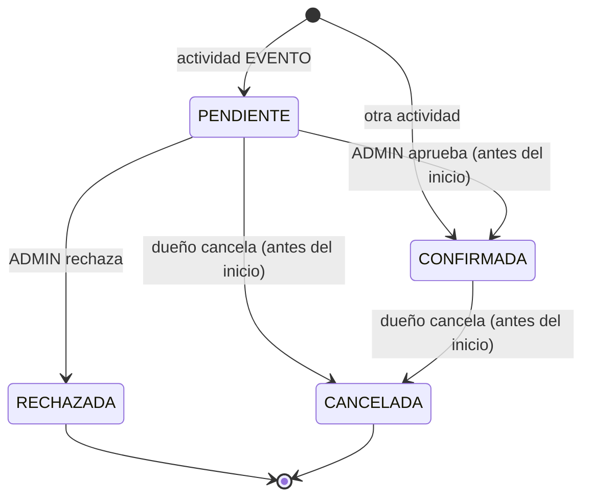
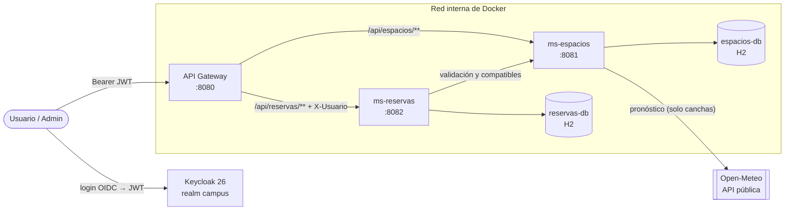

# CampusReservas

**Backend para gestionar las reservas de los espacios de una facultad: aulas, laboratorios, salas y canchas al aire libre.**

Trabajo Práctico Integrador de **Backend de Aplicaciones** · UTN Facultad Regional Córdoba · 2026
Dominio 9 del anexo: *Coordinación de espacios, actividades y reservas*.


---

## ¿Qué problema resuelve?

En una facultad, reservar un espacio no es solo anotar un nombre en una agenda. Cada reserva tiene que cumplir con las condiciones del lugar y con las reglas de la institución:

- que el espacio **esté abierto** en ese horario y **tenga lugar** para todos los asistentes;
- que **admita la actividad** (un laboratorio no sirve para hacer deporte) y **tenga el equipamiento** pedido (proyector, computadoras…);
- que **no se superponga** con otra reserva;
- y, si es una cancha al aire libre, que **no se pronostique lluvia**.

CampusReservas valida todo eso automáticamente. Además, **sugiere los espacios disponibles** que cumplen con lo que el usuario necesita, combinando datos propios (catálogo, equipamiento, ocupación) con un dato externo que cambia hora a hora: el pronóstico del clima, obtenido de [Open-Meteo](https://open-meteo.com/).

Los **eventos** no se confirman solos: quedan pendientes hasta que bedelía los aprueba o los rechaza.

> **Alcance:** catálogo de espacios y sus reservas, con aprobación de eventos por bedelía. Quedan fuera el frontend, los pagos y las notificaciones.

---

## ¿Quién lo usa?

Cada rol es un rol de realm en Keycloak.

| Rol | Quién es | Qué puede hacer |
|---|---|---|
| `USUARIO` | Estudiante o docente | Consultar espacios, buscar espacios disponibles, crear reservas, ver y cancelar sus reservas |
| `ADMIN` | Bedelía | Dar de alta, modificar y dar de baja espacios, aprobar o rechazar eventos, ver todas las reservas |

---

## Funcionalidades principales

- **Administración de espacios** (ADMIN): nombre, tipo, capacidad, equipamiento, actividades que admite, ubicación y horario de apertura.
- **Consulta de espacios** (USUARIO y ADMIN).
- **Búsqueda de espacios disponibles**: el usuario indica franja, actividad, cantidad de personas y equipamiento, y el sistema devuelve los espacios que sirven y están libres.
- **Creación de reservas** con una cadena de validaciones. Si la actividad es un evento queda `PENDIENTE`; si no, `CONFIRMADA`.
- **Aprobación o rechazo de eventos** (ADMIN).
- **Consulta y cancelación** de las reservas propias.
- **Listado de todas las reservas** (ADMIN), con filtro por estado.

---

## Reglas de negocio

Cada regla tiene un único servicio dueño: **ms-espacios** decide si el *espacio* puede usarse en una franja; **ms-reservas** decide si la *reserva* es válida.

| # | Regla | Dueño |
|---|---|---|
| RN1 | La reserva empieza en el futuro y como máximo 14 días después de hoy (el horizonte del pronóstico) | ms-reservas |
| RN2 | Dura entre 30 minutos y 4 horas, dentro del mismo día | ms-reservas |
| RN3 | La franja está dentro del horario de apertura del espacio | ms-espacios |
| RN4 | En una cancha, si en alguna hora de la franja la probabilidad de lluvia supera el 60 %, no se reserva ni se sugiere | ms-espacios |
| RN5 | Los asistentes no superan la capacidad del espacio | ms-reservas |
| RN6 | Un espacio no tiene dos reservas activas superpuestas | ms-reservas |
| RN7 | Solo quien hizo la reserva puede cancelarla, y solo antes de que empiece | ms-reservas |
| RN8 | El espacio tiene todo el equipamiento pedido | ms-espacios |
| RN9 | El espacio admite el tipo de actividad (`CLASE`, `EXAMEN`, `EVENTO`, `DEPORTE`) | ms-espacios |
| RN10 | Un laboratorio se reserva de lunes a viernes y con 24 h de anticipación | ms-espacios |
| RN11 | Una sala se reserva por un máximo de 2 horas | ms-espacios |
| RN12 | Una cancha se reserva en turnos de horas enteras | ms-espacios |
| RN13 | Un `EVENTO` queda `PENDIENTE` hasta que un ADMIN lo apruebe o rechace; el resto nace `CONFIRMADA` | ms-reservas |
| RN14 | Solo se permiten los cambios de estado del diagrama; cualquier otro devuelve 409 | ms-reservas |
| RN15 | Si dos pedidos reservan el mismo espacio a la vez, solo uno se guarda; el otro recibe 409 | ms-reservas |

### Estados de una reserva



`PENDIENTE` y `CONFIRMADA` ocupan el espacio; `RECHAZADA` y `CANCELADA` lo liberan.

---

## Arquitectura

Tres aplicaciones Spring (un gateway y dos microservicios), cada microservicio con su propia base H2, y un JAR común. Todo corre en Docker Compose junto con Keycloak; **solo el gateway y Keycloak publican puertos**, así que la red interna de Docker funciona como *trusted zone*.



| Componente | Responsabilidad |
|---|---|
| **API Gateway** | Único punto de entrada. Rutea por path, valida el JWT y el rol por ruta, y agrega el header `X-Usuario` |
| **ms-espacios** | ABM de espacios; valida si un espacio sirve para una franja según las reglas de su tipo; lista los espacios compatibles; consulta Open-Meteo |
| **ms-reservas** | Ciclo de vida de la reserva (crear, aprobar, rechazar, cancelar, listar); cadena de validaciones; estados; concurrencia; búsqueda de disponibles |
| **Keycloak** | Identity Provider: usuarios, roles `USUARIO` y `ADMIN`, emisión de JWT |
| **campus-commons** | JAR Maven compartido: `ApiResponse`, excepciones de negocio y manejo de errores común (404, 409, 422, 503) |

### Cómo colaboran los servicios

Ningún servicio puede resolver solo una reserva: **ms-espacios no conoce la ocupación** y **ms-reservas no conoce el catálogo ni el clima**. La comunicación va en una sola dirección (ms-reservas → ms-espacios):

- **Crear una reserva:** ms-reservas pregunta a `GET /api/espacios/{id}/validacion` si el espacio sirve para la franja (horario, actividad, equipamiento, reglas del tipo y clima).
- **Buscar disponibles:** ms-reservas pide `GET /api/espacios/compatibles` y descarta los que ya están ocupados.

Si una dependencia externa falla, el sistema responde **503** en vez de romperse: sin ms-espacios no se crea ni se busca, pero se puede listar y cancelar; sin Open-Meteo las canchas no se pueden reservar y se omiten de las búsquedas, pero el resto de los espacios sigue funcionando.

---

## Estructura del repositorio

```
.
├── campus-commons/        # JAR común (mvn install → ~/.m2)
├── ms-espacios/           # Microservicio de espacios (puerto 8081)
├── ms-reservas/           # Microservicio de reservas (puerto 8082)
├── api-gateway/           # Gateway y seguridad (puerto 8080)
├── keycloak/
│   └── realm-campus.json  # Realm importado al arrancar Keycloak
├── Docs/                  # Documentación del proyecto
└── docker-compose.yml
```
