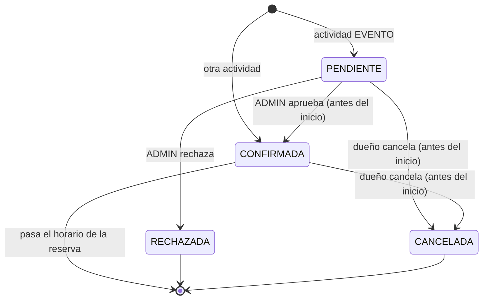
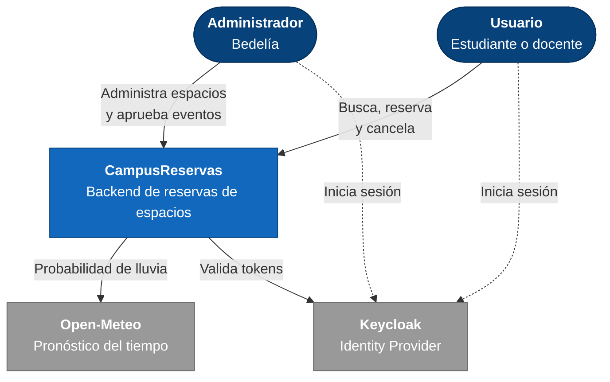
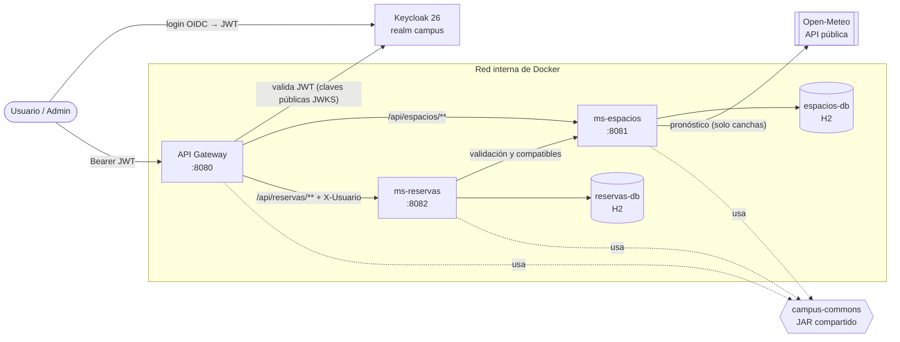

# CampusReservas

**Backend para gestionar las reservas de los espacios de una facultad: aulas, laboratorios, salas y canchas al aire libre.**

Trabajo Práctico Integrador de **Backend de Aplicaciones** · UTN Facultad Regional Córdoba · 2026
Dominio 9 del anexo: *Coordinación de espacios, actividades y reservas*.


---

## ¿Qué problema resuelve?

En una facultad, reservar un espacio no es solo anotar un nombre en una agenda. Cada reserva tiene que cumplir con las condiciones del lugar y con las reglas de la institución:

- que el espacio **esté abierto** en ese horario y **tenga lugar** para todos los asistentes;
- que **admita la actividad** (un laboratorio no sirve para hacer deporte) y **tenga el equipamiento** pedido (proyector, computadoras…);
- que **no se superponga** con otra reserva;
- y, si es una cancha al aire libre, que **no se pronostique lluvia**.

CampusReservas valida todo eso automáticamente. Además, **sugiere los espacios disponibles** que cumplen con lo que el usuario necesita, combinando datos propios (catálogo, equipamiento, ocupación) con un dato externo que cambia hora a hora: el pronóstico del clima, obtenido de [Open-Meteo](https://open-meteo.com/).

Los **eventos** no se confirman solos: quedan pendientes hasta que bedelía los aprueba o los rechaza.

> **Alcance:** catálogo de espacios y sus reservas, con aprobación de eventos por bedelía. Quedan fuera el frontend, los pagos y las notificaciones.

---

## ¿Quién lo usa?

Cada rol es un rol de realm en Keycloak.

| Rol | Quién es | Qué puede hacer |
|---|---|---|
| `USUARIO` | Estudiante o docente | Consultar espacios, buscar espacios disponibles, crear reservas, ver y cancelar sus reservas |
| `ADMIN` | Bedelía | Dar de alta, modificar y dar de baja espacios, aprobar o rechazar eventos, ver todas las reservas |

---

## Funcionalidades principales

- **Administración de espacios** (ADMIN): nombre, tipo, capacidad, equipamiento, actividades que admite, ubicación y horario de apertura.
- **Consulta de espacios** (USUARIO y ADMIN).
- **Búsqueda de espacios disponibles**: el usuario indica franja, actividad, cantidad de personas y equipamiento, y el sistema devuelve los espacios que sirven y están libres.
- **Creación de reservas** con una cadena de validaciones. Si la actividad es un evento queda `PENDIENTE`; si no, `CONFIRMADA`.
- **Aprobación o rechazo de eventos** (ADMIN).
- **Consulta y cancelación** de las reservas propias.
- **Listado de todas las reservas** (ADMIN), con filtro por estado.

---

## Reglas de negocio

Cada regla tiene un único servicio dueño: **ms-espacios** decide si el *espacio* puede usarse en una franja; **ms-reservas** decide si la *reserva* es válida.

| # | Regla | Dueño |
|---|---|---|
| RN1 | La reserva empieza en el futuro y como máximo 14 días después de hoy (el horizonte del pronóstico) | ms-reservas |
| RN2 | Dura entre 30 minutos y 4 horas, dentro del mismo día | ms-reservas |
| RN3 | La franja está dentro del horario de apertura del espacio | ms-espacios |
| RN4 | En una cancha, si en alguna hora de la franja la probabilidad de lluvia supera el 60 %, no se reserva ni se sugiere | ms-espacios |
| RN5 | Los asistentes no superan la capacidad del espacio | ms-reservas |
| RN6 | Un espacio no tiene dos reservas activas superpuestas | ms-reservas |
| RN7 | Solo quien hizo la reserva puede cancelarla, y solo antes de que empiece | ms-reservas |
| RN8 | El espacio tiene todo el equipamiento pedido | ms-espacios |
| RN9 | El espacio admite el tipo de actividad (`CLASE`, `EXAMEN`, `EVENTO`, `DEPORTE`) | ms-espacios |
| RN10 | Un laboratorio se reserva de lunes a viernes y con 24 h de anticipación | ms-espacios |
| RN11 | Una sala se reserva por un máximo de 2 horas | ms-espacios |
| RN12 | Una cancha se reserva en turnos de horas enteras | ms-espacios |
| RN13 | Un `EVENTO` queda `PENDIENTE` hasta que un ADMIN lo apruebe o rechace; el resto nace `CONFIRMADA` | ms-reservas |
| RN14 | Solo se permiten los cambios de estado del diagrama; cualquier otro devuelve 409 | ms-reservas |
| RN15 | Si dos pedidos reservan el mismo espacio a la vez, solo uno se guarda; el otro recibe 409 | ms-reservas |

### Estados de una reserva



`PENDIENTE` y `CONFIRMADA` ocupan el espacio; `RECHAZADA` y `CANCELADA` lo liberan. Una reserva confirmada que se usa termina siendo `CONFIRMADA`: no hay un estado `FINALIZADA`, porque haría falta una tarea programada que cambie el estado cuando pasa el horario. Una vez que empieza, la reserva ya no se puede cancelar, así que queda cerrada.

---

## Arquitectura

Tres aplicaciones Spring (un gateway y dos microservicios), cada microservicio con su propia base H2, y un JAR común. Todo corre en Docker Compose junto con Keycloak; **solo el gateway y Keycloak publican puertos**, así que la red interna de Docker funciona como *trusted zone*.

### Diagrama de contexto (C1)



Los usuarios hablan con CampusReservas por HTTPS/JSON con un JWT; el login contra Keycloak es OIDC (líneas punteadas).

| Elemento | Qué es |
|---|---|
| **Administrador** | Bedelía. Administra los espacios, aprueba o rechaza los eventos y consulta todas las reservas |
| **Usuario** | Estudiante o docente. Busca espacios disponibles, reserva y cancela sus reservas |
| **CampusReservas** | Valida cada reserva según el tipo de espacio (horario, actividad, equipamiento, capacidad, superposición y, en canchas al aire libre, el pronóstico de lluvia). Maneja el ciclo de vida de la reserva y sugiere espacios disponibles |
| **Open-Meteo** | Sistema externo: pronóstico del tiempo por coordenadas |
| **Keycloak** | Sistema externo: autentica usuarios con OIDC y emite tokens JWT con los roles |

### Diagrama de contenedores (C2)



| Componente | Responsabilidad |
|---|---|
| **API Gateway** | Único punto de entrada. Rutea por path, valida el JWT y el rol por ruta, y agrega el header `X-Usuario` |
| **ms-espacios** | ABM de espacios; valida si un espacio sirve para una franja según las reglas de su tipo; lista los espacios compatibles; consulta Open-Meteo |
| **ms-reservas** | Ciclo de vida de la reserva (crear, aprobar, rechazar, cancelar, listar); cadena de validaciones; estados; concurrencia; búsqueda de disponibles |
| **Keycloak** | Identity Provider: usuarios, roles `USUARIO` y `ADMIN`, emisión de JWT |
| **campus-commons** | JAR Maven compartido: `ApiResponse`, excepciones de negocio y manejo de errores común (400, 403, 404, 409, 422, 503) |

### Cómo colaboran los servicios

Ningún servicio puede resolver solo una reserva: **ms-espacios no conoce la ocupación** y **ms-reservas no conoce el catálogo ni el clima**. La comunicación va en una sola dirección (ms-reservas → ms-espacios):

- **Crear una reserva:** ms-reservas pregunta a `GET /api/espacios/{id}/validacion` si el espacio sirve para la franja (horario, actividad, equipamiento, reglas del tipo y clima).
- **Buscar disponibles:** ms-reservas pide `GET /api/espacios/compatibles` y descarta los que ya están ocupados.

Si una dependencia falla, el sistema responde **503** ("ahora no puedo, reintentá más tarde") en vez de romperse con un 500:

- **ms-espacios no responde:** no se puede crear una reserva ni buscar disponibles (503), pero sí listar y cancelar las reservas, porque cada reserva guarda una copia del nombre del espacio. Las rutas que van directo a ms-espacios (`/api/espacios/**`) también dan 503: lo responde el gateway, en 2 segundos como máximo.
- **Open-Meteo no responde:** ver [más abajo](#qué-pasa-si-open-meteo-no-responde).

---

## Cómo levantarlo

### Requisitos

| Herramienta | Versión | Para qué |
|---|---|---|
| Java (JDK) | 25 | Compilar los JAR (las imágenes de Docker no compilan: copian el JAR) |
| Maven | 3.9 o más | Instalar `campus-commons` en el repositorio local |
| Docker Desktop | reciente | Correr todo el sistema |
| Git Bash (en Windows) | viene con Git | Correr `build.sh` |
| Postman | reciente | Probar la aplicación |

### 1. Compilar

Desde la raíz del repo, en Git Bash (o en Linux / Mac):

```bash
sh build.sh
```

En PowerShell, `sh` no existe; se llama al bash de Git:

```powershell
& "C:\Program Files\Git\bin\bash.exe" build.sh
```

`build.sh` instala primero `campus-commons` en `~/.m2` (los otros tres dependen de él) y después empaqueta ms-espacios, ms-reservas y el gateway. Tienen que salir cuatro `BUILD SUCCESS`.

### 2. Levantar

```bash
docker compose up -d --build
```

Levanta cuatro contenedores: `keycloak`, `ms-espacios`, `ms-reservas` y `api-gateway`.

| Puerto | Qué |
|---|---|
| 8080 | API Gateway: el único punto de entrada a la API |
| 8180 | Keycloak: tokens y consola de administración (<http://localhost:8180/admin>, `admin` / `admin`) |

ms-espacios (8081) y ms-reservas (8082) no publican puertos: desde afuera solo se llega a ellos por el gateway.

### 3. Usuarios de prueba

Vienen en `keycloak/realm-campus.json`, que Keycloak importa al arrancar. La contraseña es igual al usuario.

| Usuario | Contraseña | Rol |
|---|---|---|
| `usuario1` | `usuario1` | USUARIO |
| `usuario2` | `usuario2` | USUARIO |
| `admin1` | `admin1` | ADMIN |

ms-espacios arranca con 5 espacios de prueba: Aula 101, Aula 102, Laboratorio 3, Sala de reuniones y Cancha de fútbol.

### 4. Probarlo

La aplicación se prueba con **Postman**. Todos los pedidos van al gateway (`http://localhost:8080`) con el JWT que entrega Keycloak en `Authorization: Bearer`.

### 5. Apagar

```bash
docker compose stop    # apaga sin borrar: "docker compose start" sigue con los mismos datos
docker compose down    # apaga y borra los contenedores: la próxima vez arranca con la base vacía
```

Las bases H2 viven dentro de cada contenedor, así que `down` deja el sistema como recién instalado.

---

## Endpoints

Todos se llaman por el gateway (`http://localhost:8080`) con un JWT. Las respuestas tienen siempre el mismo formato, `ApiResponse`: `{ success, responseValue, message, executedOn }`.

| Método | Ruta | Rol | Qué hace |
|---|---|---|---|
| GET | `/api/espacios` | USUARIO, ADMIN | Lista los espacios |
| GET | `/api/espacios/{id}` | USUARIO, ADMIN | Busca un espacio |
| GET | `/api/espacios/{id}/validacion` | USUARIO, ADMIN | ¿El espacio sirve para esta franja, actividad y equipamiento? |
| GET | `/api/espacios/compatibles` | USUARIO, ADMIN | Espacios que sirven para una franja (sin mirar la ocupación) |
| POST · PUT · DELETE | `/api/espacios[/{id}]` | ADMIN | Alta, modificación y baja de espacios |
| GET | `/api/reservas/disponibilidad` | USUARIO | Espacios que sirven **y** están libres en una franja |
| POST | `/api/reservas` | USUARIO | Crea una reserva (`PENDIENTE` si es un evento, si no `CONFIRMADA`) |
| GET | `/api/reservas/mias` | USUARIO | Las reservas del usuario logueado |
| PATCH | `/api/reservas/{id}/cancelar` | USUARIO | Cancela una reserva propia |
| GET | `/api/reservas[?estado=...]` | ADMIN | Todas las reservas, con filtro opcional por estado |
| PATCH | `/api/reservas/{id}/aprobar` · `/rechazar` | ADMIN | Aprueba o rechaza un evento pendiente |

Sin token, el gateway responde **401**; con un token válido pero sin el rol, **403**. Cualquier otra ruta se rechaza.

---

## Qué pasa si Open-Meteo no responde

Open-Meteo es la API pública de clima que usamos para la regla RN4 (no se reserva una cancha si se pronostica más de 60 % de lluvia). Solo se consulta para las **canchas**. ms-espacios la llama con un timeout de 2 segundos para conectar y 3 para leer, y si no responde, tarda demasiado o devuelve datos incompletos:

- **Reservar una cancha** → **503** *"No se pudo consultar el pronóstico del clima"*. Sin pronóstico no se puede garantizar que no llueva, así que no se confirma la reserva.
- **Buscar disponibles** → **200**, pero **sin las canchas**: se omiten de la búsqueda y el resto de los espacios aparece normalmente.
- **Aulas, laboratorios y salas** → funcionan igual que siempre, porque no dependen del clima.

Cada falla queda en el log de ms-espacios con nivel `WARN`, con el error real de la conexión.

---

## Estructura del repositorio

```
.
├── campus-commons/        # JAR común (mvn install → ~/.m2)
├── ms-espacios/           # Microservicio de espacios (puerto 8081, interno)
├── ms-reservas/           # Microservicio de reservas (puerto 8082, interno)
├── api-gateway/           # Gateway y seguridad (puerto 8080)
├── keycloak/
│   └── realm-campus.json  # Realm importado al arrancar Keycloak
├── Docs/                  # Diagramas de arquitectura (ver abajo)
├── build.sh               # Compila los cuatro proyectos en orden
└── docker-compose.yml     # Levanta Keycloak, los dos microservicios y el gateway
```

Cada aplicación tiene su `Dockerfile`, que copia el JAR que deja `build.sh` en `target/`.

---

## Diagramas

| Archivo | Qué tiene |
|---|---|
| [`Docs/diagramas/c1-contexto.png`](Docs/diagramas/c1-contexto.png) | Diagrama de contexto (C1) |
| [`Docs/diagramas/c2-contenedores.png`](Docs/diagramas/c2-contenedores.png) | Diagrama de contenedores (C2), con su fuente en SVG |
